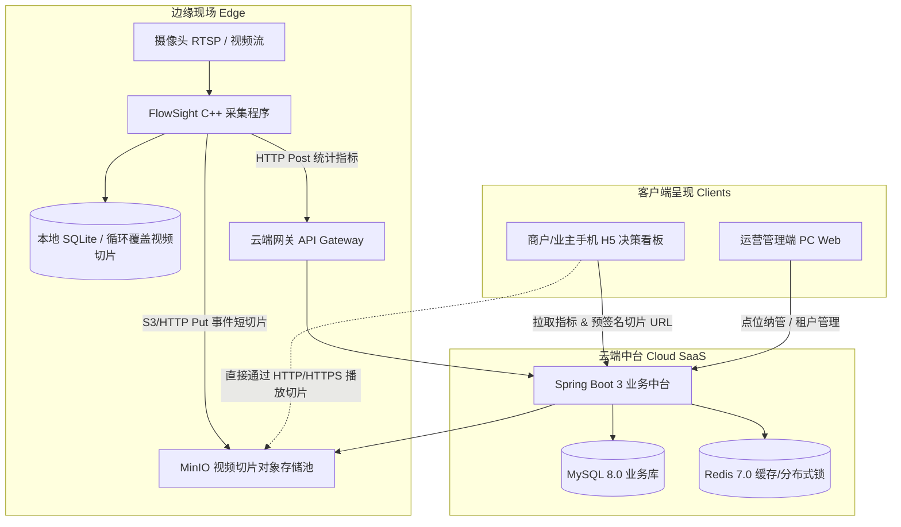

# 架构参考矩阵与基础设施编排 (Architecture Matrix & Infrastructure)

本文件定义边-云-端协同多租户平台的底层基础设施标准编排与核心数据模型。

---

## 1. 边-云-端系统拓扑



---

## 2. Docker Compose 基础设施参考 (`docker-compose.yml`)

```yaml
version: '3.8'

services:
  mysql:
    image: mysql:8.0
    container_name: flowsight-mysql
    restart: always
    environment:
      MYSQL_ROOT_PASSWORD: rootpassword
      MYSQL_DATABASE: flowsight_cloud
    ports:
      - "3306:3306"
    volumes:
      - mysql_data:/var/lib/mysql
    command: --character-set-server=utf8mb4 --collation-server=utf8mb4_unicode_ci

  redis:
    image: redis:7.0-alpine
    container_name: flowsight-redis
    restart: always
    ports:
      - "6379:6379"
    volumes:
      - redis_data:/data

  minio:
    image: minio/minio:latest
    container_name: flowsight-minio
    restart: always
    command: server /data --console-address ":9001"
    environment:
      MINIO_ROOT_USER: minioadmin
      MINIO_ROOT_PASSWORD: minioadminpassword
    ports:
      - "9000:9000"
      - "9001:9001"
    volumes:
      - minio_data:/data

volumes:
  mysql_data:
  redis_data:
  minio_data:
```

---

## 3. MySQL 8.0 核心 DDL 模式设计 (`schema.sql`)

```sql
CREATE DATABASE IF NOT EXISTS flowsight_cloud DEFAULT CHARACTER SET utf8mb4 COLLATE utf8mb4_unicode_ci;
USE flowsight_cloud;

-- 1. 租户表
CREATE TABLE IF NOT EXISTS `tb_tenant` (
    `id` BIGINT AUTO_INCREMENT PRIMARY KEY,
    `tenant_code` VARCHAR(64) NOT NULL UNIQUE COMMENT '租户唯一编码',
    `name` VARCHAR(128) NOT NULL COMMENT '商户/租户名称',
    `contact_phone` VARCHAR(32) DEFAULT NULL,
    `status` TINYINT DEFAULT 1 COMMENT '1:正常, 0:禁用',
    `created_at` DATETIME DEFAULT CURRENT_TIMESTAMP,
    `updated_at` DATETIME DEFAULT CURRENT_TIMESTAMP ON UPDATE CURRENT_TIMESTAMP
) ENGINE=InnoDB DEFAULT CHARSET=utf8mb4 COMMENT='租户信息表';

-- 2. 系统用户表
CREATE TABLE IF NOT EXISTS `tb_user` (
    `id` BIGINT AUTO_INCREMENT PRIMARY KEY,
    `tenant_id` BIGINT NOT NULL COMMENT '归属租户ID',
    `username` VARCHAR(64) NOT NULL COMMENT '用户名',
    `phone` VARCHAR(32) NOT NULL COMMENT '手机号',
    `password_hash` VARCHAR(128) NOT NULL COMMENT 'BCrypt加密密码',
    `role` VARCHAR(32) DEFAULT 'MERCHANT' COMMENT 'ADMIN:超级管理员, MERCHANT:商户业主',
    `status` TINYINT DEFAULT 1 COMMENT '1:正常, 0:禁用',
    `created_at` DATETIME DEFAULT CURRENT_TIMESTAMP,
    `updated_at` DATETIME DEFAULT CURRENT_TIMESTAMP ON UPDATE CURRENT_TIMESTAMP,
    UNIQUE KEY `uk_phone` (`phone`),
    KEY `idx_tenant_id` (`tenant_id`)
) ENGINE=InnoDB DEFAULT CHARSET=utf8mb4 COMMENT='用户/商户表';

-- 3. 监控/采集点位表
CREATE TABLE IF NOT EXISTS `tb_point` (
    `id` BIGINT AUTO_INCREMENT PRIMARY KEY,
    `tenant_id` BIGINT NOT NULL COMMENT '归属租户ID',
    `point_code` VARCHAR(64) NOT NULL UNIQUE COMMENT '点位业务编码',
    `name` VARCHAR(128) NOT NULL COMMENT '点位名称(如: 西门客流通道)',
    `token_hash` VARCHAR(128) NOT NULL COMMENT '点位认证Token(加盐SHA256哈希)',
    `status` TINYINT DEFAULT 1 COMMENT '1:在用, 0:停用',
    `is_online` TINYINT DEFAULT 0 COMMENT '1:在线, 0:离线',
    `last_heartbeat_at` DATETIME DEFAULT NULL COMMENT '最后心跳时间',
    `created_at` DATETIME DEFAULT CURRENT_TIMESTAMP,
    `updated_at` DATETIME DEFAULT CURRENT_TIMESTAMP ON UPDATE CURRENT_TIMESTAMP,
    KEY `idx_tenant_id` (`tenant_id`)
) ENGINE=InnoDB DEFAULT CHARSET=utf8mb4 COMMENT='监控采集点位表';

-- 4. 客流统计按小时聚合表
CREATE TABLE IF NOT EXISTS `tb_metric_flow_hourly` (
    `id` BIGINT AUTO_INCREMENT PRIMARY KEY,
    `tenant_id` BIGINT NOT NULL,
    `point_id` BIGINT NOT NULL,
    `stat_date` DATE NOT NULL COMMENT '统计日期: YYYY-MM-DD',
    `stat_hour` TINYINT NOT NULL COMMENT '统计小时: 0~23',
    `in_count` INT NOT NULL DEFAULT 0 COMMENT '进入人次',
    `out_count` INT NOT NULL DEFAULT 0 COMMENT '离开人次',
    `male_count` INT NOT NULL DEFAULT 0 COMMENT '男性人次',
    `female_count` INT NOT NULL DEFAULT 0 COMMENT '女性人次',
    `child_count` INT NOT NULL DEFAULT 0 COMMENT '儿童人次(0~17)',
    `adult_count` INT NOT NULL DEFAULT 0 COMMENT '青年及中年人次(18~59)',
    `senior_count` INT NOT NULL DEFAULT 0 COMMENT '老年人次(60+)',
    `created_at` DATETIME DEFAULT CURRENT_TIMESTAMP,
    `updated_at` DATETIME DEFAULT CURRENT_TIMESTAMP ON UPDATE CURRENT_TIMESTAMP,
    UNIQUE KEY `uk_point_hour` (`point_id`, `stat_date`, `stat_hour`),
    KEY `idx_tenant_date` (`tenant_id`, `stat_date`)
) ENGINE=InnoDB DEFAULT CHARSET=utf8mb4 COMMENT='客流小时级聚合表';

-- 5. 视频事件短切片索引表
CREATE TABLE IF NOT EXISTS `tb_video_slice` (
    `id` BIGINT AUTO_INCREMENT PRIMARY KEY,
    `tenant_id` BIGINT NOT NULL,
    `point_id` BIGINT NOT NULL,
    `slice_id` VARCHAR(64) NOT NULL UNIQUE COMMENT '全局唯一切片编号',
    `event_type` VARCHAR(32) NOT NULL COMMENT '事件类型: PASS, PEAK, ANOMALY',
    `start_time` DATETIME NOT NULL COMMENT '事件发生起始时间',
    `end_time` DATETIME NOT NULL COMMENT '事件发生截止时间',
    `duration_seconds` INT NOT NULL COMMENT '时长(秒)',
    `storage_path` VARCHAR(255) NOT NULL COMMENT 'MinIO对象键: clips/point_1/xxx.mp4',
    `file_size_bytes` BIGINT NOT NULL COMMENT '文件字节大小',
    `in_count` INT DEFAULT 0 COMMENT '切片内进入人数',
    `out_count` INT DEFAULT 0 COMMENT '切片内离开人数',
    `created_at` DATETIME DEFAULT CURRENT_TIMESTAMP,
    KEY `idx_point_time` (`point_id`, `start_time`)
) ENGINE=InnoDB DEFAULT CHARSET=utf8mb4 COMMENT='视频切片索引表';
```
