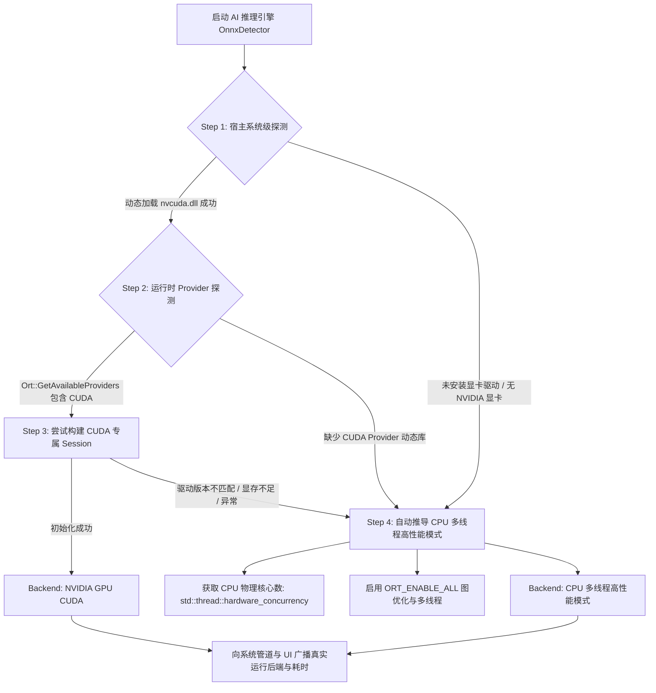

# FlowSight 硬件推理环境智能探测与 CPU 平滑 Fallback 容灾方案

## 1. 方案背景与问题溯源

在 AI 计算机视觉产品的商业化落地与跨设备部署中，现场硬件环境往往存在极大的不确定性与异构性：
- **高端边缘计算节点**：配备 NVIDIA 独立显卡（如 RTX 系列、Tesla、Quadro），拥有完备的 CUDA Toolkit 与 cuDNN 环境；
- **老旧工控机或轻薄终端**：虽有 NVIDIA 显卡，但驱动版本长期未更新（版本过低），或者未配置 CUDA 运行时运行库；
- **纯通用计算平台**：无独立 GPU，仅依靠多核 x86_64 或 ARM CPU 运行。

### 1.1 典型故障复盘
在早期的直接加载逻辑中，系统直接调用 ONNX Runtime 的 `AppendExecutionProvider_CUDA`。当宿主环境缺少对应 Provider 动态库（如 `onnxruntime_providers_shared.dll` / `onnxruntime_providers_cuda.dll`）或驱动版本过低时，系统会报出底层原生异常：
```text
[E:onnxruntime:YOLOv8_FlowSight, provider_bridge_ort.cc:2101 onnxruntime::CudaProviderFactoryCreator::Create] 
[ONNXRuntimeError] : 1 : FAIL : Error loading "...onnxruntime_providers_shared.dll" which is missing. 
(Error 126: "[OnnxDetector] CUDA unavailable, falling back to CPU: OrtSessionOptionsAppendExecutionProvider_Cuda: Failed to load shared library
```
该错误不仅会在控制台产生大量底层报警调用栈，而且若外层未对 `Ort::SessionOptions` 进行沙箱隔离与纯净重构，可能导致后续 CPU 会话创建失败或残留损坏状态。

为此，FlowSight 制定了**「默认显卡优先、两级环境前置探测、沙箱化静默捕获、CPU 极致性能自动推导」**的容灾 Fallback 标准架构。

---

## 2. 核心设计原则



1. **默认英伟达显卡优先 (NVIDIA GPU Preferred)**：
   若宿主设备具备受支持的 NVIDIA 显卡与运行库，系统默认调用 GPU 并开辟显存推理管线，最大化帧率与降低时延。
2. **两级环境前置探测 (Pre-flight Probing)**：
   - **操作系统级**：探测底层显示驱动链接（如 Windows 下的 `nvcuda.dll`）；
   - **运行时库级**：通过 `Ort::GetAvailableProviders()` 查询当前 ONNX Runtime 二进制是否编译包含了 `CUDAExecutionProvider`。
   若前置探测不通过，决不盲目调用 CUDA 绑定，从根源杜绝 Windows `Error 126`（动态库加载失败）。
3. **静默沙箱隔离 (Silent Sandbox Isolation)**：
   将探测阶段的 `Ort::Env` 日志等级提升为 `ORT_LOGGING_LEVEL_FATAL`，即使驱动发生底层微小版本不兼容，也由外层 C++ 异常处理器静默捕获，杜绝控制台刷屏告警。
4. **CPU 极致性能自动推导演进 (Auto CPU Optimization)**：
   若降级到 CPU，系统并非简单使用单线程低效模式，而是根据宿主 CPU 拓扑动态分配合适并发线程数（如 2~4 核并行），开启全局算子融合与内存复用池，保障 CPU 模式下亦能达到 30+ FPS 的实时分析能力。
5. **全链路状态自省与 UI 感知 (End-to-End Transparency)**：
   底层所采用的推理后端（GPU 还是 CPU）透明回传至 `PipelineController`，并实时反映在界面侧边栏硬件指示灯与底部状态栏（标注推理耗时与引擎类型）。

---

## 3. 技术落地与核心实现代码

### 3.1 动态探测与沙箱化回退实现 (`src/ai/OnnxDetector.cpp`)

```cpp
#if defined(_WIN32)
#define WIN32_LEAN_AND_MEAN
#ifndef NOMINMAX
#define NOMINMAX
#endif
#include <windows.h>
#endif
#include <thread>

// 1. 系统级显卡驱动探测
static bool is_nvidia_driver_available() {
#if defined(_WIN32)
    HMODULE hMod = LoadLibraryA("nvcuda.dll");
    if (hMod) {
        FreeLibrary(hMod);
        return true;
    }
    return false;
#else
    return false;
#endif
}

// 2. 运行时库级 Provider 探测
static bool is_cuda_provider_available() {
    try {
        auto providers = Ort::GetAvailableProviders();
        for (const auto& p : providers) {
            if (p == "CUDAExecutionProvider") {
                return true;
            }
        }
    } catch (...) {}
    return false;
}

// 3. 智能推导与初始化
bool OnnxDetector::Impl::init(const std::string& model_path, float conf_thresh, float nms_thresh) {
    conf_thresh_ = conf_thresh;
    nms_thresh_ = nms_thresh;

    std::wstring wide_path(model_path.begin(), model_path.end());
    bool cuda_initialized = false;

    // 优先尝试启用 NVIDIA GPU (CUDA)
    bool has_nvidia_gpu = is_nvidia_driver_available();
    bool has_cuda_provider = is_cuda_provider_available();

    if (has_nvidia_gpu && has_cuda_provider) {
        try {
            Ort::SessionOptions cuda_options;
            cuda_options.SetIntraOpNumThreads(2);
            cuda_options.SetGraphOptimizationLevel(GraphOptimizationLevel::ORT_ENABLE_ALL);

            OrtCUDAProviderOptions cuda_opts{};
            cuda_opts.device_id = 0;
            cuda_options.AppendExecutionProvider_CUDA(cuda_opts);

            session_ = std::make_unique<Ort::Session>(env_, wide_path.c_str(), cuda_options);
            backend_name_ = "NVIDIA GPU (CUDA)";
            cuda_initialized = true;
            std::cout << "[OnnxDetector] 成功启用 NVIDIA 独立显卡硬件加速 (CUDA 引擎)" << std::endl;
        } catch (...) {
            cuda_initialized = false;
            session_.reset();
        }
    }

    // 若未检测到 NVIDIA 环境、驱动/CUDA 版本不满足或缺少组件，自动平滑推导为 CPU 模式
    if (!cuda_initialized) {
        try {
            Ort::SessionOptions cpu_options;
            unsigned int num_threads = std::max(2u, std::min(4u, std::thread::hardware_concurrency()));
            cpu_options.SetIntraOpNumThreads(num_threads);
            cpu_options.SetGraphOptimizationLevel(GraphOptimizationLevel::ORT_ENABLE_ALL);

            session_ = std::make_unique<Ort::Session>(env_, wide_path.c_str(), cpu_options);
            backend_name_ = "CPU (多线程高性能优化)";
            std::cout << "[OnnxDetector] 未检测到匹配的 NVIDIA CUDA 运行库或显卡驱动版本不满足，系统已自动推导并平滑降级为 CPU 多线程模式 (线程数: "
                      << num_threads << ")" << std::endl;
        } catch (const std::exception& e) {
            std::cerr << "[OnnxDetector] Failed to load model file on CPU: " << e.what() << std::endl;
            return false;
        }
    }

    // 动态绑定 Input/Output Tensor 元数据...
    return true;
}
```

### 3.2 自动化构建与产物分发保护 (`CMakeLists.txt`)

为了确保当现场部署了支持 CUDA 的动态库时能够免配置无缝生效，在构建脚本中加入了动态库的自动排查与同步拷贝机制：

```cmake
# 自动拷贝运行时 DLL 到构建目标目录
if(WIN32)
    # 拷贝主运行时库
    if(EXISTS "${ONNXRUNTIME_ROOT_DIR}/lib/onnxruntime.dll")
        add_custom_command(TARGET FlowSight POST_BUILD
            COMMAND ${CMAKE_COMMAND} -E copy_if_different
            "${ONNXRUNTIME_ROOT_DIR}/lib/onnxruntime.dll"
            $<TARGET_FILE_DIR:FlowSight>
        )
    endif()
    # 自动识别并拷贝 Provider 共享库
    if(EXISTS "${ONNXRUNTIME_ROOT_DIR}/lib/onnxruntime_providers_shared.dll")
        add_custom_command(TARGET FlowSight POST_BUILD
            COMMAND ${CMAKE_COMMAND} -E copy_if_different
            "${ONNXRUNTIME_ROOT_DIR}/lib/onnxruntime_providers_shared.dll"
            $<TARGET_FILE_DIR:FlowSight>
        )
    endif()
    # 自动识别并拷贝 CUDA 专用硬件插件库
    if(EXISTS "${ONNXRUNTIME_ROOT_DIR}/lib/onnxruntime_providers_cuda.dll")
        add_custom_command(TARGET FlowSight POST_BUILD
            COMMAND ${CMAKE_COMMAND} -E copy_if_different
            "${ONNXRUNTIME_ROOT_DIR}/lib/onnxruntime_providers_cuda.dll"
            $<TARGET_FILE_DIR:FlowSight>
        )
    endif()
endif()
```

### 3.3 UI 状态双向联动与实时看板呈现 (`MainWindow.cpp`)

UI 界面彻底告别假状态与机械写死，通过 `StatisticsSnapshot` 实时捕获当前使用的推理硬件：

```cpp
void MainWindow::on_stats_updated(const StatisticsSnapshot& stats) {
    QString backend_str = QString::fromStdString(stats.backend_name);
    
    // 底部状态栏指标联动
    status_infer_label_->setText(QString("⚡ 推理: %1 ms (%2)")
        .arg(QString::number(stats.infer_ms, 'f', 1))
        .arg(backend_str.contains("CUDA") ? "CUDA" : "CPU"));
    status_fps_label_->setText(QString("📺 帧率: %1 FPS").arg(QString::number(stats.fps, 'f', 1)));

    // 侧边栏硬件指示胶囊芯片联动
    if (gpu_badge_label_) {
        if (backend_str.contains("CUDA") || backend_str.contains("GPU")) {
            gpu_badge_label_->setText("● NVIDIA GPU (CUDA)");
            gpu_badge_label_->setStyleSheet("color: #3fb950; font-size: 11px; font-weight: bold;");
        } else {
            gpu_badge_label_->setText("● CPU 多线程高性能模式");
            gpu_badge_label_->setStyleSheet("color: #58a6ff; font-size: 11px; font-weight: bold;");
        }
    }
}
```

---

## 4. 现场部署与运维排查手册 (Troubleshooting)

### 4.1 如何查看当前实际使用的运行后端？
1. **控制台日志**：启动时观察首行日志输出：
   - 启用 GPU 时：`[OnnxDetector] 成功启用 NVIDIA 独立显卡硬件加速 (CUDA 引擎)`
   - 降级 CPU 时：`[OnnxDetector] 未检测到匹配的 NVIDIA CUDA 运行库或显卡驱动版本不满足，系统已自动推导并平滑降级为 CPU 多线程模式 (线程数: X)`
2. **图形界面**：
   - 左下侧边栏显示绿色胶囊：`● NVIDIA GPU (CUDA)`，或蓝色胶囊：`● CPU 多线程高性能模式`；
   - 底部状态栏实时显示：`⚡ 推理: 14.2 ms (CPU)`。

### 4.2 若现场希望启用 NVIDIA 显卡加速，应满足哪些依赖？
若当前运行在 CPU 降级模式，而现场具备 NVIDIA 显卡并希望开启 CUDA 加速，请确认以下三个环节：
1. **显卡驱动版本**：在终端输入 `nvidia-smi`，确认驱动正常工作且 `CUDA Version` $\ge 11.8$ 或 $\ge 12.0$；
2. **ONNX Runtime GPU 版组件**：
   确保运行目录下存在以下动态库：
   - `onnxruntime.dll` (GPU 编译版本)
   - `onnxruntime_providers_shared.dll`
   - `onnxruntime_providers_cuda.dll`
3. **CUDA/cuDNN 运行时依赖**：
   确保系统 `PATH` 包含对应版本的 `cudart64_*.dll` 与 `cublas64_*.dll`、`cudnn64_*.dll`（通常位于 CUDA Toolkit 的 `bin` 目录下）。
   > 若任一环节不满足，系统将自动安全降级至 CPU 模式，保障核心安防分析业务永不中断。
