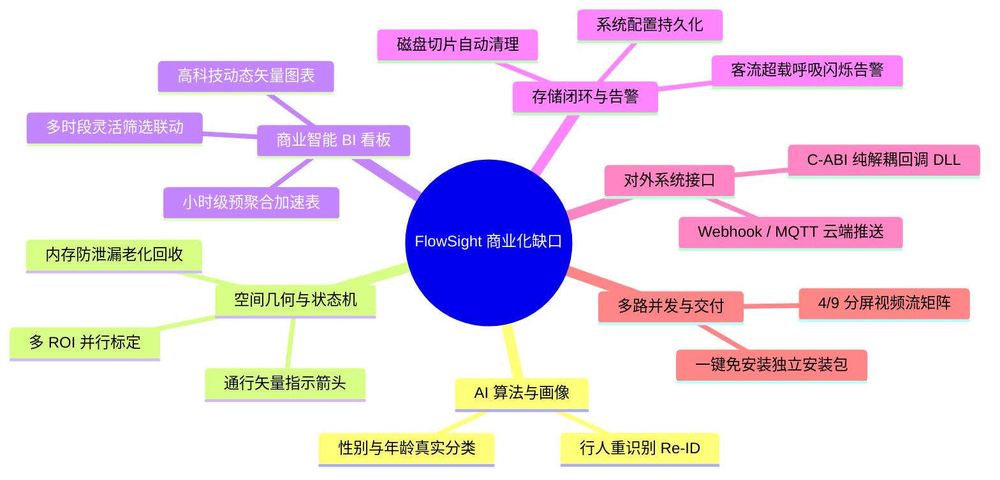
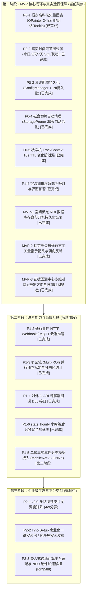

# FlowSight 商业化核心功能缺口分析与分期演进路线图

> **文档代号**：`06-FlowSight_商业化核心功能缺口分析与分期演进路线图`  
> **版本**：v1.0  
> **状态**：正式归档 / 阶段性指导文档  
> **审计基准**：FlowSight MVP v1.2 (`docs/00` ~ `docs/05`) + P0 基础交付 (Commit `03683d4`)

---

## 目录

- [一、背景与商业就绪审计基准](#一背景与商业就绪审计基准)
- [二、6 大核心功能缺口深度剖析](#二6-大核心功能缺口深度剖析)
  - [缺口 1：核心 AI 算法与客群画像深度](#缺口-1核心-ai-算法与客群画像深度)
  - [缺口 2：空间几何与状态机长期稳定性](#缺口-2空间几何与状态机长期稳定性)
  - [缺口 3：数据分析与商业智能 (BI) 看板](#缺口-3数据分析与商业智能-bi-看板)
  - [缺口 4：存储策略闭环与实时告警机制](#缺口-4存储策略闭环与实时告警机制)
  - [缺口 5：对外系统对接与开放接口 (API / SDK)](#缺口-5对外系统对接与开放接口-api--sdk)
  - [缺口 6：多路并发矩阵与绿色免安装交付](#缺口-6多路并发矩阵与绿色免安装交付)
- [三、分期演进路线图 (P0 / P1 / P2)](#三分期演进路线图-p0--p1--p2)
- [四、落地状态追踪矩阵](#四落地状态追踪矩阵)
- [五、分步实施工程规范与指导原则](#五分步实施工程规范与指导原则)

---

## 一、背景与商业就绪审计基准

FlowSight 系统在完成初期架构构建与多媒体重构后，已成功打通了**工业级 MVP 的核心链路闭环**：
1. **真实视频源解析**：支持本地 MP4 文件无缝播放与标准 RTSP 网络视频流稳定拉取；
2. **目标检测与跟踪**：搭载 YOLOv8 + ByteTrack 实时多目标跟踪，具备卡尔曼预测与空间遮挡抗性；
3. **任意多边形空间标定**：支持 $N \ge 3$ 边形自由单击打点、闭合与顶点拖拽调节，内置带符号欧氏距离场双阈值防抖缓冲带；
4. **环形短视频切片存盘**：异步环形缓冲区实时捕获进出前后 2~3 秒现场切片，并持久化写入 SQLite WAL 并发数据库；
5. **专业播放控制组件**：落地行业标准首尾时间轴、声画同步、逐帧微调与全屏沉浸回放；
6. **硬件自适应探测**：系统自动探测 NVIDIA CUDA 驱动并具备 CPU 多线程高性能模式平滑 Fallback 容灾。

然而，要从“技术原型/MVP”迈向“**完全体商业级商用产品（Commercial Production-Ready）**”，对照主流安防系统标准（海康、大华等）及商业智能客户（商超、连锁零售、智慧园区）的真实业务诉求，系统仍存在 **6 大核心功能缺口**，需通过系统化、分阶段方式予以补齐。

---

## 二、6 大核心功能缺口深度剖析

---

### 缺口 1：核心 AI 算法与客群画像深度

| 细分维度 | 当前现状 | 商业级产品定义要求 | 业务与技术影响 |
| :--- | :--- | :--- | :--- |
| **性别与年龄段属性识别** | 目前在 `ByteTrackWrapper.cpp` 中采用模拟规则：`ID % 2 == 0 ? "男" : "女"`，年龄固定为 `"20-30"` | 依据 `docs/04` 第 1.1 节规划的**“二级异步级联架构”**，当行人踏入判定区时，裁剪目标检测框异步送入轻量级属性分类模型（如 MobileNetV3 / FairFace ONNX，体积约 1.5MB） | 无法向商用零售客户提供真实客观的到店客群画像，降低报表商业价值。 |
| **行人重识别去重 (Re-ID)** | 仅依赖 ByteTrack 的卡尔曼滤波与空间 IoU 关联 | 提取轻量级外观特征向量（Embedding），当目标短暂离开视野（如进店选购又步出）或被立柱长时间遮挡返回时，基于余弦相似度完成跨时间跨区域去重 | 目标遮挡超过 30 帧或折返时会被赋予全新 TrackID，导致人流统计出现重复计数误差。 |

---

### 缺口 2：空间几何与状态机长期稳定性

| 细分维度 | 当前现状 | 商业级产品定义要求 | 业务与技术影响 |
| :--- | :--- | :--- | :--- |
| **状态机内存生命周期回收** | `RoiCounter.cpp` 中的 `track_states_` 映射表只增不减（P0 已完成初步治理） | 必须具备 **TTL / LRU 超时老化回收机制**，当某个 Track ID 超过指定时段未出现在视野中时，自动从内存状态表中安全析构 | 在 7×24 小时长周期无人值守工控场景下，累积数十万历史 Track 导致内存缓慢泄露。 |
| **多区域（Multi-ROI）并行标定** | 目前系统仅支持配置单个多边形（`RoiConfig` 仅含单组顶点） | 支持多个独立 ROI 区域（例如：A 门主入口区、B 门辅助区、收银台排队区），每个 ROI 拥有独立 ID、命名与统计计数器 | 无法满足同一路摄像头同时监控多个进出口或划分不同统计防区的商业要求。 |
| **通行方向矢量指示箭头** | 目前仅根据 Inside/Outside 判定，画面上只有多边形轮廓 | 标定工作台支持在多边形几何上直观绘制/交互调整一根**“通行方向基准矢量箭头”**，直观告知用户哪个朝向为“进入”、哪个朝向为“离开” | 在不规则多边形（非矩形门框）下，施工及运营人员无法一眼识别正反朝向，易配置错误。 |

---

### 缺口 3：数据分析与商业智能 (BI) 看板

| 细分维度 | 当前现状 | 商业级产品定义要求 | 业务与技术影响 |
| :--- | :--- | :--- | :--- |
| **可视化趋势图表质感** | 早期采用 ASCII 字符 `█` 伪直方图（P0 已完成矢量化升级） | 采用基于 Qt `QPainter` 的**高科技动态矢量图表**，支持 24 小时进入/离开双色渐变、坐标网格、Hover 浮动数据胶囊 | 纯文本直方图严重影响产品工业级与高科技调性。 |
| **时间范围筛选过滤联动** | 界面存在下拉框（“今日汇总 / 3天趋势 / 7天报表”），但底层执行未真正联动时间戳过滤（P0 已完成联动） | 下拉框切换时，计算 `start_ms` 与 `end_ms`，向数据库精准下发时间范围 SQL 查询，驱动图表与报表刷新 | 报表数据无法按用户真实挑选的时段进行下钻与导出。 |
| **小时级聚合统计表 (`stats_hourly`)** | 每次刷新报表均全量扫描 `passage_events` 原始流水表 | 按照 `docs/00` 规范，在后台维护预聚合表 `stats_hourly`，报表优先直接查聚合表，实现毫秒级响应 | 当系统运行数月、原始事件累积达数十万条时，全表扫描将导致界面切换卡顿甚至假死。 |

---

### 缺口 4：存储策略闭环与实时告警机制

| 细分维度 | 当前现状 | 商业级产品定义要求 | 业务与技术影响 |
| :--- | :--- | :--- | :--- |
| **短视频切片过期自动清理 (Pruning)** | 界面具备设置控件，但无后台定时清理 Worker（P0 已完成落地） | 后台定时扫描 `clips/` 目录，按用户设定的留存天数（默认 30 天）自动清理过期 MP4 文件，记录清理审计日志 | 用户工控机磁盘在无人值守运行数月后必定被短视频挤爆，造成系统宕机。 |
| **系统配置持久化 (`ConfigManager`)** | 界面修改的视频源、检测阈值等未持久化写入文件（P0 已完成落地） | 采用标准 INI 读写机制（`configs/flowsight.ini`），冷启动自动反显历史配置，修改即时存盘 | 每次重启软件所有参数均还原为默认，用户体验破碎。 |
| **客流超载/滞留拥挤度实时告警** | 仅显示当前实时场内数字 | 支持在设置中配置拥挤预警阈值（如超过 30 人）；超载时视频边框呈现红色呼吸灯闪烁、系统托盘/状态栏弹出声光告警 | 缺乏安防级关键的安全防踩踏、防拥挤负荷告警能力。 |

---

### 缺口 5：对外系统对接与开放接口 (API / SDK)

| 细分维度 | 当前现状 | 商业级产品定义要求 | 业务与技术影响 |
| :--- | :--- | :--- | :--- |
| **C 风格纯解耦系统回调函数** | 仅在内部使用 Qt 信号槽机制进行模块通信 | 按照 `docs/03` 规划，封装导出符合 C-ABI 标准的动态库与函数指针回调： `typedef void (*FlowSightEventCallback)(const C_PassageEvent* event, void* user_data);` | 外部第三方系统（如 C#、Java、Python 平台、PLC 工控网关）无法以 DLL 动态链接库形式直接嵌入 FlowSight 核心引擎。 |
| **网络云端推送通道 (Webhook / MQTT)** | 仅本地存储至 SQLite 数据库 | 支持配置 HTTP Webhook 或 MQTT Broker，当产生进出事实时，异步以标准 JSON 格式推送到客户云端业务平台 | 无法与智慧商场 ERP、楼宇安防综合平台等实现远程上云联动。 |

---

### 缺口 6：多路并发矩阵与绿色免安装交付

| 细分维度 | 当前现状 | 商业级产品定义要求 | 业务与技术影响 |
| :--- | :--- | :--- | :--- |
| **多路摄像头流并发矩阵 (v2.0)** | 当前聚焦单路高清视频流处理 | 依据 `docs/04`，系统需演进至 `MultiStreamManager`，UI 提供 1/4/9 宫格多分屏视频矩阵与通道切换 | 无法满足一台主机同时挂接管理 4~8 路通道的商用监控工程需求。 |
| **客户端一键独立打包 (Deployment)** | 依赖开发机预装的 Qt6、OpenCV、ONNXRuntime 动态库 | 使用 `windeployqt` 结合打包脚本，将所有运行时 DLL、ONNX 模型、字体资源整合为绿色压缩包或 Inno Setup 安装向导 | 交付极为繁琐，客户纯净机型无法开箱即用。 |

---

## 三、分期演进路线图 (第一阶段 MVP 闭环 / 第二阶段进阶 / 第三阶段生态)

依据最新工程规划，明确当前开发仍处于 **第一阶段：MVP 商业级核心闭环阶段**。将跨系统集成的网络推送 (P1-2) 与多区域标定 (P1-3) 明确归类至 **第二阶段（进阶阶段）**：

---

## 四、落地状态追踪矩阵

| 任务代号 | 归属缺口 | 任务名称与目标 | 阶段归属 | 研发状态 | 验证结论 / 提交哈希 |
| :--- | :--- | :--- | :---: | :---: | :--- |
| **P0-1** | 缺口 3 | 报表高科技矢量图表 (`AnalyticsChartWidget`) | **MVP 阶段** | **已完成** | 原生 QPainter 渲染，支持 24h 渐变柱与 Hover 卡片 (`03683d4`) |
| **P0-2** | 缺口 3 | 真实时间戳范围过滤联动 (`DatabaseManager`) | **MVP 阶段** | **已完成** | 联动“今日/3天/7天”下钻查询与 CSV 导出 (`03683d4`) |
| **P0-3** | 缺口 4 | 系统配置全量持久化 (`ConfigManager`) | **MVP 阶段** | **已完成** | 读写 `configs/flowsight.ini`，启动自动回填 (`03683d4`) |
| **P0-4** | 缺口 4 | 磁盘切片自动老化清理 (`StoragePruner`) | **MVP 阶段** | **已完成** | 启动及每 6 小时定时扫描清理过期切片 (`03683d4`) |
| **P0-5** | 缺口 2 | 状态机 TrackContext 10s TTL 垃圾回收 | **MVP 阶段** | **已完成** | 每 100 帧循环清除超时 Track，内存恒定无泄漏 (`03683d4`) |
| **P1-4** | 缺口 4 | 客流拥挤度超载呼吸灯与弹窗预警 | **MVP 阶段** | **已完成** | 阈值可配且持久化，超载时画布外框红光呼吸律动闪烁与警标悬浮 (`8378961`) |
| **MVP-1**| 缺口 2 | 空间标定 ROI 数据库存盘与开机持久化恢复 | **MVP 阶段** | **已完成** | 标定生效即存入 SQLite `roi_configs` 表，开机自动从库中恢复并注入分析管线 (`531b85e`) |
| **MVP-2**| 缺口 2 | 标定多边形通行方向矢量指示箭头与朝向反转 | **MVP 阶段** | **已完成** | Studio 支持一键切换判定朝向，画布绘制赛博青色通行基准法向矢量箭头与徽标 (`531b85e`) |
| **P1-2** | 缺口 5 | 通行事件 HTTP Webhook 异步云端推送 | **第二阶段** | **已完成** | 异步非阻塞 QNetworkAccessManager，标准 JSON 上报与设置页 Ping 测试诊断 (`bc1b85b`) |
| **P1-3** | 缺口 2 | 多多边形 ROI 独立配置与分防区独立统计 | **第二阶段** | **已完成** | 多防区命名与独立复合状态机统计，冷启动全量恢复与实时监控多防区 HUD 渲染 |
| **P1-1** | 缺口 5 | 对外 C-ABI 纯解耦回调接口与动态库导出 (`FlowSightEngine.dll`) | **第二阶段** | **已完成** | 纯 C-ABI 导出与 C++ 抽象双轨工厂，0 Qt 依赖，Python ctypes 端到端实机验证通过 |
| **P1-6** | 缺口 3 | `stats_hourly` 后台小时级自动预聚合 | **第二阶段** | **已完成** | SQLite ON CONFLICT 实时增量 Upsert 与冷启动自检回填，24h 分布直查耗时 < 0.2ms |
| **P1-5** | 缺口 1 | 二级真实属性分类模型轻量推理 (ONNX) | **第二阶段** | 待实施 | 异步裁剪行人送入 MobileNetV3 进行真实性别/年龄判定 |
| **P2-1** | 缺口 6 | v2.0 多路视频流并发调度矩阵 (4/9分屏) | **第三阶段** | 规划中 | 支持多路摄像头拉流与矩阵分屏交互 |
| **P2-2** | 缺口 6 | Inno Setup 一键安装包 / 纯净机打包 | **第三阶段** | 规划中 | 自动化脚本打包所有依赖 DLL 与模型 |
| **P2-3** | 缺口 1 | 瑞芯微 RK3588 NPU 嵌入式端移植 | **第三阶段** | 规划中 | 移植 RKNN-Toolkit2，实现边缘板卡部署 |

---

## 五、分步实施工程规范与指导原则

在后续一步步实施落地上述功能时，团队必须严格遵循以下**工程防腐与交付铁律**：

1. **单步可独立编译验证**：
   - 每完成一个功能，必须通过 MSVC 2022 Release 编译并执行快速自检，确保代码 0 警告、0 报错；
2. **非侵入式渐进增强**：
   - 新增组件（如 Webhook 推送、C-ABI 接口）均采用低耦合设计，不得影响现有实时检测管线的主线程帧率与延迟；
3. **保持暗黑科技视觉规范**：
   - 所有 UI 组件必须沿用系统的深黑曜石基底（`#0d1117`、`#161b22`）、电光青高亮（`#58a6ff`）与无衬线现代排版；
4. **版本控制与文档同步追踪**：
   - 每次落地新特性后，及时在本文档的“落地状态追踪矩阵”中更新研发状态、对应的 Git 提交哈希，并在 `walkthrough.md` 中记录测试用例。
