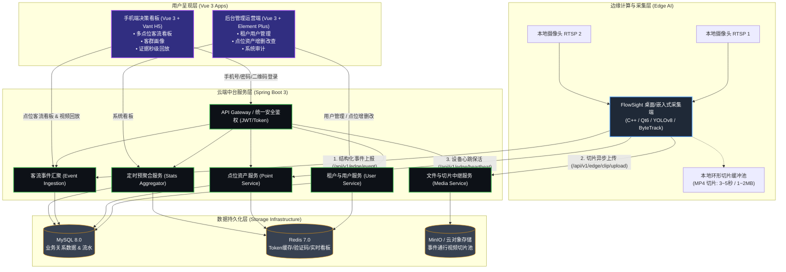
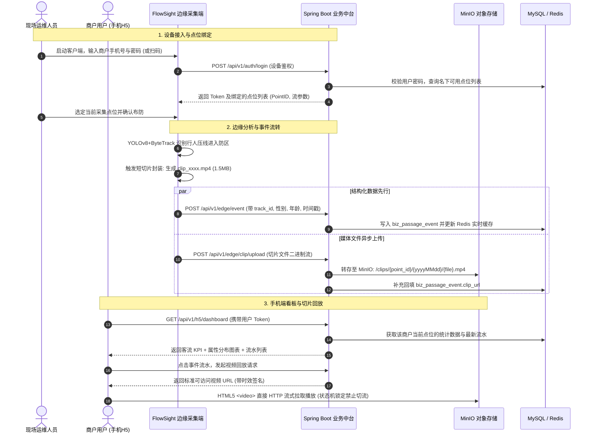
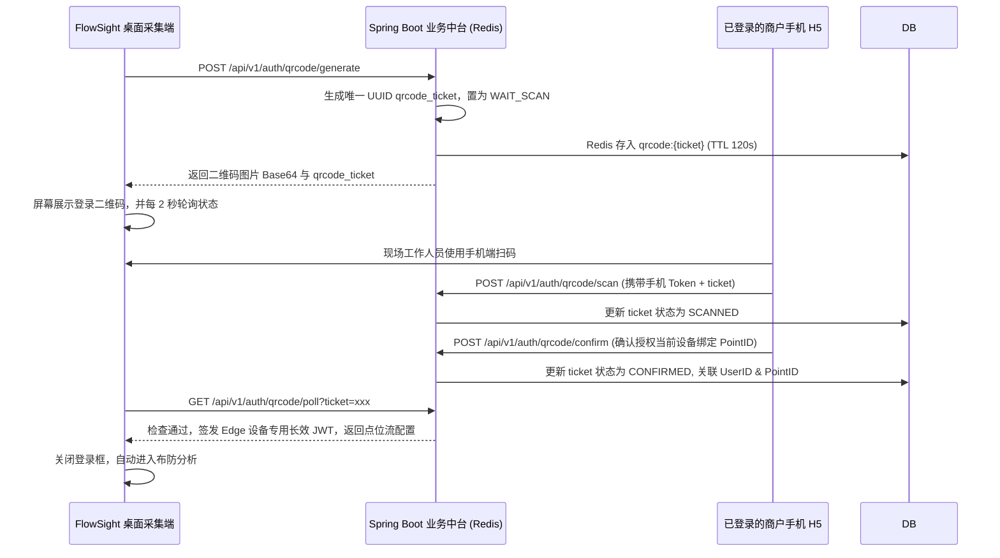
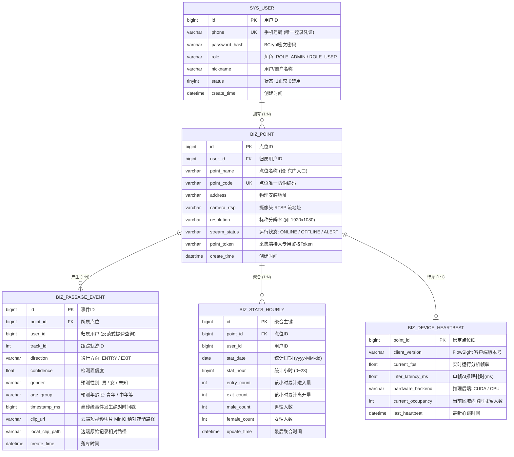

# FlowSight 多租户云端业务中台与移动端 H5 全景方案设计规范 (v1.0)

> **文档代号**：`07-FlowSight_多租户云端业务中台与移动端H5全景方案设计规范`  
> **编制日期**：2026-10-21  
> **关联模块**：`solution/backend` (Spring Boot 3) | `solution/apps` (Vue 3 H5 / Admin) | `FlowSight` (C++ 边缘采集客户端)  
> **技术决策基准**：
> - 核心架构：**云-边-端协同多租户架构 (Edge-Cloud Collaborative Multi-Tenant Architecture)**
> - 视频回放机制：**方案 A（云端对象存储/MinIO 按需直传 + HTML5 标准秒开播放）**
> - 流切换模式：**纯数据看板流切换（视频播放时状态锁定禁止切换）**
> - 认证鉴权体系：**统一手机号/密码 + 二维码跨端免密互认 + JWT/Token 静默上报**
> - 技术栈标准：**Spring Boot 3.x + Vue 3 (Vant/Element Plus) + MySQL 8.0 + Redis + MinIO**

---

## 目录

- [第一章 系统全景定位与多角色业务模型](#第一章-系统全景定位与多角色业务模型)
  - [1.1 业务背景与系统拓扑](#11-业务背景与系统拓扑)
  - [1.2 用户角色与权限边界](#12-用户角色与权限边界)
  - [1.3 端到端业务数据流向图](#13-端到端业务数据流向图)
- [第二章 关键技术决策与状态机深度设计](#第二章-关键技术决策与状态机深度设计)
  - [2.1 短视频切片轻量化云端流转方案 (方案 A 落地)](#21-短视频切片轻量化云端流转方案-方案-a-落地)
  - [2.2 手机端多点位流切换与播放锁定状态机](#22-手机端多点位流切换与播放锁定状态机)
  - [2.3 多端统一身份认证与二维码扫码联动机制](#23-多端统一身份认证与二维码扫码联动机制)
  - [2.4 点位生命周期与数据级联删除规范](#24-点位生命周期与数据级联删除规范)
- [第三章 数据库设计与持久化规范 (MySQL 8.0 DDL)](#第三章-数据库设计与持久化规范-mysql-80-ddl)
  - [3.1 E-R 实体关系图](#31-e-r-实体关系图)
  - [3.2 生产级 SQL 建表脚本 (完整 DDL)](#32-生产级-sql-建表脚本-完整-ddl)
- [第四章 云端 RESTful API 与通信协议规范](#第四章-云端-restful-api-与通信协议规范)
  - [4.1 统一响应格式与认证请求头](#41-统一响应格式与认证请求头)
  - [4.2 认证与扫码接口集 (`/api/v1/auth`)](#42-认证与扫码接口集-apiv1auth)
  - [4.3 管理员用户管理接口 (`/api/v1/admin/users`)](#43-管理员用户管理接口-apiv1adminusers)
  - [4.4 点位资产管理接口 (`/api/v1/points`)](#44-点位资产管理接口-apiv1points)
  - [4.5 边缘采集端数据上报接口 (`/api/v1/edge`)](#45-边缘采集端数据上报接口-apiv1edge)
  - [4.6 手机端 H5 业务接口 (`/api/v1/h5`)](#46-手机端-h5-业务接口-apiv1h5)
- [第五章 边缘采集端 (FlowSight C++) 对接升级规范](#第五章-边缘采集端-flowsight-c-对接升级规范)
  - [5.1 WebhookPusher 协议对齐与 Token 注入](#51-webhookpusher-协议对齐与-token-注入)
  - [5.2 短切片异步上传至 MinIO/后端组件设计](#52-短切片异步上传至-minio后端组件设计)
  - [5.3 桌面端登录与点位绑定 UI 交互流](#53-桌面端登录与点位绑定-ui-交互流)
- [第六章 工程目录规范与落地方案](#第六章-工程目录规范与落地方案)
  - [6.1 后端工程骨架 (`solution/backend`)](#61-后端工程骨架-solutionbackend)
  - [6.2 前端工程骨架 (`solution/apps`)](#62-前端工程骨架-solutionapps)
  - [6.3 生产级容器化部署方案 (Docker Compose)](#63-生产级容器化部署方案-docker-compose)

---

## 第一章 系统全景定位与多角色业务模型

### 1.1 业务背景与系统拓扑

FlowSight 整体解决方案由 **“边端分析网关”**、**“云端业务中台”** 与 **“双端用户触点”** 三大核心板块构成：
1. **边缘计算采集端 (FlowSight Desktop/Box)**：部署在门店或通道本地硬件（PC/RK3588），实时拉取本地摄像头 RTSP 流，运行 YOLOv8 + ByteTrack + 属性分类模型，执行实时人流计数、性别年龄识别、短切片录制，并通过 HTTP/Token 向上汇报。
2. **云端业务中台 (`solution/backend`)**：基于 Spring Boot 3 研发，负责多租户数据隔离、点位资产配置、事件落库聚合、切片文件持久化（MinIO/OSS）以及大屏报表推送。
3. **多端交互应用 (`solution/apps`)**：
   - **运营管理端 (Web Admin)**：供超级管理员进行全局租户、点位数目、系统指标调优与权限分配；
   - **移动客户端 (H5 Mobile)**：商户/业主使用手机号登录，实时查看名下各点位人流动态、客群画像，并支持按需回放抓拍到的历史通行人物视频。



---

### 1.2 用户角色与权限边界

系统分为两级权限模型：
1. **超级管理员 (`ROLE_ADMIN`)**：
   - 全局运营看板（全网商户总数、点位总数、实时分析流总数、今日总通行流量）；
   - 用户管理：添加商户用户（指定手机号，默认密码同手机号，直接初始分配点位）、禁用/删除用户；
   - 点位审计：跨用户检索各点位状态（在线/离线、摄像头地址、分辨率、实时 FPS）；
   - 数据清理：级联物理销毁已删除用户的点位与云端视频切片。
2. **商户/点位业主 (`ROLE_USER`)**：
   - 身份凭证：唯一手机号码 + 密码；
   - 移动端 H5 看板：仅可查看自身名下的点位列表及其统计指标（进出量、滞留人数、性别构成、年龄分布）；
   - 点位流切换：支持按点位（摄像头）单向切换浏览；
   - 事件回放：点击通行流水，调取云端存储的现场 3~5 秒切片进行精准复核；
   - 采集客户端接入：支持在 FlowSight 现场客户端使用该手机号密码直接登录，或通过手机 H5 扫码授权登录现场客户端。

---

### 1.3 端到端业务数据流向图



---

## 第二章 关键技术决策与状态机深度设计

### 2.1 短视频切片轻量化云端流转方案 (方案 A 落地)

根据技术决议，放弃网络不可靠的 WebRTC P2P 直连，全面落地 **“短切片边缘异步上传 + 云端轻量持久化 + CDN/HTTP 直链秒播”** 工业级链路：

1. **切片规格控制**：
   - FlowSight 边缘端保持每秒 12~15 帧的环形缓冲池；
   - 触发通行事件后，截取事件发生**前 2 秒 + 后 2 秒**（共 4 秒），编码为 Baseline H.264，分辨率保持 720P/480P，文件体积严格收敛在 **1.2MB ~ 2.0MB** 以内。
2. **异步非阻塞上传机制**：
   - 边缘端 `WebhookPusher` 采用独立线程池处理上传，绝不阻塞视频抓帧与 YOLO 推理主线程；
   - 采用 HTTP `multipart/form-data` 格式直传 Spring Boot 中台，中台流式转发至 MinIO 对象存储，避免占用应用服务器本地硬盘。
3. **安全防盗链设计**：
   - 手机 H5 请求视频回放时，中台生成带有时效性（默认 15 分钟）的预签名 URL（Presigned Get URL），防止切片资源被越权遍历窃取。

---

### 2.2 手机端多点位流切换与播放锁定状态机

针对手机 H5 看板“多点位切换”与“视频播放时互斥”的核心交互要求，设计如下双模态控制状态机：

```mermaid
stateDiagram-v2
    [*] --> Dashboard_Browsing: 登录进入当前默认点位

    state Dashboard_Browsing {
        [*] --> Idle
        Idle --> Refreshing: 下拉刷新 / 自动轮询 (每10秒)
        Refreshing --> Idle: 报表刷新完成
        Idle --> Point_Switching: 用户点击顶部点位下拉框
        Point_Switching --> Idle: 切换点位成功 (重新拉取新点位客流数据)
    }

    Dashboard_Browsing --> Video_Modal_Playing: 用户点击某条通行记录回放

    state Video_Modal_Playing {
        [*] --> Clip_Loading: 获取切片签名 URL
        Clip_Loading --> Clip_Playing: 视频加载就绪，自动起播
        note right of Video_Modal_Playing
            【硬性业务约束】
            1. 顶部点位切换组件强制 Disable (锁定灰显)
            2. 数据定时刷新定时器暂停挂起
            3. 避免跨点位视频串流与数据时序错乱
        end note
        Clip_Playing --> Clip_Paused: 用户暂停
        Clip_Paused --> Clip_Playing: 用户继续播放
    }

    Video_Modal_Playing --> Dashboard_Browsing: 用户点击“关闭视频”或回放结束自动退出
```

**关键前端防御逻辑**：
- 在 Pinia 全局状态管理中定义 `isMediaPlaying: boolean`；
- 当视频弹窗打开时，`isMediaPlaying = true`，此时点位下拉菜单（`<van-dropdown-menu>`）设置 `disabled = true`；
- 页面数据定时轮询器（Polling Timer）自动拦截跳过，确保回放过程中无网络资源抢占，无视觉干扰。

---

### 2.3 多端统一身份认证与二维码扫码联动机制

商户手机号与密码在所有端（Web 管理端、手机 H5、FlowSight 桌面端）通用。为提升现场部署体验，额外引入**“手机扫码秒级登录边缘端”**能力：



---

### 2.4 点位生命周期与数据级联删除规范

根据业务规则，“删除用户/点位时，需要级联清理云端对应数据，使手机端无法再查看”：

> [!IMPORTANT]
> **边云删除边界权威定义**：
> 当云端执行删除点位或删除商户用户时，**仅物理清理云端资源（MySQL 数据库记录、Redis 缓存与 MinIO 中的视频切片池）**，达到手机端 H5 及 Web 管理端彻底无法再查看到这些数据的效果；**边缘现场客户端（FlowSight PC/工控机）本地的数据库（SQLite `flowsight.db`）与本地磁盘短视频切片（`clips/` 目录）予以保留、不执行删除**。该设计确保了现场数据的本地自治与审计留存，同时严格满足了移动端数据隔离与屏蔽的诉求。

- **删除点位 (`DELETE /api/v1/points/{id}`)**：
  1. 逻辑标记点位下线，断开该点位的实时采集推流通道；
  2. 异步清空云端 MySQL 中该点位关联的全部 `biz_passage_event` 流水记录及 `biz_stats_hourly` 预聚合数据；
  3. 异步向 MinIO 对象存储发送批处理删除指令，物理清空目录 `/clips/{point_id}/` 下的全部云端短视频切片；
  4. 清理 Redis 中该点位的所有缓存 Key；
  5. **边缘端行为**：边缘客户端本地存储不受影响，仅断开云端推送或提示“该点位已被云端解绑”。
- **删除用户 (`DELETE /api/v1/admin/users/{id}`)**：
  1. 查询该用户所属的所有点位列表；
  2. 依次递归调用上述点位云端销毁逻辑；
  3. 删除云端用户主记录 `sys_user`，注销其所有移动端与管理端 Token。

---

## 第三章 数据库设计与持久化规范 (MySQL 8.0 DDL)

### 3.1 E-R 实体关系图



---

### 3.2 生产级 SQL 建表脚本 (完整 DDL)

```sql
-- 创建 FlowSight 商业中台数据库
CREATE DATABASE IF NOT EXISTS `flowsight_cloud` DEFAULT CHARACTER SET utf8mb4 COLLATE utf8mb4_unicode_ci;
USE `flowsight_cloud`;

-- 1. 用户认证与租户表
CREATE TABLE IF NOT EXISTS `sys_user` (
    `id` BIGINT NOT NULL AUTO_INCREMENT COMMENT '用户主键ID',
    `phone` VARCHAR(20) NOT NULL COMMENT '登录手机号码(唯一凭证)',
    `password_hash` VARCHAR(128) NOT NULL COMMENT 'BCrypt 加密密码散列',
    `role` VARCHAR(20) NOT NULL DEFAULT 'ROLE_USER' COMMENT '角色标识: ROLE_ADMIN / ROLE_USER',
    `nickname` VARCHAR(64) NOT NULL DEFAULT '' COMMENT '用户或商户展示名称',
    `avatar` VARCHAR(255) DEFAULT '' COMMENT '用户头像地址',
    `status` TINYINT NOT NULL DEFAULT 1 COMMENT '账号状态: 1-正常, 0-禁用',
    `create_time` DATETIME NOT NULL DEFAULT CURRENT_TIMESTAMP COMMENT '注册创建时间',
    `update_time` DATETIME NOT NULL DEFAULT CURRENT_TIMESTAMP ON UPDATE CURRENT_TIMESTAMP COMMENT '最后更新时间',
    PRIMARY KEY (`id`),
    UNIQUE KEY `uk_phone` (`phone`)
) ENGINE=InnoDB DEFAULT CHARSET=utf8mb4 COMMENT='用户与租户基础表';

-- 初始化超级管理员 (默认手机号: 13800000000, 密码与手机同号: 13800000000 的 BCrypt 密文)
INSERT INTO `sys_user` (`phone`, `password_hash`, `role`, `nickname`) 
VALUES ('13800000000', '$2a$10$7JB720yubVSZvUI0rEqK/.Vq4VfH4FjPvhV7r0h1hA9x.VcmQYVce', 'ROLE_ADMIN', '系统总管理员')
ON DUPLICATE KEY UPDATE `id`=`id`;

-- 2. 点位资产配置表
CREATE TABLE IF NOT EXISTS `biz_point` (
    `id` BIGINT NOT NULL AUTO_INCREMENT COMMENT '点位主键ID',
    `user_id` BIGINT NOT NULL COMMENT '所属商户用户ID',
    `point_name` VARCHAR(100) NOT NULL COMMENT '点位名称(例如: A门主入口)',
    `point_code` VARCHAR(64) NOT NULL COMMENT '点位唯一编码(业务编号)',
    `address` VARCHAR(255) DEFAULT '' COMMENT '物理安装具体位置/门店地址',
    `camera_rtsp` VARCHAR(512) DEFAULT '' COMMENT '摄像头 RTSP 流地址',
    `resolution` VARCHAR(32) DEFAULT '1920x1080' COMMENT '推流画面分辨率规格',
    `stream_status` VARCHAR(20) NOT NULL DEFAULT 'OFFLINE' COMMENT '状态: ONLINE-在线, OFFLINE-离线, ALERT-异常',
    `point_token` VARCHAR(64) NOT NULL COMMENT '边缘采集端专用对接认证Token',
    `is_deleted` TINYINT NOT NULL DEFAULT 0 COMMENT '逻辑删除标记: 0-正常, 1-已删除',
    `create_time` DATETIME NOT NULL DEFAULT CURRENT_TIMESTAMP COMMENT '创建时间',
    `update_time` DATETIME NOT NULL DEFAULT CURRENT_TIMESTAMP ON UPDATE CURRENT_TIMESTAMP COMMENT '配置更新时间',
    PRIMARY KEY (`id`),
    UNIQUE KEY `uk_point_code` (`point_code`),
    KEY `idx_user_id` (`user_id`),
    KEY `idx_token` (`point_token`)
) ENGINE=InnoDB DEFAULT CHARSET=utf8mb4 COMMENT='监控分析点位资产表';

-- 3. 人流通行结构化事件流水明细表
CREATE TABLE IF NOT EXISTS `biz_passage_event` (
    `id` BIGINT NOT NULL AUTO_INCREMENT COMMENT '事件全局唯一流水ID',
    `point_id` BIGINT NOT NULL COMMENT '所属点位ID',
    `user_id` BIGINT NOT NULL COMMENT '所属商户用户ID(反范式索引加速)',
    `track_id` INT NOT NULL COMMENT '跟踪目标局部ID',
    `direction` VARCHAR(16) NOT NULL COMMENT '通行判定方向: ENTRY-进入, EXIT-离开',
    `confidence` FLOAT NOT NULL DEFAULT 0.0 COMMENT '检测综合置信度',
    `gender` VARCHAR(16) DEFAULT '未知' COMMENT '客群画像预测性别: 男/女/未知',
    `age_group` VARCHAR(32) DEFAULT '未知' COMMENT '预测年龄段: 青年(18-35)等',
    `timestamp_ms` BIGINT NOT NULL COMMENT '通行发生绝对毫秒时间戳',
    `clip_url` VARCHAR(512) DEFAULT '' COMMENT '云端短视频切片 MinIO 访问路径',
    `local_clip_path` VARCHAR(255) DEFAULT '' COMMENT '边缘端原始生成切片相对路径',
    `create_time` DATETIME NOT NULL DEFAULT CURRENT_TIMESTAMP COMMENT '事件入库时间',
    PRIMARY KEY (`id`),
    KEY `idx_point_time` (`point_id`, `timestamp_ms`),
    KEY `idx_user_time` (`user_id`, `timestamp_ms`),
    KEY `idx_track` (`track_id`)
) ENGINE=InnoDB DEFAULT CHARSET=utf8mb4 COMMENT='通行事件明细流水表';

-- 4. 小时级商业指标预聚合表 (加速大屏图表极速响应)
CREATE TABLE IF NOT EXISTS `biz_stats_hourly` (
    `id` BIGINT NOT NULL AUTO_INCREMENT COMMENT '自增主键',
    `point_id` BIGINT NOT NULL COMMENT '点位ID',
    `user_id` BIGINT NOT NULL COMMENT '用户ID',
    `stat_date` DATE NOT NULL COMMENT '统计日期(yyyy-MM-dd)',
    `stat_hour` TINYINT NOT NULL COMMENT '统计小时段(0~23)',
    `entry_count` INT NOT NULL DEFAULT 0 COMMENT '小时累计进入人数',
    `exit_count` INT NOT NULL DEFAULT 0 COMMENT '小时累计离开人数',
    `male_count` INT NOT NULL DEFAULT 0 COMMENT '男性顾客人次',
    `female_count` INT NOT NULL DEFAULT 0 COMMENT '女性顾客人次',
    `update_time` DATETIME NOT NULL DEFAULT CURRENT_TIMESTAMP ON UPDATE CURRENT_TIMESTAMP,
    PRIMARY KEY (`id`),
    UNIQUE KEY `uk_point_date_hour` (`point_id`, `stat_date`, `stat_hour`),
    KEY `idx_user_date` (`user_id`, `stat_date`)
) ENGINE=InnoDB DEFAULT CHARSET=utf8mb4 COMMENT='小时级客流画像预聚合表';

-- 5. 边缘设备心跳与分析健康状态表
CREATE TABLE IF NOT EXISTS `biz_device_heartbeat` (
    `point_id` BIGINT NOT NULL COMMENT '关联点位ID',
    `client_version` VARCHAR(32) NOT NULL DEFAULT 'v1.2.0' COMMENT '采集端核心软件版本',
    `current_fps` FLOAT NOT NULL DEFAULT 0.0 COMMENT '边缘当前处理帧率',
    `infer_latency_ms` FLOAT NOT NULL DEFAULT 0.0 COMMENT '单帧平均推理延迟毫秒',
    `hardware_backend` VARCHAR(32) DEFAULT 'CPU' COMMENT '运行硬件后端(CUDA/CPU/RKNN)',
    `current_occupancy` INT NOT NULL DEFAULT 0 COMMENT '当前防区滞留人数',
    `last_heartbeat` DATETIME NOT NULL DEFAULT CURRENT_TIMESTAMP ON UPDATE CURRENT_TIMESTAMP COMMENT '最新心跳时间',
    PRIMARY KEY (`point_id`)
) ENGINE=InnoDB DEFAULT CHARSET=utf8mb4 COMMENT='边缘设备健康心跳表';
```

---

## 第四章 云端 RESTful API 与通信协议规范

### 4.1 统一响应格式与认证请求头

所有 API 均遵循工业级 REST 规范，采用 JSON 返回，格式固定如下：
```json
{
  "code": 200,             // 业务状态码: 200-成功, 401-未登录, 403-无权, 500-服务异常
  "message": "操作成功",
  "data": { ... },          // 业务数据负载
  "timestamp": 1729511200000
}
```
**安全鉴权请求头**：
- 用户端（H5 / 管理端 Web）：请求头附带 `Authorization: Bearer <JWT_TOKEN>`
- 边缘采集端（FlowSight C++）：请求头附带 `X-Point-Token: <POINT_TOKEN>` 或设备 JWT

---

### 4.2 认证与扫码接口集 (`/api/v1/auth`)

#### 1. 账号密码登录
- **`POST /api/v1/auth/login`**
- **请求体**：
  ```json
  {
    "phone": "13812345678",
    "password": "同手机号或用户自定义密码",
    "client_type": "H5" // 可选: "H5" / "ADMIN" / "EDGE"
  }
  ```
- **成功响应**：
  ```json
  {
    "code": 200,
    "data": {
      "token": "eyJhbGciOiJIUzI1NiIsIn...",
      "user_id": 1001,
      "role": "ROLE_USER",
      "phone": "13812345678",
      "nickname": "旗舰店商户"
    }
  }
  ```

#### 2. 生成边缘登录二维码
- **`POST /api/v1/auth/qrcode/generate`**
- **响应**：返回二维码票据 `ticket` 及 Base64 图片，客户端用于在桌面端展示。

#### 3. 手机端扫码与确认登录
- **`POST /api/v1/auth/qrcode/scan`**：手机 H5 扫码后上报已扫码；
- **`POST /api/v1/auth/qrcode/confirm`**：手机 H5 传入选择绑定的 `point_id` 并点击确认，将设备 Token 签发给该 ticket。

#### 4. 边缘端轮询二维码状态
- **`GET /api/v1/auth/qrcode/poll?ticket={ticket}`**：
  - 返回状态：`WAIT_SCAN` / `SCANNED` / `CONFIRMED` / `EXPIRED`；确认后下发设备专用 Token。

---

### 4.3 管理员用户管理接口 (`/api/v1/admin/users`)

*权限要求：必须拥有 `ROLE_ADMIN` 权限。*

| 方法 | 路径 | 功能说明 | 关键参数 |
| :--- | :--- | :--- | :--- |
| **GET** | `/api/v1/admin/users` | 分页查询商户列表 | `page`, `size`, `phone`, `keyword` |
| **POST** | `/api/v1/admin/users` | **添加商户用户** (需求 3.1) | `phone`, `password`(留空则同号), `nickname`, `initial_point_name` |
| **PUT** | `/api/v1/admin/users/{id}` | 修改商户基本信息 (需求 3.3) | `nickname`, `password`, `status` |
| **DELETE** | `/api/v1/admin/users/{id}` | **级联物理删除用户** (需求 3.2) | 级联删除名下点位、通行明细及 MinIO 切片视频 |

---

### 4.4 点位资产管理接口 (`/api/v1/points`)

| 方法 | 路径 | 权限 | 功能说明 |
| :--- | :--- | :--- | :--- |
| **GET** | `/api/v1/points` | 所有登录用户 | 获取当前登录用户拥有的点位列表（包含在线状态与 Token） |
| **POST** | `/api/v1/points` | ADMIN / USER | **新增点位**：提交 `point_name`, `address`, `camera_rtsp`, `resolution` |
| **PUT** | `/api/v1/points/{id}` | 属主 / ADMIN | 修改点位配置参数 |
| **DELETE** | `/api/v1/points/{id}` | 属主 / ADMIN | **删除点位**：级联销毁该点位数据库流水与 MinIO 切片池文件 |
| **POST** | `/api/v1/points/{id}/token/refresh` | 属主 / ADMIN | 重新重置刷新该点位的接入 Token |

---

### 4.5 边缘采集端数据上报接口 (`/api/v1/edge`)

*权限要求：Header 携带合法的 `X-Point-Token`。*

#### 1. 结构化事件实时上报 (与现有 FlowSight Webhook 对接)
- **`POST /api/v1/edge/event`**
- **请求体 (现有 C++ 格式直接兼容)**：
  ```json
  {
    "event_type": "PASSAGE",
    "direction": "ENTRY",
    "track_id": 14,
    "timestamp": 1729511200123,
    "datetime": "2026-10-21T19:46:40.123+08:00",
    "confidence": 0.89,
    "source_id": "CAM-01",
    "clip_path": "clips/20261021_194640_track14.mp4",
    "attributes": {
      "gender": "男",
      "age_group": "青年(18-35)"
    }
  }
  ```

#### 2. 短视频切片二进制流上传 (方案 A 落地关键)
- **`POST /api/v1/edge/clip/upload`**
- **请求类型**：`multipart/form-data`
- **表单字段**：
  - `point_id` (Long): 点位编号；
  - `track_id` (Integer): 目标 Track 编号；
  - `timestamp` (Long): 事件发生时间戳；
  - `file` (Binary): `4秒 / 1.5MB` 的 MP4 切片文件流。
- **响应**：返回存入 MinIO 后的公开/签名访问相对路径 `clip_url`。

#### 3. 边缘设备心跳保活
- **`POST /api/v1/edge/heartbeat`**
- **请求体**：上报当前分析 FPS（如 15.0）、推理毫秒延迟（如 14.2ms）、硬件后端（CUDA/CPU）及防区瞬时在场滞留人数。

---

### 4.6 手机端 H5 业务接口 (`/api/v1/h5`)

*权限要求：Header 携带商户登录 JWT。*

#### 1. 获取商户名下点位选择列表
- **`GET /api/v1/h5/points`**：返回用户有权查看的点位，包含名称、流状态及是否在分析。

#### 2. 获取当前点位客流大盘数据 (需求 6 看板)
- **`GET /api/v1/h5/dashboard/summary?point_id={id}`**
- **响应体**：
  ```json
  {
    "code": 200,
    "data": {
      "point_name": "正门主通道",
      "stream_status": "ONLINE",
      "current_occupancy": 3,
      "today_entry": 142,
      "today_exit": 128,
      "today_total": 270,
      "demographics": {
        "male_ratio": 0.58,
        "female_ratio": 0.42,
        "top_age_group": "青年(18-35)"
      },
      "hourly_chart": [
        { "hour": 8, "entry": 12, "exit": 4 },
        { "hour": 9, "entry": 35, "exit": 18 },
        ...
      ]
    }
  }
  ```

#### 3. 分页拉取事件记录流水 (含视频回放凭证)
- **`GET /api/v1/h5/events?point_id={id}&page=1&size=20`**
- **返回字段列表**：包含 `track_id`、`direction`、`gender`、`age_group`、`datetime` 以及可供手机端直接播放的视频切片播放直链 `play_url`（带 15 分钟临时签名）。

---

## 第五章 边缘采集端 (FlowSight C++) 对接升级规范

现有 FlowSight 客户端已经具备完善的底层算法（检测、跟踪、属性识别、短视频环形切片录制），仅需在网络与配置层做轻量适配改造：

### 5.1 WebhookPusher 协议对齐与 Token 注入

在 `src/network/WebhookPusher.cpp` 中增加请求头支持：
```cpp
// 在 send_json_post 与新增加的 upload_clip_multipart 中自动附带点位 Token
QNetworkRequest request(url);
request.setHeader(QNetworkRequest::ContentTypeHeader, "application/json");
QString token = ConfigManager::instance().get_cloud_point_token();
if (!token.isEmpty()) {
    request.setRawHeader("X-Point-Token", token.toUtf8());
}
```

### 5.2 短切片异步上传至 MinIO/后端组件设计

在 `src/video/ClipRecorder.hpp` 录制完成回调中，除写入 SQLite 本地库外，增加异步上传队列任务：
```cpp
// 当短切片在本地 clips/ 目录封装完成时 (耗时约 50ms)
void on_clip_file_ready(const std::string& clip_path, int track_id, int64_t ts) {
    if (!ConfigManager::instance().get_cloud_upload_enabled()) return;
    
    // 提交到非阻塞 HTTP 上传工作线程
    QThreadPool::globalInstance()->start([clip_path, track_id, ts]() {
        HttpUploader::upload_file(
            ConfigManager::instance().get_cloud_upload_url(), // e.g. http://server/api/v1/edge/clip/upload
            ConfigManager::instance().get_cloud_point_token(),
            clip_path,
            track_id,
            ts
        );
    });
}
```

### 5.3 桌面端登录与点位绑定 UI 交互流

在 FlowSight 菜单栏新增 **“☁️ 云端协同中台”** 状态卡：
- **状态 A (未绑定)**：显示“点击登录云端中台”，弹出对话框，支持输入手机号/密码或展示登录二维码；
- **状态 B (已绑定)**：显示“● 云端同步中 (点位: A门主通道 | CAM-01)”，右上角显示网络上报成功绿标。

---

## 第六章 工程目录规范与落地方案

针对 `E:\FlowSight\solution` 目录下的工程落地布局规范如下：

### 6.1 后端工程骨架 (`solution/backend`)

采用 **Spring Boot 3.2.x + Java 17/21** 构建：
```text
solution/backend/
├── pom.xml                               # 依赖管理 (Spring Web, MyBatis-Plus, Sa-Token, MinIO SDK, MySQL)
├── src/main/java/com/flowsight/cloud/
│   ├── FlowSightCloudApplication.java    # 启动入口
│   ├── common/                           # 通用响应 (Result.java)、全局异常处理器、工具类
│   ├── config/                           # MinIO配置、Redis配置、Security/Token拦截器
│   ├── controller/
│   │   ├── AuthController.java           # 登录、扫码与令牌发放
│   │   ├── AdminUserController.java      # 管理员多租户用户管理 (增删改查)
│   │   ├── PointController.java          # 点位资产配置
│   │   ├── EdgeIngestController.java     # 边缘事件接收与视频切片流转上传
│   │   └── H5DashboardController.java    # 手机移动端看板与切片回放
│   ├── entity/                           # JPA/MyBatis-Plus 对应实体 (User, Point, Event, Stats)
│   ├── mapper/                           # 数据库 Mapper 接口
│   ├── service/                          # 业务逻辑契约及实现类
│   └── task/                             # 小时级统计预聚合定时调度器
└── src/main/resources/
    ├── application.yml                   # 数据库与服务端口配置
    └── mapper/                           # SQL XML 映射文件
```

### 6.2 前端工程骨架 (`solution/apps`)

包含独立的移动端 H5 与 Web 管理平台：
```text
solution/apps/
├── h5/                                   # 移动端决策看板 (面向商户/用户)
│   ├── package.json                      # Vue 3 + Vite + Vant 4 + Pinia + ECharts + Axios
│   ├── src/
│   │   ├── views/
│   │   │   ├── Login.vue                 # 手机号/密码简洁登录页
│   │   │   └── Dashboard.vue             # 核心流式看板 (点位切换下拉、KPI卡、属性圆环图、通行回放抽屉)
│   │   ├── components/
│   │   │   ├── PointSelector.vue         # 顶部流切换组件 (带视频播放中 Disable 锁定保护)
│   │   │   └── VideoReplayModal.vue      # 1~2MB 短切片沉浸式 HTML5 秒开播放器
│   │   └── store/usePointStore.ts        # 全局点位与播放状态机
└── admin/                                # Web 运营后台 (面向超级管理员)
    ├── package.json                      # Vue 3 + Vite + Element Plus + Pinia
    └── src/views/
        ├── Overview.vue                  # 全局租户数、点位数、设备在线率监控
        ├── UserManage.vue                # 用户管理 (添加手机号/点位、级联注销用户)
        └── PointManage.vue               # 点位管理 (RTSP流管理、状态查看、切片清理)
```

### 6.3 生产级容器化部署方案 (Docker Compose)

在 `solution/docker-compose.yml` 中编排基础设施，实现生产环境“一键起服”：
```yaml
version: '3.8'

services:
  flowsight-mysql:
    image: mysql:8.0.34
    container_name: flowsight-mysql
    restart: always
    environment:
      MYSQL_ROOT_PASSWORD: FlowSightRoot123!
      MYSQL_DATABASE: flowsight_cloud
    ports:
      - "3306:3306"
    volumes:
      - ./data/mysql:/var/lib/mysql
      - ./backend/src/main/resources/schema.sql:/docker-entrypoint-initdb.d/schema.sql

  flowsight-redis:
    image: redis:7.0-alpine
    container_name: flowsight-redis
    restart: always
    command: redis-server --requirepass FlowSightRedis123!
    ports:
      - "6379:6379"
    volumes:
      - ./data/redis:/data

  flowsight-minio:
    image: minio/minio:RELEASE.2023-09-07T02-17-48Z
    container_name: flowsight-minio
    restart: always
    command: server /data --console-address ":9001"
    environment:
      MINIO_ROOT_USER: flowsight_admin
      MINIO_ROOT_PASSWORD: FlowSightMinio123!
    ports:
      - "9000:9000"     # API 端口
      - "9001:9001"     # Web 控制台端口
    volumes:
      - ./data/minio:/data

  flowsight-backend:
    build:
      context: ./backend
      dockerfile: Dockerfile
    container_name: flowsight-backend
    restart: always
    depends_on:
      - flowsight-mysql
      - flowsight-redis
      - flowsight-minio
    environment:
      SPRING_PROFILES_ACTIVE: prod
    ports:
      - "8080:8080"
```

---

## 总结与工程推进建议

本设计方案严格闭环了用户在 `solution/README.md` 中提出的全部商业诉求，并通过 **方案 A（MinIO 短切片轻量云端直传）** 规避了局域网 P2P 穿透死角，通过 **前端状态机互斥** 规范了多点位流切换的边界，建立了完备的 **Spring Boot 3 + Vue 3 + MySQL 8.0** 技术框架基石。

后续可直接按照此标准文档，在 `solution/backend` 与 `solution/apps` 下展开代码脚手架搭建与功能研发。
