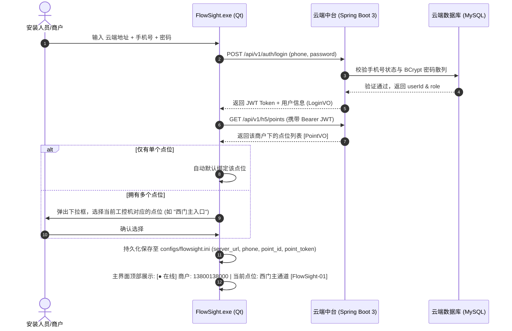
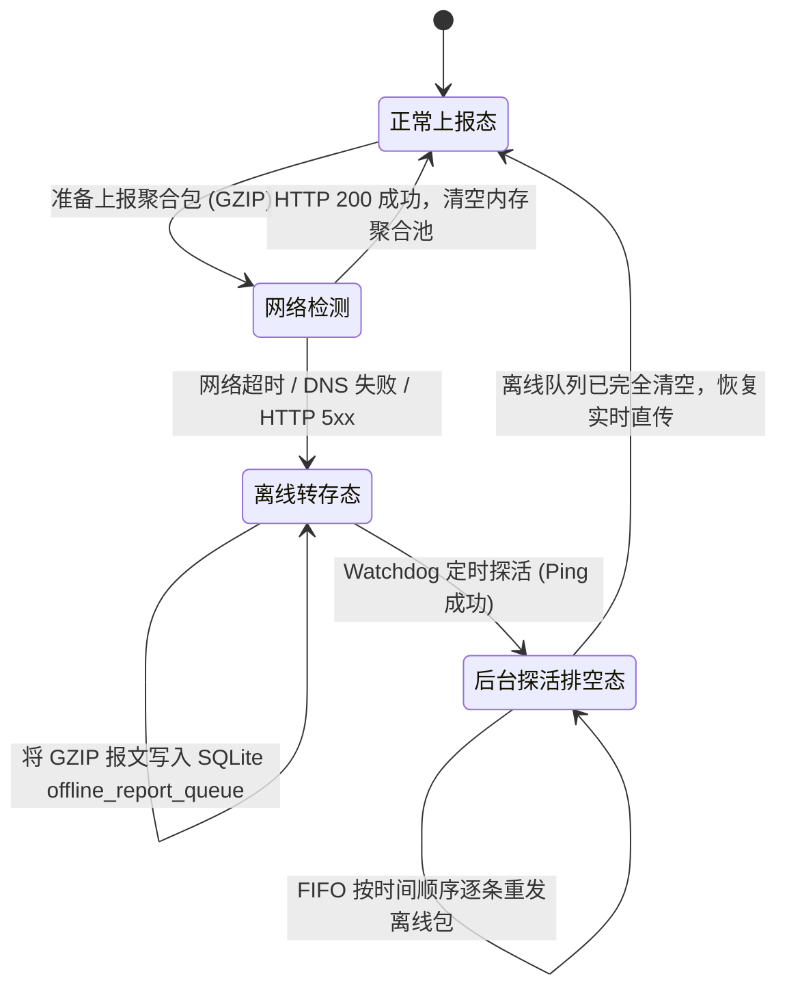

# FlowSight 端云协同全业务闭环设计方案：客户端登录、优化上报与 H5 决策大屏

> **文件编号**：`docs/08-FlowSight_端云协同全业务闭环设计方案_客户端登录上报与H5展示优化.md`  
> **适用版本**：FlowSight v1.2+ (Edge C++ 客户端 + Spring Boot 3 云端中台 + Vue 3 移动端 H5)  
> **更新时间**：2026-10-24  
> **状态**：正式归档 / 生产实施蓝图

---

## 一、系统全景与设计目标

本方案针对商户连锁门店、园区通道、智慧商业等场景，设计一套高可用、低带宽消耗、具备断网容灾能力的**端-云-端协同智能视觉与客流决策系统**。

```mermaid
flowchart TD
    subgraph 边缘现场 Edge (FlowSight.exe)
        CAM[摄像头 RTSP / 视频流] --> YOLO[AI 视觉分析引擎 (YOLO+ByteTrack)]
        YOLO --> Aggregator[时间窗口批量聚合器 (10~30s Window)]
        Aggregator --> GZIP[GZIP 压缩引擎 (压缩率 80%+)]
        GZIP --> Pusher[HTTP 智能上报器]
        Pusher -- "网络畅通 (HTTP 200)" --> CloudAPI[云端 API 网关]
        Pusher -- "网络故障 (超时/断网)" --> LocalQueue[(本地 SQLite 离线队列)]
        LocalQueue -. "网络恢复 FIFO 补传" .-> Pusher
    end

    subgraph 云端中台 Cloud SaaS (Spring Boot 3)
        CloudAPI --> GzipFilter[GZIP 自动解压过滤器]
        GzipFilter --> AuthSrv[统一认证中心 (手机号+密码)]
        GzipFilter --> IngestSrv[指标批量归档引擎 (幂等入库)]
        IngestSrv --> MySQL[(MySQL 8.0 业务与报表库)]
        IngestSrv --> MinIO[(MinIO 视频切片对象存储)]
        IngestSrv --> Redis[(Redis 状态与去重缓存)]
    end

    subgraph 移动决策端 Clients (Vue 3 H5)
        H5Login[统一登录 (手机号+密码)] --> H5Dash[移动端数据看板]
        H5Dash -- "拉取实时人数 & 24h报表" --> CloudAPI
        H5Dash -. "MinIO 预签名切片直链秒开 (播放互斥锁)" .-> MinIO
    end
```

### 核心设计目标
1. **统一账号身份模型**：所有终端（FlowSight.exe 客户端、手机 H5 看板、PC 管理端）均以**手机号 + 密码**作为统一身份鉴权凭证。
2. **边缘智能优化与流量节流**：坚决摒弃“单帧/单次检出即上报”的高频网络调用，采用**时间窗口聚合 + GZIP 二进制压缩传输**，报文体积降低 80% 以上。
3. **现场离线容灾（零数据丢失）**：网络断开、抖动或云端不可达时，自动转存本地 SQLite 离线队列表，网络恢复后按 FIFO 时间序断点补传。
4. **H5 移动端极致体验**：清晰呈现客户端名称、在线/离线健康状态、实时人数、24 小时报表、客群画像，并严格遵循“切片播放期间硬锁定禁止切换点位”的状态机互斥规范。

---

## 二、统一认证与登录设计（手机号 + 密码）

### 1. 统一认证机制设计

系统以**商户手机号码 (`phone`)** 作为全局唯一账户主体。一个手机号账户下可拥有并纳管多个采集点位（例如：A 门主入口、B 门通道、收银台等）。

| 终端类型 | 认证方式 | 交互体验与持久化策略 |
| :--- | :--- | :--- |
| **FlowSight.exe (客户端)** | 手机号 + 密码 | 现场安装或首次启动弹出登录框，输入手机号和密码后从云端拉取该账号绑定的点位列表，选择绑定本设备后生成持久化凭证，后续启动自动静默连接。 |
| **Mobile H5 (移动看板)** | 手机号 + 密码 | 老板/店长在手机浏览器或微信中打开，输入手机号和密码，颁发 JWT Token 并保存在 `localStorage`，直接进入多点位切换看板。 |
| **PC Admin (运营端)** | 手机号 + 密码 | 平台总管理员与大商户运营人员登录，进行租户资产配置与点位下发。 |

### 2. FlowSight.exe 客户端登录时序



---

## 三、客户端优化上报设计：批量聚合、GZIP 压缩与本地断网重传

### 1. 批量时间窗口聚合器 (Windowed Batch Aggregator)

为了避免频繁建立 TCP 连接和高并发打满网络，FlowSight.exe 内部设立**内存聚合池**：
- **聚合时间窗口（Window Size）**：默认 10 秒（可配置 5~60 秒）。
- **最大事件缓冲（Batch Capacity）**：默认 50 条。
- **触发上报条件**：`窗口定时器到期 OR 累积事件达到阈值`。

#### 聚合报文结构 (JSON Payload)
```json
{
  "clientName": "FlowSight-Node-01",
  "appVersion": "v1.2.0",
  "pointId": 1001,
  "batchUuid": "550e8400-e29b-41d4-a716-446655440000",
  "startTimeMs": 1729750000000,
  "endTimeMs": 1729750010000,
  "headcount": {
    "inIncrement": 8,
    "outIncrement": 3,
    "currentOccupancy": 15
  },
  "demographics": {
    "maleCount": 5,
    "femaleCount": 6,
    "childCount": 1,
    "adultCount": 9,
    "seniorCount": 1
  },
  "telemetry": {
    "fps": 24.8,
    "inferLatencyMs": 18.2,
    "cpuUsage": 14.5,
    "memoryUsageMb": 286,
    "cameraConnected": true,
    "pendingOfflineQueue": 0
  },
  "events": [
    {
      "trackId": 102,
      "direction": "ENTRY",
      "timestampMs": 1729750002100,
      "confidence": 0.91,
      "gender": "男",
      "ageGroup": "青年(18-35)",
      "clipPath": "clips/20261024_102.mp4"
    }
  ]
}
```

### 2. GZIP 二进制压缩传输管道

聚合后的 JSON 字符串使用 GZIP 压缩后传输，网络报文体积直降 75%~85%：
- **请求头声明**：
  ```http
  POST /api/v1/edge/metrics/batch HTTP/1.1
  Host: api.flowsight.com
  Content-Type: application/json
  Content-Encoding: gzip
  X-Point-Token: pt_8a9f2bc3d4e5f6...
  ```
- **云端 Spring Boot 透明解压机制**：
  通过注册全局 `GzipRequestFilter`，拦截携带 `Content-Encoding: gzip` 的请求并包装为 `GZIPInputStream`，业务 Controller 无需任何改动即可透明接收强类型 DTO。

### 3. 本地 SQLite 离线队列与断网容灾 (Offline Queue & Reliable Resend)

当现场网络出现宽带断开、Wi-Fi 中断、云端升级超时等情况时，必须保证**数据零丢失**。



#### 本地 SQLite 离线队列表结构
```sql
CREATE TABLE IF NOT EXISTS tb_offline_report_queue (
    queue_id INTEGER PRIMARY KEY AUTOINCREMENT,
    batch_uuid TEXT NOT NULL UNIQUE,       -- 批次防重唯一标识
    report_type TEXT NOT NULL,             -- 'METRICS_BATCH', 'HEARTBEAT'
    payload_blob BLOB NOT NULL,            -- GZIP 压缩后的报文二进制
    is_compressed INTEGER DEFAULT 1,       -- 1: GZIP 压缩, 0: 明文
    retry_count INTEGER DEFAULT 0,         -- 已重试次数
    next_retry_ts INTEGER NOT NULL,        -- 下次允许重试时间戳(毫秒)
    status INTEGER DEFAULT 0,              -- 0: 待发, 1: 发送中
    created_at INTEGER NOT NULL            -- 离线保存时的时间戳
);
CREATE INDEX IF NOT EXISTS idx_offline_status ON tb_offline_report_queue(status, next_retry_ts);
```

#### 指数退避与抖动重试机制 (Exponential Backoff with Jitter)
- 重试间隔时间公式：
  $$\text{Interval} = \min(60, 2^{\text{retry\_count}} \times 2) + \text{rand}(0, 3) \text{ 秒}$$
- 避免现场上千台设备在云端恢复的一瞬间同时并发重发造成流量雪崩。

---

## 四、前端 H5 移动决策看板设计（政务与物业高端美学与多维统计）

针对**政务监管领导**与**商业物业管理员**每日通过手机查账、巡检、决策的核心诉求，界面设计深度贯彻**GovTech（政务科技）与现代物业中台**的高保真美学标准，兼顾极简操作、沉浸视觉、安全告警与跨周期宏观趋势洞察。

### 1. 目标用户画像与视觉规范

| 维度 | 政务监管人员（街道/应急/商务局） | 物业与场馆设施管理员 |
| :--- | :--- | :--- |
| **核心关切** | 重点区域人流承载量、防聚集防拥挤踩踏安全底线、季度/节假日宏观演进规律、合规审计。 | 进出客流吞吐量、早晚高峰时段排班保洁配置、日均/月度客流趋势。 |
| **视觉基调** | **深邃政务蓝 (`#0f172a`)**，配合 **翡翠通行绿 (`#10b981`)**、**天际蓝 (`#2563eb`)** 与 **琥珀预警金 (`#f59e0b`)**。 |
| **交互质感** | 12px 圆角轻拟物卡片、呼吸发光状态指示灯、单手丝滑触控、ECharts 渐变光影渲染。 |

### 2. 界面模块全景规划

```text
+-------------------------------------------------------------+
| 👁️ FlowSight 智慧客流决策中心                [安全登出 ↩]     |
+-------------------------------------------------------------+
| 📍 [华东总店-西门入口通道 ▼]  [● 实时在线 (延迟18ms · 刚刚)] |
|    💻 客户端: FlowSight-Node-01 (v1.2.0)                     |
|    🔒 视频回放中锁定点位切换 (状态机信号量硬互斥)            |
+-------------------------------------------------------------+
| 🛡️ [安全状态] 当前区域人流承载与通行状态正常                 |
+-------------------------------------------------------------+
| [当前区域滞留]   [今日累计进入]   [今日累计离开]   [全天双向客流] |
|     15 人           148 人次         133 人次         281 人次  |
|   ● 实时在场        ↑ 进门增量       ↓ 离场离闸       ∑ 双向吞吐 |
+-------------------------------------------------------------+
| 📈 客流趋势全景分析与决策曲线                                 |
| [24小时逐时]   [近7天走势]   [近30天走势]   [季度宏观走势]     |
| 周期总客流: 1,842人次 | 峰值: 14:00 (148人) | 均值: 76.8人次   |
|   人次                                                       |
|   150|            * 峰值 14:00 (148)                         |
|   100|           / \                                         |
|    50|      /\  /   \    /\                                  |
|     0+-----/--\/-----\--/--\------------------------------   |
|        08:00  10:00  12:00  14:00  16:00  18:00  20:00  22:00|
|        ● 进入人次 (蓝色面积渐变)   ● 离开人次 (琥珀色平滑线)   |
+-------------------------------------------------------------+
| 👥 客群画像与结构特征                                         |
| 👨 男 54.2% (152人) [████████████░░░░░░░░░░] 👩 女 45.8% (129人)|
| 主要到场客群年龄: [ 青年 (18-35岁) ]  · 基于边缘 NPU 属性多目标分析 |
+-------------------------------------------------------------+
| 🎬 实时通行抓拍记录流水 (点击秒开 MinIO 预签名回放切片)       |
| - 14:02:15  [🟢 进] 目标 #102  男 / 青年       [回放切片 ▶]   |
| - 14:01:48  [🔴 出] 目标 #101  女 / 中年       [回放切片 ▶]   |
+-------------------------------------------------------------+
```

### 3. 多维度统计曲线模型 (按小时 / 按天 / 按季度)

系统在移动端依托 ECharts 5 落地四维分段平滑过渡渲染：
1. **【24小时逐时曲线】**：
   - 展现今日 00:00 ~ 23:00 逐时进出趋势；
   - 自动标定全天最高客流峰值时段（MarkPoint 高亮显示），辅助物业调整早高峰（08:00~09:30）与晚高峰（17:30~19:00）的保洁安保力量。
2. **【近7天 / 近30天逐日走势】**：
   - 双柱或平滑折线对比，揭示工作日与周末的通行节律；
   - 提供均值辅助线（MarkLine），便于政务与商户考核日常平均客流水位。
3. **【季度宏观走势 (Q1~Q4)】**：
   - 年度按季度聚合汇总总人流与日均客流，直观呈现淡旺季商业趋势，作为物业季度财报或政务安全评估的直观依据。

### 4. 状态机互斥锁定规范 (Mutual Exclusion Lock)

根据核心设计决策：**在视频切片弹窗打开或视频播放期间，点位下拉切换组件必须硬锁定**。
```typescript
// Pinia 核心状态互斥锁
export const usePointStore = defineStore('point', {
  state: () => ({
    activePointId: null as number | null,
    isMediaPlaying: false // 互斥信号量
  }),
  actions: {
    setMediaPlaying(status: boolean) {
      this.isMediaPlaying = status;
    },
    switchPoint(newPointId: number) {
      if (this.isMediaPlaying) {
        showToast({ message: '正在播放视频切片，请关闭窗口后再切换点位', icon: 'lock' });
        return false;
      }
      this.activePointId = newPointId;
      return true;
    }
  }
});
```

---

## 五、RESTful API 契约规范

### 1. 统一登录接口
- **URL**: `POST /api/v1/auth/login`
- **Request**:
  ```json
  {
    "phone": "13800138000",
    "password": "Password123"
  }
  ```
- **Response**:
  ```json
  {
    "code": 200,
    "message": "success",
    "data": {
      "token": "eyJhbGciOiJIUzI1NiIsInR5cCI6...",
      "userId": 101,
      "phone": "13800138000",
      "nickname": "旗舰店店长",
      "role": "ROLE_USER"
    }
  }
  ```

### 2. 边缘批量指标与事件聚合上报接口 (支持 GZIP)
- **URL**: `POST /api/v1/edge/metrics/batch`
- **Headers**:
  - `X-Point-Token`: `pt_xxxxxxxxxxxxxxxx`
  - `Content-Encoding`: `gzip` (可选，推荐)
  - `Content-Type`: `application/json`
- **Request Body**: (参考第三节的聚合报文 JSON)
- **Response**:
  ```json
  {
    "code": 200,
    "message": "batch ingest success",
    "data": {
      "ackUuid": "550e8400-e29b-41d4-a716-446655440000",
      "acceptedEvents": 1,
      "serverTime": "2026-10-24T14:02:15"
    }
  }
  ```

### 3. H5 移动决策大屏看板汇总接口
- **URL**: `GET /api/v1/h5/dashboard/summary?pointId=1001`
- **Headers**: `Authorization: Bearer <jwt_token>`
- **Response**:
  ```json
  {
    "code": 200,
    "message": "success",
    "data": {
      "pointId": 1001,
      "pointName": "华东总店-西门入口通道",
      "clientName": "FlowSight-Node-01",
      "appVersion": "v1.2.0",
      "streamStatus": "ONLINE",
      "lastHeartbeat": "2026-10-24 14:02:10",
      "currentOccupancy": 15,
      "todayEntry": 148,
      "todayExit": 133,
      "todayTotal": 281,
      "demographics": {
        "maleCount": 152,
        "femaleCount": 129,
        "maleRatio": 0.541,
        "femaleRatio": 0.459,
        "topAgeGroup": "青年(18-35)"
      },
      "hourlyChart": [
        { "hour": 8, "entry": 12, "exit": 2 },
        { "hour": 9, "entry": 35, "exit": 8 },
        { "hour": 14, "entry": 15, "exit": 14 }
      ]
    }
  }
  ```

---

## 六、实施落地检查清单

| 模块 | 实施步骤 | 验证手段 |
| :--- | :--- | :--- |
| **云端网关** | 增加 `GzipRequestFilter` 自动解压 HTTP Body | 通过 Postman 发送带有 `Content-Encoding: gzip` 的二进制压缩包，验证控制器无感解析。 |
| **云端业务** | 落地 `POST /api/v1/edge/metrics/batch` 批量归档服务 | 验证 `batchUuid` 幂等防重机制与 `stats_hourly` 增量原子更新。 |
| **移动端 H5** | 统一手机号+密码登录，完善客户端名称展示与切片播放互斥锁 | 在 H5 播放视频切片时尝试切换点位，验证下拉组件自动 Disabled 提示。 |
| **客户端 Exe** | 实现 `Aggregator` 内存窗口聚合 + `qCompress` GZIP 编码 | 抓包对比原报文与压缩后报文，确认体积骤降且上报频率可控。 |
| **客户端 Exe** | 实现 SQLite 离线队列与断网自动探测补发 | 拔掉客户端网线，触发通行产生事件，插上网线，观察自动排空与补报。 |
