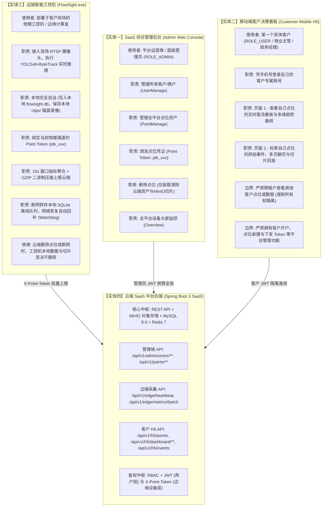
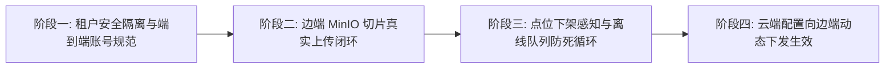

# FlowSight 边云协同智能客流 SaaS 平台
## 架构全景图、实体职责边界与当前混沌问题排查纠偏清单

---

## 一、 平台定位与商业业务本质

### 1.1 平台本质
**FlowSight 不是单机工控机软件，也不是普通的移动端网页，而是一套标准的 B2B 多租户边云协同智能视觉分析 SaaS 平台（Multi-Tenant Edge-Cloud Vision Platform）。**

- **云端（SaaS Central Platform）**：服务于全平台的**多租户客户**，集中提供点位资产管理、客流大数据治理、跨时间维度指标聚合计算、短视频切片对象存储（MinIO）以及向移动端的授权分发。
- **边端（Edge Computing Nodes - FlowSight.exe）**：部署在各个客户的**具体物理场所现场**（如商业综合体大门、写字楼闸机、政务大厅入口、智慧社区单元门）的工控机或边缘计算盒。现场接入本地网络摄像机，执行 YOLOv8 + ByteTrack 实时检测跟踪，本地 SQLite 自治存储，并将聚合指标与短视频切片安全脱敏上报至云端。
- **管理后台（Admin Web Console）**：供**平台运营商/超级管理员**使用，统一开通客户、管理客户、配置点位资产、下发点位 Token 及全平台运行监控。
- **客户手机端（Customer Mobile H5）**：供**具体某一个签约客户（如某物业经理、某政务主管）**使用，手机号登录后，**严格且只能**查阅属于该客户名下的点位运行状态、客流大数据报表及事件视频切片证据。

---

## 二、 核心实体职责与权限边界定义 (Do's & Don'ts)

整个 FlowSight 体系严格划分为 **四个核心软件实体**，每个实体必须恪守自身权责，严禁越权操作：

### 各实体权责与严禁行为对比表：

| 实体名称 | 主体身份 | 允许的核心职责 (Do's) | 严禁的越权行为 (Don'ts) |
| :--- | :--- | :--- | :--- |
| **SaaS 管理后台** `solution/apps/admin` | 平台运营商 超级管理员 (`ROLE_ADMIN`) | • 开通/停用客户账号（手机号/商户名） • 为客户新建监控点位，下发 `Point Token` • 配置点位 RTSP 流地址与分辨率 • 删除点位（级联清理云端数据库与 MinIO 切片） • 监控全平台所有边缘工控机运行健康状态 | • 严禁直接修改客户现场物理工控机的本地私有配置 • 严禁直接越权抹除现场工控机的本地 SQLite 数据库与磁盘视频文件 |
| **客户移动端 H5** `solution/apps/h5` | 某单一客户 物业/政务负责人 (`ROLE_USER`) | • 输入手机号+密码登录查阅自己名下的业务结果 • 切换查阅自己名下的通道点位状态（是否在线、场内人数） • 查看客流宏观趋势（24小时/7天/30天/季度曲线） • 多条件检索自己点位的通行切片，支持分页与切片视频播放 | • **严禁**跨租户访问其他客户的点位数据 • **严禁**包含开通客户、生成 Token、删除点位等管理功能 • **严禁**在云端删除点位后依然能缓存访问该点位 |
| **边端工控机** `FlowSight.exe` | 现场物理工控机 AI 视频计算盒 | • 现场 30fps 实时视频推理与目标轨迹跟踪 • 通行事件本地 SQLite 持久化与本地 MP4 录像切片存储 • 现场运维人员输入客户手机号拉取该客户点位一键绑定，或直接填入 `Point Token` • 10 秒时间窗口聚合客流与健康遥测，GZIP 压缩批量上报 • 断网离线队列持久化容灾与网络恢复自愈回传 | • **严禁**充当管理中枢（不参与用户租户管理） • **严禁**因云端下架点位或断网而清空本地历史数据与磁盘切片 • **严禁**逐帧未经聚合压缩直接向云端高频推数据 |
| **云端 SaaS 中台** `solution/backend` | 云端服务集群 Spring Boot 3 | • 双轨安全鉴权（用户端 JWT + 边缘端 `X-Point-Token`） • 边缘数据高效解压与预聚合归档（MySQL 8.0） • MinIO 预签名播放直链生成与切片生命周期管理 • 强多租户数据所有权校验与越权防御（`checkPointOwnership`） | • **严禁**允许未授权的租户跨用户拉取点位流水与统计图表 • **严禁**在删除云端点位时向边端工控机下发清空本地数据的破坏性指令 |

---

## 三、 当前项目存在的“混沌点与功能错位”全景排查

经过通盘代码与架构排查，当前项目存在 **六大关键混沌点与断裂带**，后续需依序进行系统性矫正：

### 混沌点 1：移动端 H5 的角色定位与所有权校验混淆（已初步纠正，需彻底加固）
- **现象与根因**：
  此前测试时误用平台超管账号（`13800000000`）登录 H5，甚至修改后端让超管在 H5 查看到全平台所有商户的点位。
- **业务危害**：
  破坏了多租户 SaaS 的核心隔离基线。客户端（H5）是供单一客户使用的。如果多个客户同时使用，必须实现严格的数据沙箱隔离。
- **现状与矫正**：
  已在 [`H5DashboardController.java`](file:///E:/FlowSight/solution/backend/src/main/java/com/flowsight/cloud/controller/H5DashboardController.java) 中植入 `checkPointOwnership`，若当前点位不属于当前登录客户，直接拦截。但前端登录交互界面与种子商户数据仍需标准化示范（如预置两个独立商户账号供演示对比隔离效果）。

---

### 混沌点 2：MinIO 视频切片上传管道在边端实际处于“断裂未调用”状态（重大功能盲区）
- **现象与根因**：
  - 云端中台虽然定义了 `POST /api/v1/edge/clip/upload` 接口，并且具备将切片转存 MinIO 并生成预签名直链的能力；
  - 但是边端 `FlowSight.exe` 客户端在生成本地短视频切片（`clips/clip_12.mp4`）后，**仅仅在指标聚合 JSON 中带上了本地路径字符串 `ev.clip_path`，从未真正发起 HTTP Multipart 请求将 MP4 视频二进制文件上传到云端 `/api/v1/edge/clip/upload`！**
- **业务后果**：
  导致云端数据库 `biz_passage_event.clip_url` 字段始终为空，客户在 H5 移动端点击“播放切片”时，前端因无有效 MinIO 直链而无法真正播放录像视频！
- **矫正方案**：
  在边端 `EdgeReportManager` 中新增短视频切片异步上传工作线程池，当产生有效通行切片时，自动在后台以分块/异步 POST 方式将本地 MP4 文件上传至 `/api/v1/edge/clip/upload`，获取并绑定云端 MinIO URL。

---

### 混沌点 3：云端配置下发与边端工控机视频流未形成闭环
- **现象与根因**：
  - 在 SaaS 管理后台（`PointManage.vue`）中，管理员为点位配置了摄像头 RTSP 流地址（`camera_rtsp`）和分辨率；
  - 云端中台也提供了 `GET /api/v1/edge/config` 接口供边端拉取配置；
  - 但边端 `FlowSight.exe` 客户端启动或绑定后，**从未调用过 `/edge/config`，依然只读本地的 `configs/flowsight.ini` 中的固定路径**！
- **业务后果**：
  管理员在云端修改了摄像机 RTSP 地址或点位参数，现场工控机完全感知不到，依然跑旧的本地视频源，造成配置断层。
- **矫正方案**：
  工控机绑定点位成功后，立即异步调用 `GET /api/v1/edge/config` 拉取该点位云端 RTSP 地址，若云端配置了非空 RTSP 流且与本地不同，提示或自动平滑切换到该 RTSP 流。

---

### 混沌点 4：点位被云端删除后，工控机离线重试队列存在“死循环积压”风险
- **现象与根因**：
  - 用户核心需求：**管理后台删除点位时，云端数据必须清空（手机端再也看不到），但工控机本地数据坚决不删**。
  - 目前云端 `deletePointCascadeCloud` 彻底删除了云端 `biz_point` 记录；
  - 此时工控机如果继续使用该点位的 Token 发送心跳或批量数据，云端会返回 `HTTP 400 (未授权: 无效的 Point Token)`；
  - 工控机目前的 `EdgeReportManager` 逻辑是：只要不是 HTTP 200，就判定为网络失败，**把数据写入本地 SQLite 离线队列，并启动定时器无限次重试排空**！
- **业务后果**：
  因为云端点位已永久不存在，工控机重试 10000 次也不会成功，导致工控机本地 SQLite 离线队列表无限制膨胀膨胀，占用磁盘并消耗 CPU。
- **矫正方案**：
  边端工控机需识别响应语义：
  - 若为网络断开/超时/5xx 服务端异常：保存至离线队列，等待重试；
  - 若为 `HTTP 400/401`（明确指示 Token 已被云端注销/下架）：工控机**停止向该点位队列追加数据**，界面状态芯片显示为 `⚠️ 点位已下架停用`，停止无谓重传，但**保留本地已有数据库与切片不变**。

---

### 混沌点 5：租户客户（SysUser）实体商业元数据过于单薄
- **现象与根因**：
  - 当前数据库 `sys_user` 仅有 `id`, `phone`, `password_hash`, `role`, `nickname` 五个基础字段；
  - “商户/租户名称”、“客户企业全称”、“客户联系人”、“客户类型（物业/商超/政务）”、“授权到期时间”、“允许开通点位配额”等商业 SaaS 必需的租户属性完全缺失。
- **业务后果**：
  管理后台无法有效管理客户的合同期、点位配额以及公司单位名称，容易将个人账号与企业租户混同。
- **矫正方案**：
  在 `sys_user` 中扩展租户属性字段（或拆分出独立的 `sys_tenant` 租户实体与 `tenant_id` 外键）。

---

### 混沌点 6：开发环境热重启与编译 Class 脱节导致的“认知幽灵”
- **现象与根因**：
  后端通过 IntelliJ IDEA 启动了后台 Java 进程，但我们在控制台通过 `mvn compile` 编译更新了代码之后，IDEA 如果没有配置自动热部署（Spring DevTools）或未重新触发 Run，正在运行的 JVM 依然加载旧代码的字节码。
- **后果**：
  导致代码明明修复了（例如 `@RequestParam(required = false)`），但请求依然报旧类的错误，极易引发开发者判断失误。
- **矫正方案**：
  明确本地联调操作规范：每次后端有代码变更且需验证时，在 IDEA 中明确执行一次 `Shift + F10`（重启服务），或者在命令行由统一的脚本托管启动。

---

## 四、 后续逐项矫正路线图 (Rectification Roadmap)

| 阶段 | 矫正目标 | 具体任务与交付物 | 涉及实体与文件 |
| :---: | :--- | :--- | :--- |
| **阶段一** | **多租户数据与账号彻底规范化** | 1. 种子数据初始化 2 个不同商户账号（如万科物业 `13454118762` 与政务客户 `13900000002`），各自分配独立点位。 2. 验证分别在 H5 登录两个账号，确认各自主界面与切片列表 100% 独立隔离，互不可见。 3. 验证管理后台（Admin Web）可统管上述全部商户与点位。 | • `schema.sql` • `H5DashboardController.java` • `PointServiceImpl.java` |
| **阶段二** | **MinIO 短视频切片真实上传闭环** | 1. 在 `FlowSight.exe` 的 `EdgeReportManager` 中实现短视频切片异步上传队列。 2. 本地录像切片生成后，异步 POST 到云端 `/api/v1/edge/clip/upload`。 3. 云端转存 MinIO 并将有效 URL 回写至 `biz_passage_event.clip_url`。 4. 在 H5 端点击卡片，真实秒开回放 MinIO 存储的高清 MP4 切片。 | • `EdgeReportManager.cpp` • `EventServiceImpl.java` • `Playback.vue` |
| **阶段三** | **点位下架智能感知与防死循环排空** | 1. 云端管理后台执行“删除点位”后，云端数据与 MinIO 清空，H5 手机端即刻不可见。 2. 边端 `EdgeReportManager` 接收到 Token 失效响应时，阻断离线队列无谓重试，标记点位已下架，保护本地工控机性能与磁盘。 3. 边端本地 SQLite 与 clips 录像保持 100% 自治完好。 | • `EdgeReportManager.cpp` • `PointManage.vue` • `PointServiceImpl.java` |
| **阶段四** | **云端配置下发与现场自适应联动** | 1. 边端绑定点位后自动拉取 `/api/v1/edge/config`。 2. 云端修改 RTSP 流地址后，工控机可提示并一键热重载视频源。 3. 完善 `sys_user` 租户企业名称与点位配额商业字段。 | • `EdgeReportManager.cpp` • `PipelineController.cpp` • `UserManage.vue` |

---

> **结语**：本架构审计文档已永久归档至项目文档目录 [`docs/09-FlowSight_端云协同架构全景图_实体职责边界与混沌问题排查纠偏清单.md`](file:///E:/FlowSight/docs/09-FlowSight_端云协同架构全景图_实体职责边界与混沌问题排查纠偏清单.md)，作为后续系统功能矫正的最高基线规范。
