# FlowSight 边云协同多租户认证与端云双向身份绑定机制白皮书

---

## 1. 核心问题与设计原则

在商业级物联网（IoT）与 AI 视觉边云协同系统中，面临一个经典架构设计问题：

> **“现在边缘也需要用户认证防止非法上传，H5 客户端也需要用户验证。这两个验证需要用同一套用户名和密码吗？如果不用同一套，边缘和 H5 客户端是如何对应起来的？”**

### 1.1 结论先行
1. **绝对不需要，而且工业界严格禁止边缘设备长期保存商户的用户名和密码！**
2. **边缘与 H5 客户端的对应关系，是通过「商户主体（人）- 监控点位（资产/桥梁）- 边缘设备凭证（物）」的三层映射机制完成解耦与绑定的。**

---

## 2. 为什么边缘端不能长期保存商户账号密码？

| 风险维度 | 若使用同一套账号密码（反面设计） | 工业标准：设备唯一凭证 Token（FlowSight 设计） |
| :--- | :--- | :--- |
| **物理环境安全性** | 边缘 IPC 摄像头或工控机通常部署在门店、商超天花板或现场弱电箱，属于**半公开不受信环境**。若配置文件明文记录手机号和密码，任何接触硬件的人（施工队、外包运维、硬件失窃）均可窃取主账号密码，登录云端控制台窃取商户全部商业数据。 | 边缘端仅保存该点位专属的 `PointToken`（如 `ptk_c7c51284...`）。即使设备被物理拆解，攻击者也只能拿到单个点位的上传凭证，无法逆向破解商户账号，且云端随时可一键吊销该 Token。 |
| **密码轮换与可用性** | 边缘是 **7×24 小时开机自启、无人值守** 的系统。当商户负责人（如万科物业刘经理）在手机端修改密码后，所有边缘设备因保存旧密码而集体鉴权失败，导致全量设备瞬间断网瘫痪。 | **人与设备生命周期解耦**。商户在 H5 端如何修改密码，边缘设备的采集和上报永不中断；无需人工跑到每个摄像机现场重新配置。 |
| **权限最小化原则 (PoLP)** | 赋予了边缘端超出其职责的过大权限（如查看财务报表、删除客户、重置系统等）。 | 边缘设备被严格限制为**“单向数据生产者”**，仅具备特定通道的事件上报、批量指标归档与心跳回传权限。 |

---

## 3. 架构总览：端云双向身份绑定模型

```mermaid
flowchart TD
    subgraph S1 ["阶段一：现场实施与身份绑定 (人赋予物身份)"]
        A["实施人员/商户在边缘端界面输入<br/>手机号: 13454118762 & 密码"] --> B["调用云端 POST /api/v1/auth/login<br/>获取临时管理会话 JWT"]
        B --> C["调用 GET /api/v1/h5/points<br/>获取该商户名下已开通的点位列表"]
        C --> D["界面下拉选择：[1] 万科西区东门主入口<br/>点击『确认绑定此点位』"]
        D --> E["提取点位专属凭证 PointToken<br/>持久化至 configs/flowsight.ini<br/><b>立即销毁内存中的手机号密码</b>"]
    end

    subgraph S2 ["阶段二：7x24小时无人值守运行时 (物向云生产数据)"]
        F["边缘 AI 推理检测 (YOLOv8 + ByteTrack)"] --> G["组装批量客流上报数据 / 视频切片"]
        G --> H["携带 Header <b>X-Point-Token: ptk_c7c51284...</b><br/>POST /api/v1/edge/metrics/batch"]
        H --> I["Spring Boot 网关解析 Token 命中点位资产<br/>point_id = 1, 所属 user_id = 2"]
        I --> J["事件表/小时统计表自动绑定 user_id = 2 落库"]
    end

    subgraph S3 ["阶段三：H5 移动端查看与多租户隔离 (人向云消费数据)"]
        K["商户在手机端输入 13454118762 & 密码登录"] --> L["云端颁发带有 claims: {userId: 2} 的 JWT"]
        L --> M["H5 轮询看板: GET /api/v1/h5/dashboard/summary?pointId=1"]
        M --> N["JwtInterceptor 校验拦截: request.userId == 2<br/>checkPointOwnership 校验: point.userId == 2"]
        N --> O["返回该商户名下该点位的实时客流看板数据"]
    end
```



---

## 4. 数据库层级映射设计

数据库中通过 `sys_user` 与 `biz_point` 建立清晰的 1:N 关系，使边缘数据与商户身份天然打通：

```sql
-- 1. 商户租户表 (人)
CREATE TABLE `sys_user` (
    `id` BIGINT NOT NULL AUTO_INCREMENT PRIMARY KEY,
    `phone` VARCHAR(20) NOT NULL UNIQUE,       -- 13454118762
    `password_hash` VARCHAR(128) NOT NULL,    -- BCrypt 加密密码
    `company_name` VARCHAR(128) NOT NULL      -- 万科物业
);

-- 2. 点位资产表 (桥梁)
CREATE TABLE `biz_point` (
    `id` BIGINT NOT NULL AUTO_INCREMENT PRIMARY KEY, -- point_id = 1
    `user_id` BIGINT NOT NULL,                       -- 关联商户 user_id = 2
    `point_name` VARCHAR(100) NOT NULL,              -- 万科西区东门主入口
    `point_token` VARCHAR(64) NOT NULL UNIQUE,       -- ptk_c7c51284a35c43f5a5292927b9baea07 (边缘专属凭证)
    KEY `idx_user_id` (`user_id`),
    KEY `idx_token` (`point_token`)
);

-- 3. 客流事件明细表 (数据)
CREATE TABLE `biz_passage_event` (
    `id` BIGINT NOT NULL AUTO_INCREMENT PRIMARY KEY,
    `point_id` BIGINT NOT NULL,                      -- 1
    `user_id` BIGINT NOT NULL,                       -- 2 (由云端根据 Token 自动注入，保证租户严格隔离)
    `track_id` INT NOT NULL,
    `direction` VARCHAR(10) NOT NULL,
    `timestamp_ms` BIGINT NOT NULL
);
```

---

## 5. FlowSight 代码实现全景剖析

### 5.1 边缘端登录与绑定流程 (`src/network/EdgeReportManager.cpp`)
在实施阶段，边缘端仅在绑定时做一次性交互：
```cpp
// 1. 输入手机号密码登录，获取名下点位
void EdgeReportManager::login_with_credentials(const QString& base_url, const QString& phone, const QString& password, LoginCallback callback) {
    // POST /api/v1/auth/login -> 获取临时 Token
    // GET /api/v1/h5/points -> 获取商户已开通点位列表
}

// 2. 选择点位后持久化 PointToken，销毁密码
void EdgeReportManager::bind_point(const QString& base_url, qint64 point_id, const QString& point_name, const QString& point_token, const QString& client_name) {
    bound_point_id_ = point_id;
    bound_point_token_ = point_token; // 核心凭证
    
    // 保存至 ini 文件（不保存密码！）
    ConfigManager::instance().set_cloud_point_token(bound_point_token_);
    ConfigManager::instance().save();
}
```

### 5.2 边缘端无人值守上报 (`src/network/EdgeReportManager.cpp`)
所有上报请求均自动附带 `X-Point-Token` 请求头：
```cpp
request.setRawHeader("X-Point-Token", bound_point_token_.toUtf8());
// 上报批量指标 POST /api/v1/edge/metrics/batch
// 上报视频切片 POST /api/v1/edge/clip/upload
// 上报节点心跳 POST /api/v1/edge/heartbeat
```

### 5.3 云端网关鉴权与租户归属 (`EdgeIngestController.java`)
云端拦截器根据 `X-Point-Token` 提取关联租户信息，写入业务表：
```java
private BizPoint authenticateEdge(String token) {
    if (token == null || token.trim().isEmpty()) {
        throw new IllegalArgumentException("未授权: 缺少 X-Point-Token 请求头");
    }
    BizPoint point = pointService.getPointByToken(token);
    if (point == null) {
        throw new IllegalArgumentException("未授权: 无效的 Point Token");
    }
    return point; // 包含 point.getId() 与 point.getUserId()
}

@PostMapping("/metrics/batch")
public Result<String> ingestBatchMetrics(@RequestHeader("X-Point-Token") String token,
                                         @RequestBody EdgeBatchReportDTO dto) {
    BizPoint point = authenticateEdge(token);
    // 强制打入该点位所属的商户 user_id
    eventService.recordEdgeBatchReport(point.getId(), dto); 
    return Result.success("归档成功", dto.getBatchUuid());
}
```

### 5.4 H5 移动端查看与多租户安全拦截 (`H5DashboardController.java`)
H5 端使用商户手机号登录，云端严格校验租户边界：
```java
private void checkPointOwnership(Long pointId, HttpServletRequest request) {
    Long userId = (Long) request.getAttribute("userId"); // 从 JWT claims 提取
    PointVO point = pointService.getPointById(pointId);
    if (point == null || !userId.equals(point.getUserId())) {
        throw new IllegalArgumentException("无权查看该监控点位：该点位不属于当前商户客户！");
    }
}
```

---

## 6. 常见工业场景绑定衍生模式对比

| 绑定模式 | 交互体验 | 适用设备形态 | FlowSight 现状 |
| :--- | :--- | :--- | :--- |
| **模式 A：实施界面一键登录绑定 (Credentials-Exchange-Token)** | 现场施工人员在工控机界面输入商户账号密码，拉取并选择点位。 | 具备显示屏/键鼠交互的工控机、IPC 客户端、NVR 主机。 | **FlowSight 目前内建的成熟模式**（见 `SettingsWidget.cpp`）。 |
| **模式 B：移动端扫码/配对码激活 (QR-Code Pairing)** | 设备出厂生成唯一 SN/激活码；商户在手机 H5/App 点击“扫码添加设备”，云端后台自动绑定。 | 无屏嵌入式 IPC、AI 边缘盒子（如 RK3588/RV1126）。 | 系统架构已完备支持，只需在 C++ 端生成带 SN 的二维码并在云端提供配对 API 即可直接升级。 |
| **模式 C：云端后台预置分配 (Pre-provisioned Token)** | 平台管理员在云端控制台创建点位并生成 `PointToken`，施工人员直接将 Token 写入配置。 | 大型政企专网项目、批量静默安装部署。 | 当前直接支持，通过在 `flowsight.ini` 写入 `PointToken` 即可生效。 |

---

## 7. 架构总结

1. **角色解耦**：
   - **H5 客户端**：面向“人”，采用 **手机号 + 密码 / 短信验证码 + 短周期 JWT** 鉴权；
   - **边缘采集端**：面向“设备”，采用 **点位专属长效加密凭证（Point Token）** 鉴权。
2. **安全隔离**：
   - 边缘端不持有商户密码，无物理泄漏后门；
   - 商户修改登录密码不会导致现场采集节点断线；
   - 云端通过 `biz_point` 资产关系在底层实现数据 100% 自动归属与严密的多租户隔离。
