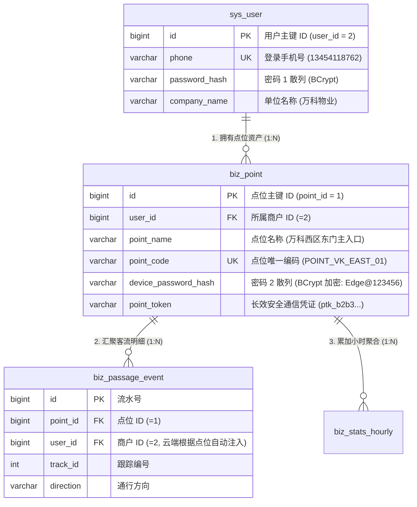
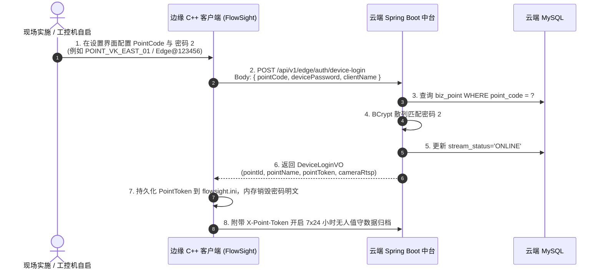
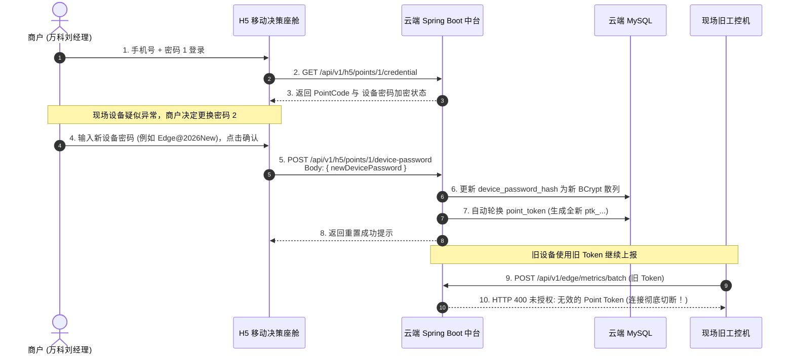

# FlowSight 双密码体系设计与端云交互关联规范

---

## 1. 体系概述与设计目标

在商业级物联网（IoT）与 AI 视觉边云协同系统中，商户账号安全与现场设备安全存在天然的冲突：
- **商户主账号** 面向人，具备查看全店客流报表、修改商户财务与账号信息的全量权限；
- **边缘计算节点** 部署在现场弱电箱或门店天花板，属于半公开不受信的物理环境，仅需向指定点位上报人流数据。

为实现人机解耦与安全防线隔离，FlowSight 建立**「双密码体系（Dual-Credential Architecture）」**：
1. **密码 1：商户用户主密码（人）** —— 用于 H5 移动决策座舱与云端管理后台登录；
2. **密码 2：边缘专属设备接入密码（物）** —— 用于边缘 C++ 客户端 / 工控机身份接入与通信授权。

---

## 2. 两套密码的精准定位与对比

| 核心维度 | 密码 1：商户用户主密码（人） | 密码 2：边缘专属设备接入密码（物） |
| :--- | :--- | :--- |
| **主体对象** | 自然人（商户老板、店长、运营主管） | 物理硬件设备（边缘工控机、IPC 摄像机、RK3588 盒子） |
| **认证凭证** | **手机号 + 用户密码** （例如：`13454118762` / `13454118762`） | **点位唯一编码 (PointCode) + 设备接入密码 (DevicePassword)** （例如：`POINT_VK_EAST_01` / `Edge@123456`） |
| **认证接口** | `POST /api/v1/auth/login` | `POST /api/v1/edge/auth/device-login` |
| **下发凭证** | 用户会话 JWT（携带 `userId=2`，短周期，72小时） | 物理点位长效对接凭证 `PointToken`（如 `ptk_b2b307f...`） |
| **使用端** | H5 移动决策看板、PC Web 管理平台 | 边缘 C++ 客户端 (`FlowSight.exe`)、无人值守系统服务 |
| **权限范围** | **全权管理权限**： • 查看商户全店客流指标、走势、明细与证据切片 • 查看、重置名下所有点位的边缘设备专属接入密码（密码 2） | **最小写入权限 (PoLP Write-Only)**： • 仅限向所属点位提交批量聚合指标、事件明细、心跳与视频切片 • **严禁**登录商户后台，**严禁**跨点位读取任何数据 |
| **存储介质** | 云端数据库 `sys_user.password_hash` (BCrypt 散列) | 云端 `biz_point.device_password_hash` (BCrypt)； 边缘端 `configs/flowsight.ini` 中的 `[Cloud]` 段 |
| **轮换策略** | 商户自主更换、短信验证码修改 | 长效稳定；商户可在 H5 移动端**一键远程重置**，立即吊销失窃或废弃设备的上传权限 |

---

## 3. 关联模型（怎么关联？）

两套密码在认证上完全解耦，但在云端通过**「商户主体 (Tenant) ─ 监控点位 (Point Asset) ─ 边缘设备 (Device)」**在数据库中建立 1:N:1 的关系纽带：

### 关联链路闭环：
1. **密码 1 掌控密码 2 的生命周期**：商户登录 H5 后，持有 `userId = 2` 的身份令牌，有权调用 `/api/v1/h5/points/1/credential` 查看及重置该点位的密码 2；
2. **密码 2 向云端证明设备的物理归属**：边缘端以 `POINT_VK_EAST_01` + `Edge@123456`（密码 2）发起认证，云端核验成功后映射为 `point_id = 1`，并关联到 `user_id = 2`；
3. **数据落库自动标记租户**：边缘端通过 `X-Point-Token` 上报的所有事件和统计数据，云端在写入数据库时自动强制打上 `user_id = 2` 的标签；
4. **移动端查看租户级隔离**：商户在 H5 端只能查询属于自己 `user_id` 的点位数据，彻底杜绝多租户越权。

---

## 4. 全生命周期端云交互流程（怎么交互？）

### 4.1 场景一：边缘端设备身份接入认证 (Device Authentication)

### 4.2 场景二：商户在移动端查看与远程重置设备密码 (Lifecycle Management)

---

## 5. 核心代码改造点实证

### 5.1 云端数据表 (`solution/backend/src/main/resources/schema.sql`)
- 表 `biz_point` 增加字段 `device_password_hash VARCHAR(128) NOT NULL DEFAULT ''`；
- 预置万科西区东门点位初始设备接入密码：`Edge@123456`。

### 5.2 云端控制器与业务实现
- **`EdgeIngestController.java`**：
  新增端点 `POST /api/v1/edge/auth/device-login`，实现边缘端免 JWT、纯专属密码鉴权；
- **`H5DashboardController.java`**：
  新增端点 `GET /api/v1/h5/points/{pointId}/credential` 与 `POST /api/v1/h5/points/{pointId}/device-password`，商户凭密码 1 拥有重置密码 2 的权限；
- **`PointServiceImpl.java`**：
  集成 Spring Security `BCryptPasswordEncoder`，实现双向校验、自动明文升级至 BCrypt 散列以及 Token 轮换联动。

### 5.3 边缘 C++ 客户端
- **`ConfigManager.hpp / .cpp`**：
  增加 `PointCode` 与 `DevicePassword` 持久化读写字段；
- **`EdgeReportManager.hpp / .cpp`**：
  实现 `login_with_device_credentials(base_url, point_code, device_password, client_name, callback)`；
- **`SettingsWidget.hpp / .cpp`**：
  将“🛡️ 边缘专属设备接入认证（密码 2）”设为核心主控行，支持一键认证并自动激活热重载 RTSP 摄像头流。

### 5.4 H5 移动决策端 (`solution/apps/h5`)
- **`api/index.ts`**：
  封装 `getPointCredential` 与 `resetDevicePassword` 接口；
- **`views/Settings.vue`**：
  新增专属设置卡片“🛡️ 边缘专属设备密码（密码 2）”，清晰展示点位编码与状态，支持商户一键远程重置。
