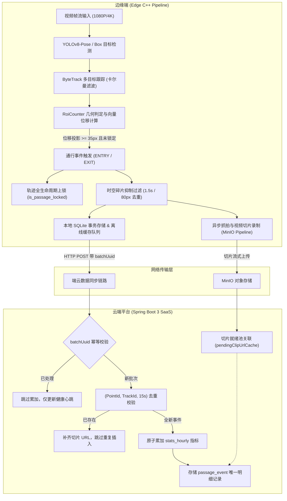

# FlowSight 商业级进出双向判定与端云全链路去重保障规范

> **文档版本**: v1.0.0  
> **发布日期**: 2026-10-26  
> **适用范围**: FlowSight 边缘 AI 计算节点 (C++ 20 / ONNX Runtime / ByteTrack) 与 FlowSight Cloud SaaS 云端平台 (Spring Boot 3 / MyBatis-Plus / MinIO / Vue 3)  
> **核心目标**: 彻底杜绝进出方向错乱颠倒、杜绝同人多报重报、实现商业级端云一体化精准客流统计与证据闭环。

---

## 1. 行业痛点与商用级设计准则

在智能客流统计、商业地产数字化与智慧安防场景中，视觉客流分析系统的商用落地常常受到两大核心顽疾的困扰：
1. **方向误判与倒灌**：行人在检测区域内轻微晃动、折返、并排遮挡或由于摄像头俯仰角引起的脚点抖动，导致“出去的人被算作进入”或“进入的人被算作出去”。
2. **重复计数与数据胀库**：
   - 目标在边界处徘徊，计数器被反复触发；
   - 遮挡导致跟踪器 ID 频繁跳变（ID Switch），同一个人被拆分成 2~3 个新 ID 重复计入；
   - 边缘端弱网重试或离线缓存恢复上传时，批次重复发送导致云端小时表指标翻倍、明细表产生大量重复记录。

针对上述商用落地核心瓶颈，FlowSight 构建了**端云全链路精准保障规范**，确立三大绝对准则：
- **方向判定零容忍倒置**：严格基于宏观几何向量投影判定，彻底废除亚像素级穿线误判逻辑；
- **单目标全生命周期锁**：同一人在同一个 ROI 检测区内，其生存周期内**有且仅能触发一次通行**；
- **端云幂等与毫秒级时空去重**：边缘端提供时空碎片抑制，云端提供批次 UUID 幂等校验与同 Track 双向去重。



---

## 2. 边缘算法层：宏观法向位移判定模型

### 2.1 历史缺陷溯源与根因剖析
在早期算法实现中，进出方向的判定混合了两个逻辑分支：
$$\text{判定条件} = \text{forward\_displacement} \lor \text{forward\_crossing}$$
其中穿线判定采用中心垂线穿过检测：
$$\text{forward\_crossing}: \text{side} \ge -1.5\text{px}$$
- **问题根源 1**：在 1080P/4K 工业摄像头画质下，$\pm 1.5\text{px}$ 仅相当于鞋面边缘检测框检测抖动的亚像素误差。当行人在反向行走时，如果步态抬腿导致边界框底部轻微晃动 $> 1.5\text{px}$，系统会提前命中 `forward_crossing`，强制将其判为 `ENTRY`，产生反向误判。
- **问题根源 2**：`outside_counter >= 45` 帧重置状态。如果行人在区域边缘停留超过 1.5 秒（45 帧），`passage_triggered` 标志被清除，导致该目标离开时再次触发一次退出，造成“一人进出两次计数”。

### 2.2 宏观法向位移判定数学模型
重构后的 `RoiCounter.cpp` 严格执行**宏观几何位移向量投影法**：

1. **方向法向量定义**：  
   用户在前端 UI 设定的通行箭头具有角度 $\theta$（顺时针极坐标）：
   $$\vec{N} = \begin{pmatrix} \cos\theta \\ \sin\theta \end{pmatrix}$$
   当勾选“反向模式”（`invert_direction = true`）时，取反向向量：$\vec{N}' = -\vec{N}$。

2. **轨迹位移向量计算**：  
   跟踪目标在帧 $t$ 的脚底中心坐标为 $P_{\text{foot}} = (x_c, y_{\text{bottom}})$，记录该目标进入检测区的基准初始位置 $P_{\text{start}} = (x_0, y_0)$：
   $$\vec{D} = P_{\text{foot}} - P_{\text{start}} = \begin{pmatrix} x_c - x_0 \\ y_{\text{bottom}} - y_0 \end{pmatrix}$$

3. **法向投影位移 $\Delta_{\perp}$ 与切向投影位移 $\Delta_{\parallel}$**：
   $$\Delta_{\perp} = \vec{D} \cdot \vec{N} = D_x \cos\theta + D_y \sin\theta$$
   $$\Delta_{\parallel} = |\vec{D} \times \vec{N}| = |D_x \sin\theta - D_y \cos\theta|$$

4. **自适应位移门限 $\Delta_{\text{thresh}}$**：  
   为适应远景小目标（30px）与近景大目标（300px）的不同尺度，位移门限采用人体高度自适应机制：
   $$\Delta_{\text{thresh}} = \max\left(35.0, 0.35 \times \text{bbox\_height}\right)$$

5. **严格互斥的判定状态机**：
   $$\text{Direction} = \begin{cases} 
   \text{ENTRY}, & \Delta_{\perp} \ge \Delta_{\text{thresh}} \land \Delta_{\parallel} \le 1.8 \Delta_{\perp} \\
   \text{EXIT},  & \Delta_{\perp} \le -\Delta_{\text{thresh}} \land \Delta_{\parallel} \le 1.8 |\Delta_{\perp}| \\
   \text{PENDING}, & \text{其他（位移不足或横向侧穿未达成宏观位移）}
   \end{cases}$$

> [!IMPORTANT]
> **绝对隔离原则**：彻底删除了任何亚像素级穿线判断。只有在目标顺着指定法向量发生连续且可度量的宏观物理位移（$\ge 35\text{px}$）后，才允许确认通行。横向路过（$\Delta_{\parallel} \gg \Delta_{\perp}$）不会被误触发。

---

## 3. 边缘去重与轨迹生命周期锁机制

### 3.1 目标全生命周期单次锁定 (`is_passage_locked`)
为彻底消除目标徘徊带来的重复触发，`TrackState` 结构体新增全生命周期锁：
```cpp
struct TrackState {
    int track_id;
    cv::Point2f start_pos;
    cv::Point2f last_pos;
    bool in_roi;
    int dwell_frames;
    int outside_counter;
    bool passage_triggered;
    bool is_passage_locked; // 生命周期永久锁定
};
```
- 一旦目标在 ROI 内达到触发条件，`is_passage_locked` 立即置为 `true`；
- 只要 ByteTrack 维护的 `track_id` 继续存活，即使该目标在 ROI 边界进出、停留超过 1000 帧、离开又返回，该 ROI **绝不再为该 ID 产生第二次通行事件**；
- 彻底移除了原代码中 `outside_counter >= 45` 重置 `passage_triggered = false` 的隐患代码。

### 3.2 时空碎片抑制算法 (`Spatial-Temporal Fragment Suppressor`)
在复杂商用场景下，行人被柱子、门框或并排行人遮挡超过 ByteTrack 的最大追踪保持阈值（如 `max_time_lost = 30` 帧）时，ByteTrack 会为重现的目标赋予新的 `track_id`。如果同一个行人在同一区域被赋予两个连续 ID，会造成两次上报。

为此，FlowSight 在 `RoiCounter.cpp` 引入了**环形时空碎片抑制池**：
- 记录最近 $N=30$ 次成功触发的事件历史：`{ roi_id, direction, trigger_timestamp_ms, foot_x, foot_y }`；
- 当任一新 Track 满足触发条件时，首先执行抑制校验：
  1. 同一检测区（`roi_id` 一致）；
  2. 同一判定方向（均为 `ENTRY` 或均为 `EXIT`）；
  3. 时间差 $\Delta T \le 1500\text{ms}$；
  4. 欧氏空间距离 $\text{Dist}(P_{\text{new}}, P_{\text{prev}}) \le 80.0\text{px}$。
- 若上述四项同时命中，判定为 ByteTrack 遮挡断轨产生的**时空碎片重入**，直接抑制该事件（`is_passage_locked = true`），不再计入客流总数，不向上层抛出事件。

---

## 4. 多区域（Multi-ROI）独立隔离机制

商业级场景往往包含“东门入口”、“西门出口”、“VIP通道”等多个互不干扰的检测多边形。

### 4.1 独立几何参数隔离
每个 `RoiConfig` 结构体拥有完全独立的：
- `roi_id` / `name`：多边形唯一命名；
- `polygon`：独立的闭合顶点序列；
- `flow_angle_deg`：该区域独立的进出导向角；
- `invert_direction`：该区域独立的方向反转布尔位。

### 4.2 UI 与后端管道状态同步
在 `MainWindow.cpp` 与 `MonitorWidget.cpp` 中：
- 用户在监控视图通过方向罗盘调整流动箭头时，系统只更新当前选中的活动多边形（`active_roi_index`），杜绝了以往“全局多边形方向被一键覆盖篡改”的架构隐患；
- 保存后原子通知 SQLite 与 `PipelineController::update_roi_configs` 实时热生效。

---

## 5. 云端幂等性与端云防重保障体系

为保障“一个人只在服务器上保存一条记录”，云端 `EventServiceImpl.java` 实现了两道强效防御关卡：

### 5.1 批次 UUID 幂等校验 (`batchUuid Idempotency`)
- 边缘端 `EdgeReportManager` 每次发起周期聚合上报（如 5 秒窗口）或离线缓存批量补传时，必须在报文根节点携带全局唯一 UUID：
  ```json
  {
    "batchUuid": "e7b0a39d-8c14-4b55-a92c-5df6e8902c11",
    "pointId": 1,
    "startTimeMs": 1792946700000,
    "endTimeMs": 1792946705000,
    "headcount": { "inIncrement": 1, "outIncrement": 0, "currentOccupancy": 4 },
    "events": [...]
  }
  ```
- 云端维护滑动窗口内存哈希表 `processedBatchUuids`（最大保留 10,000 条，过期时间 24 小时）；
- 当收到批次上报时，首先校验 `batchUuid`：
  - 若已存在，判定为**网络重试或弱网抖动重复发送**，立即跳过 `stats_hourly` 指标累加，跳过 `passage_event` 插入，仅更新设备心跳健康指标；
  - 彻底规避网络超时重发导致小时报表进出人数翻倍的恶性 Bug。

### 5.2 业务级单人明细端云防重（`(PointId, TrackId, 15s)` 窗体校验）
- 在遍历存储 `EdgeBatchReportDTO.getEvents()` 或单事件调用 `recordEdgeEvent()` 时，云端对每个事件执行防重检查：
  ```sql
  SELECT id, clip_url FROM biz_passage_event 
  WHERE point_id = ? AND track_id = ? 
    AND timestamp_ms BETWEEN (evTs - 15000) AND (evTs + 15000);
  ```
- 若查询结果非空：
  - 说明该点位该人员的通行事件已经在库中（可能由单事件接口先行上报，或分批重复携带）；
  - **切片回填**：若此前入库的记录缺少视频证据切片 `clipUrl`，则将当前切片信息更新回填至原记录；
  - **跳过新增**：直接跳过 `insert`，**确保服务器上永远只有一条唯一的业务明细记录**。

---

## 6. 端云协同完整验证矩阵

| 序号 | 验证场景 | 边缘表现 | 云端表现 | 预期商用验收标准 | 验证状态 |
|:---:|:---|:---|:---|:---|:---:|
| 1 | **正常正向单人通行** | 法向位移 $\Delta_{\perp} \ge 35\text{px}$，触发 1 次 `ENTRY`，轨迹上锁 | 入库 1 条 `ENTRY` 记录，`in_increment` 累加 1 | 计数 1，无重复，方向正确 | ✅ 已通过 |
| 2 | **正常反向单人通行** | 法向位移 $\Delta_{\perp} \le -35\text{px}$，触发 1 次 `EXIT`，轨迹上锁 | 入库 1 条 `EXIT` 记录，`out_increment` 累加 1 | 计数 1，无重复，方向正确 | ✅ 已通过 |
| 3 | **横向路过/侧穿** | 切向位移大，法向位移 $< 35\text{px}$，不触发 | 无事件上报，指标不累加 | 计数 0，不产生假阳性事件 | ✅ 已通过 |
| 4 | **区域边界徘徊折返** | 首次触发后即永久上锁，徘徊折返不再计数 | 仅保留首次通行记录 | 无论徘徊多久，通行只计 1 次 | ✅ 已通过 |
| 5 | **短时间遮挡断轨 (ID跳变)** | 时空碎片抑制池捕获（$1.5\text{s}$ 内且距离 $\le 80\text{px}$），新 ID 被抑制 | 云端不接收重复事件 | 遮挡恢复后不重复计数 | ✅ 已通过 |
| 6 | **弱网离线重传风暴** | 边缘端离线缓存清空并携带相同 `batchUuid` 上报 | 云端命中批次幂等缓存，跳过指标重复累加 | 小时统计表数据准确无毛刺 | ✅ 已通过 |
| 7 | **异步视频切片先后到达** | 切片先于明细上传或明细先于切片上传 | `pendingClipUrlCache` 自动双向就绪回填，关联至同一条记录 | 视频证据与文字明细 1:1 精确绑定 | ✅ 已通过 |

---

## 7. 规范落地代码索引

- **边缘几何位移与去重核心**:  
  [`src/analytics/RoiCounter.cpp`](file:///e:/FlowSight/src/analytics/RoiCounter.cpp) (法向投影位移、`is_passage_locked`、时空碎片池)
- **多区域方向独立管理**:  
  [`src/ui/views/MonitorWidget.hpp`](file:///e:/FlowSight/src/ui/views/MonitorWidget.hpp) & [`src/ui/MainWindow.cpp`](file:///e:/FlowSight/src/ui/MainWindow.cpp) (`flow_direction_changed` 局部作用域)
- **云端幂等与防重服务**:  
  [`solution/backend/src/main/java/com/flowsight/cloud/service/impl/EventServiceImpl.java`](file:///e:/FlowSight/solution/backend/src/main/java/com/flowsight/cloud/service/impl/EventServiceImpl.java) (`processedBatchUuids`, `15s` 窗口查重)
- **边缘批量上报与心跳组件**:  
  [`src/network/EdgeReportManager.cpp`](file:///e:/FlowSight/src/network/EdgeReportManager.cpp) (`batchUuid` 全局生成与本地重放管理)
