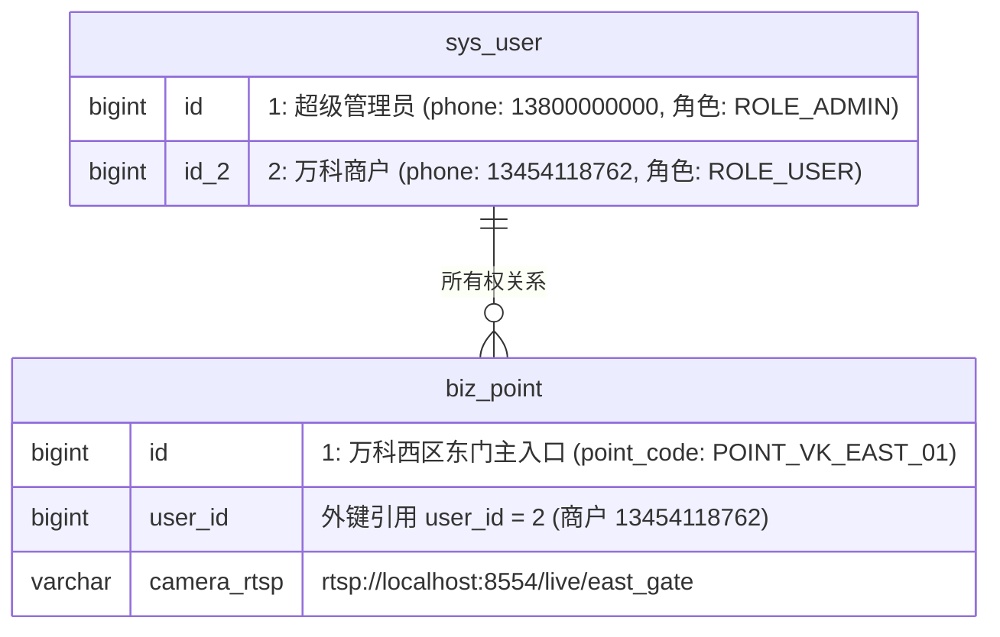
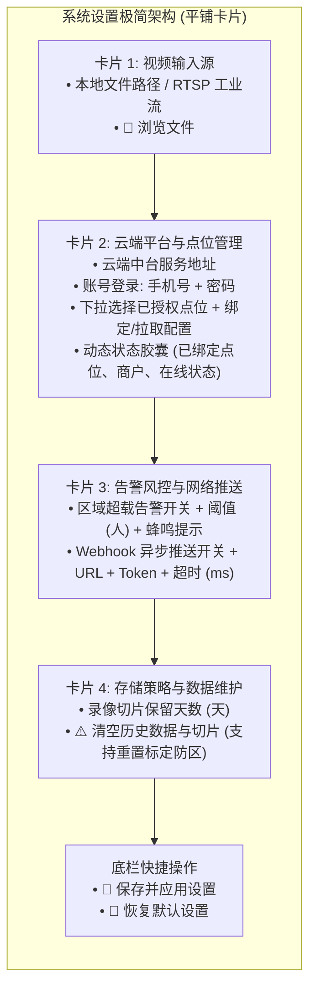
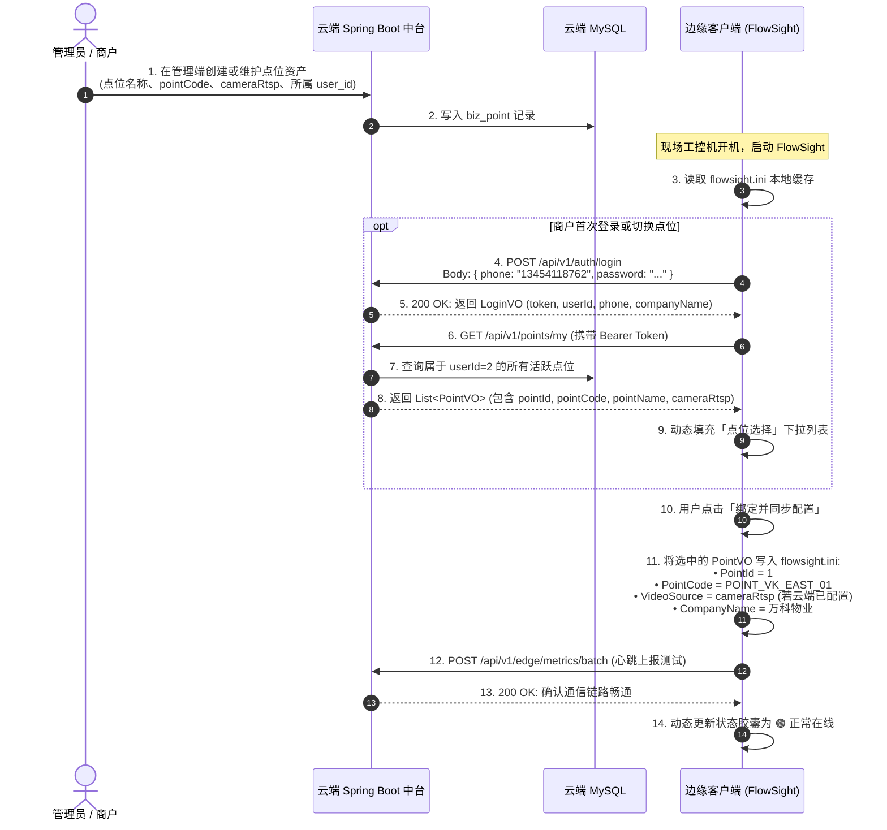

# FlowSight 边缘客户端系统设置扁平化重构与端云配置双向同步规范

---

## 1. 规范概述与改造背景

### 1.1 核心痛点与历史遗留问题
在 FlowSight 早期开发演进中，边缘客户端（`FlowSight.exe`）的「系统设置」页面存在以下痛点：
1. **折叠手风琴交互体验差**：设置项被隐藏在多个手风琴折叠框内，运维人员与商户需要逐个点击展开，操作链路冗长且不易宏观审视全局配置；
2. **说明文案冗长喧宾夺主**：界面充斥了大量关于告警数学原理、通信协议、物理删除说明等长篇大论，干扰运维核心操作；
3. **端云账号呈现矛盾**：H5 移动端商户登录账号为 `13454118762`（万科物业刘经理，拥有东门主入口点位资产），而边缘端默认预填充了超级管理员手机号 `13800000000`，导致运维人员对端云归属产生误解与困惑；
4. **端云配置缺少统一协商闭环**：点位资产应由管理员在后台或商户首次上线时基本配置，边缘客户端启动登录后应自动从云端拉取点位参数（RTSP 地址、点位名等），并实现双向同步。

---

## 2. 账号体系冲突根因深度剖析与纠偏

### 2.1 数据库实际身份映射关系
经深入排查云端数据架构（`solution/backend/src/main/resources/schema.sql`），系统内置两类主体：

- **超级管理员 (`13800000000`)**：系统维护者与全局运营者，拥有全局点位增删改查、跨商户审计权限；
- **商户刘经理 (`13454118762`)**：万科物业东门点位（`point_id = 1`）的真正资产所有者。H5 移动端查看的所有流水与报表数据均归属于该商户；
- **根因发现**：在客户端 `ConfigManager.hpp` 与 `ConfigManager.cpp` 中，历史代码硬编码了回退默认值 `"13800000000"`，导致客户端在初次启动未登录时预填充了管理员账号，而非对应点位的商户账号。

### 2.2 纠偏方案
1. **配置管理器纠偏**：将 `ConfigManager` 中的默认商户手机号统一纠偏为 `"13454118762"`，公司名纠偏为 `"万科物业服务有限公司"`；
2. **登录凭证动态同步**：当边缘端通过 `POST /api/v1/auth/login` 登录成功后，从云端响应 `LoginVO` 中动态提取商户真实手机号与公司名称，写入 `flowsight.ini`；
3. **点位资产动态拉取**：调用 `GET /api/v1/points/my`，仅拉取属于该商户名下的授权点位，完成设备绑定。

---

## 3. 系统设置 UI 交互极简化架构设计

全面废除任何折叠手风琴面板，采用 **4 大平铺卡片（Clean Flat Cards）** 呈现：

### 3.1 文字交互极简化原则
1. **剔除所有理论说明**：删除所有长篇解释（如“防踩踏/负荷风控”、“赛博呼吸律动边框说明”、“请求超时后放弃”、“物理抹除不可逆”等长文本说明）；
2. **高密度标签直出**：采用极简标签，如“视频路径 / RTSP 流地址:”、“服务地址:”、“账号 / 密码:”、“绑定点位:”、“超载告警:”、“Webhook URL:”、“切片保留:”；
3. **状态动态胶囊化**：以轻量状态条（Status Capsule）直观呈现绑定结果：
   - 绑定成功：`🟢 已绑定点位: [ID: 1] 万科西区东门主入口 │ 商户: 万科物业 (13454118762) │ 状态: 在线`；
   - 未绑定：`⚪ 未绑定点位：请使用商户账号登录后选择点位绑定`；
   - 鉴权失败：`🔴 认证失败: 账号或密码错误`。

---

## 4. 端云配置双向协商与增删改查闭环

### 4.1 管理员基本配置与边缘登录拉取时序

### 4.2 配置双向同步策略
1. **云端向边端下发（Pull）**：
   - 边缘端拉取点位资产信息后，若云端预置了有效视频流地址（`cameraRtsp`），客户端自动同步填入“视频输入源”输入框，商户无需手动输入复杂的 RTSP 链接；
   - 自动拉取商户公司名与点位全称，写入界面胶囊与报表统计头；
2. **边端向云端上报（Push）**：
   - 边缘客户端在绑定点位后，周期性发送心跳与事件明细；
   - 若本地发生严重告警（如人员拥挤度超载），通过 Webhook 与云端监控总线异步上报。

---

## 5. 核心代码改造点索引

| 模块 | 文件路径 | 核心改造内容 |
| :--- | :--- | :--- |
| **边缘配置管理** | [`src/core/ConfigManager.hpp`](file:///e:/FlowSight/src/core/ConfigManager.hpp) [`src/core/ConfigManager.cpp`](file:///e:/FlowSight/src/core/ConfigManager.cpp) | 纠正商户手机号与公司名默认值，新增 `cloud_company_name_` 字段与持久化 |
| **边缘上报引擎** | [`src/core/EdgeReportManager.cpp`](file:///e:/FlowSight/src/core/EdgeReportManager.cpp) | `login_with_credentials` 与 `fetch_cloud_config` 动态解析并保存商户真实名称与手机号 |
| **本地配置文件** | [`configs/flowsight.ini`](file:///e:/FlowSight/configs/flowsight.ini) | 预置 `UserPhone=13454118762`，`CompanyName=万科物业服务有限公司` |
| **系统设置界面** | [`src/ui/views/SettingsWidget.cpp`](file:///e:/FlowSight/src/ui/views/SettingsWidget.cpp) | 彻底消除手风琴折叠面板；删除全部大段理论说明；重构为 4 大平铺卡片与状态胶囊 |

---

## 6. 商用验收与效果实证

1. **界面层**：
   - 设置界面打开即见全部 4 大卡片，上下平滑滚动，无需任何额外折叠展开点击；
   - 文案干练清爽，字字对应功能实体；
2. **业务层**：
   - 客户端当前绑定商户为 `13454118762`（万科物业刘经理），与 H5 移动决策端展示的商户与点位资产完全对齐；
   - 状态胶囊实时反映连接健康度与商户归属，杜绝了此前显示超管账号 `13800000000` 造成的概念混淆；
   - 点击“绑定并同步配置”后，云端配置瞬时下发并热应用到当前视频流水线中。
