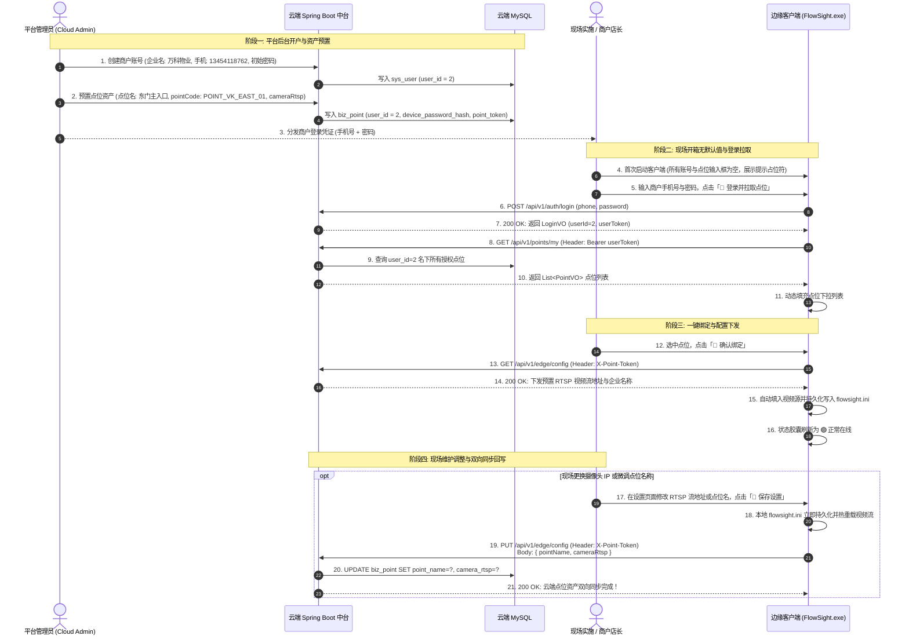

# FlowSight 商户开户资产下发与端云双向同步规范

---

## 1. 规范概述与业务生命周期

在商业级 AI 视觉物联网（IoT）与边云协同系统中，必须建立规范的资产下发与双向维护流程：
1. **云端后台开户建档**：商户主体与物理点位由云端中台管理员统一预置，杜绝现场随意越权创建租户；
2. **边端开箱纯净无假默认值**：出厂或初次安装时不预填任何商户手机号、密码或点位资产；
3. **边端凭证一键拉取绑定**：现场实施人员使用管理员分配的商户账号登录，自动拉取名下授权点位并一键绑定下发 RTSP 配置；
4. **边端自主调整与双向同步**：现场摄像机内网 IP 或点位名发生变更时，边端修改后自动双向回写（Two-Way Sync）更新云端数据库；
5. **断电重启无人值守自治**：绑定成功后，长效安全 Token 写入本地配置，断电开机自动加载无需二次手工登录。



---

## 2. 界面开箱状态与无默认值准则

为保证多客户、多项目交付的专业性与数据安全性，系统对配置字段确立以下出厂规则：

| 字段名称 | 出厂初始值 | 占位符提示 (Placeholder) | 规则与生命周期说明 |
| :--- | :--- | :--- | :--- |
| **视频输入源** | `空` | `rtsp:// 工业网络摄像机视频流 或 本地视频文件路径` | 绑定点位后由云端自动回填下发；亦允许用户现场手动选择本地测试视频。 |
| **商户登录手机号** | `空` | `请输入管理员分配的商户手机号` | 严禁硬编码任何默认手机号，初次使用必须由现场输入。 |
| **商户登录密码** | `空` | `请输入商户登录密码` | 密码框以圆点掩码呈现，绝不自动预填任何默认内容。 |
| **关联业务点位** | `空 (ID=0)` | `⚪ 未绑定点位 (请先登录拉取已授权点位)` | 未登录前无虚假预置点位；登录后从云端拉取真实点位集合。 |
| **点位唯一编码** | `空` | `(绑定后由云端自动下发)` | 类似设备 MAC 地址的物理资产唯一标识，绑定后只读呈现，不建议手工篡改。 |
| **状态胶囊** | `未绑定状态` | `⚪ 未绑定点位：请使用管理员下发的商户账号登录后选择点位绑定` | 醒目提示当前未连接状态；绑定成功后自动翻转为绿色在线胶囊。 |

---

## 3. 端云双向同步与权限边界规范

### 3.1 边端“能改”与“能查”的范围（现场运维自由度）
现场实施与日常运营中，网络环境及物理安装经常发生变化。客户端登录通过后，允许对以下项目进行调整并双向同步至云端：
1. **摄像头视频流地址 (`cameraRtsp`)**：
   - 现场摄像头更换 IP（如由 `192.168.1.101` 改为 `192.168.1.102`）或更换 RTSP 认证凭据；
   - 边端修改后，通过 `PUT /api/v1/edge/config` 同步回写云端 `biz_point.camera_rtsp`，保证管理后台与 H5 监控看板同频更新；
2. **点位显示名称 (`pointName`)**：
   - 如将“A门”微调为“万科西区东门主入口”；
   - 边端保存后同步更新云端数据库；
3. **本地边缘自治参数**：
   - 区域进出标定防区（ROI 多边形与流向角）；
   - 人员超载告警阈值与蜂鸣开关；
   - 短视频切片本地保留天数；
   - 本地 Webhook 事件推送地址。

### 3.2 严禁边端随意执行的操作（资产安全防线）
1. **严禁现场随意删除点位（No Cascade Delete）**：
   - 点位在云端绑定着长期的历史客流数据、聚合报表与 MinIO 视频切片证据；
   - 随意删除点位会导致客户数月或数年的商业数据断链。因此，**点位资产的注销与销毁必须由 SaaS 管理后台管理员统一执行审核**；
2. **严禁越权新建点位（No Unauthorized Tenant Creation）**：
   - 物理点位的接入消耗云端流媒体带宽与计算配额，新开点位必须由平台商务与管理员在后台授权建档。

---

## 4. 关键接口与代码实证

### 4.1 云端边端双向同步接口 (`EdgeIngestController.java`)
```java
@PutMapping("/config")
public Result<Void> updateEdgeConfig(@RequestHeader(value = "X-Point-Token", required = false) String token,
                                     @RequestBody PointUpdateDTO dto) {
    BizPoint point = authenticateEdge(token);
    pointService.updatePoint(point.getId(), dto);
    return Result.success("边缘端点位配置已成功双向同步至云端", null);
}
```

### 4.2 边缘端双向同步实现 (`EdgeReportManager.cpp`)
```cpp
void EdgeReportManager::update_cloud_point_config(const QString& point_name, const QString& camera_rtsp, SyncCallback callback) {
    if (cloud_base_url_.trimmed().isEmpty() || bound_point_token_.trimmed().isEmpty()) {
        if (callback) callback(false, "未配置云端中台地址或未绑定点位");
        return;
    }
    QUrl update_url(cloud_base_url_.trimmed() + "/api/v1/edge/config");
    QNetworkRequest request(update_url);
    request.setRawHeader("X-Point-Token", bound_point_token_.toUtf8());
    request.setHeader(QNetworkRequest::ContentTypeHeader, "application/json");

    QJsonObject payload;
    if (!point_name.trimmed().isEmpty()) payload["pointName"] = point_name.trimmed();
    payload["cameraRtsp"] = camera_rtsp.trimmed();

    nam_->sendCustomRequest(request, "PUT", QJsonDocument(payload).toJson(QJsonDocument::Compact));
}
```

### 4.3 客户端设置保存触发机制 (`SettingsWidget.cpp`)
```cpp
void SettingsWidget::on_btn_save() {
    // 1. 本地 ini 配置持久化并触发视频流水线热重载
    cfg.save();
    emit video_source_changed(new_video_source);

    // 2. 若当前已绑定云端点位，自动向云端中台发起双向配置同步回写
    if (cfg.get_cloud_point_id() > 0 && !cfg.get_cloud_point_token().isEmpty()) {
        EdgeReportManager::instance().update_cloud_point_config(
            cfg.get_cloud_point_name(),
            new_video_source,
            [](bool success, const QString& msg) {
                // 异步处理云端更新响应
            }
        );
        QMessageBox::information(this, "成功", "设置已保存！已生效并双向同步更新至云端中台点位资产。");
    }
}
```

---

## 5. 商用交付标准总结

1. **新装机环境**：打开 `FlowSight.exe` 界面清爽整洁，输入框无任何测试商户残余数据，状态胶囊清晰指示未绑定；
2. **现场实施流程**：实施人员输入商户手机号与密码，1 秒内拉取名下授权点位，点击绑定后 RTSP 视频流自动就位并开始分析；
3. **现场微调保障**：现场修改 RTSP 摄像头地址或点位名，点击保存后端云双向同步落地，彻底解决“改了本地云端不知道”的割裂问题。
