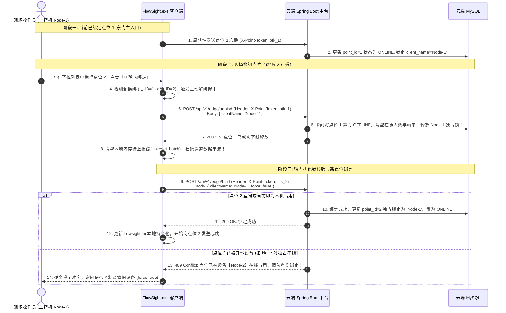

# FlowSight 端云点位独占绑定与生命周期互斥治理规范

---

## 1. 规范概述与痛点根因

在多点位（1:N）的边缘计算部署中，现场常发生同一台工控机切换绑定不同点位，或多台工控机误绑定同一通道的情况。若端云缺乏生命周期互斥治理，将引发严重缺陷：
1. **“幽灵双在线”缺陷**：
   - 现场工控机先绑定点位 1（如东门主入口），后在设置中切换绑定点位 2（如地库人行道）；
   - 客户端以往仅在本地内存覆盖点位 ID，**从未向云端发送针对点位 1 的解绑通知**；
   - 云端因缺乏主动下线握手，加之时钟判定偏差，导致云端后台和 H5 显示两个点位**同时处于“在线”状态**；
2. **多机重复绑定并发冲突**：
   - 现场两台电脑同时绑定同一个点位，导致客流重复聚合上报、指标翻倍、录像切片覆盖；
3. **数据跨通道串流风险**：
   - 切换点位时，若客户端内存中滞留的待上报聚合数据未清空，会将东门的数据误上报至地库通道。

FlowSight 建立**「主动解绑握手 + 云端独占排他锁 + 冲突拦截与强制解绑」**三大互斥治理支柱。

---

## 2. 互斥治理架构与交互时序



---

## 3. 核心设计机制

### 3.1 边端主动解绑握手（Active Unbind Handshake）
- 在 [`EdgeReportManager.hpp/.cpp`](file:///e:/FlowSight/src/network/EdgeReportManager.cpp) 中新增 `unbind_current_point()` 接口；
- **换绑前置拦截**：在 `bind_point(url, point_id, ...)` 时，一旦发现 `bound_point_id_ > 0 && bound_point_id_ != point_id`，立即先触发解绑握手并重置内存批处理缓冲区；
- **软件退出释放**：在客户端关闭退出流程（`shutdown()`）中，主动发送下线声明，使云端实现毫秒级感知设备离线，杜绝 15 秒滞后窗口。

### 3.2 云端点位独占排他锁（Exclusive Point Binding Lock）
- 云端在 `BizDeviceHeartbeat` 中绑定 `client_name` 与最新心跳时间戳；
- 在 `PointVO` 中透出占用状态元数据：
  - `isOccupied`：布尔值，表明该点位当前是否有活跃节点在线；
  - `boundClientName`：字符串，表明当前独占该点位的设备节点名称；
- 下拉列表增强展示：
  - 空闲点位：`[ID: 1] 万科西区东门主入口 (🟢 空闲可绑定)`；
  - 本机已绑：`[ID: 1] 万科西区东门主入口 (🟢 本机已绑)`；
  - 他机占用：`[ID: 2] 万科西区地库人行道 (🔴 设备【FlowSight-Node-2】占用中)`；
- 重复绑定防护拦截：当另一台机器尝试绑定已被占用的在线通道时，云端接口直接拦截；前端弹出安全确认框，需用户明确确认“强制换绑”才可解除原设备锁定。

### 3.3 时区与时间戳差值防负数修复
在 `PointServiceImpl.java` 与 `HeartbeatWatchdog.java` 中，原代码仅判断 `seconds <= 15`，若服务器时区存在微小抖动或客户端时钟快于服务器，秒数差为负数（例如 `-28800`），将导致 `negative <= 15` 恒为真，形成假在线死锁。
现全面修复为：
```java
long secondsSinceLastHeartbeat = ChronoUnit.SECONDS.between(hb.getLastHeartbeat(), LocalDateTime.now());
boolean isOnline = (secondsSinceLastHeartbeat >= 0 && secondsSinceLastHeartbeat <= 15);
```
彻底根治负数时区引起的假在线故障。

---

## 4. 关键源码实证

| 端侧 | 文件路径 | 核心改造内容 |
| :--- | :--- | :--- |
| **云端控制器** | [`EdgeIngestController.java`](file:///e:/FlowSight/solution/backend/src/main/java/com/flowsight/cloud/controller/EdgeIngestController.java) | 新增 `POST /api/v1/edge/bind` 与 `POST /api/v1/edge/unbind` 接口 |
| **云端服务层** | [`PointServiceImpl.java`](file:///e:/FlowSight/solution/backend/src/main/java/com/flowsight/cloud/service/impl/PointServiceImpl.java) | 实现 `bindPoint(id, client, force)` 与 `unbindPoint(id, client)`，修复时区负数 Bug |
| **云端看门狗** | [`HeartbeatWatchdog.java`](file:///e:/FlowSight/solution/backend/src/main/java/com/flowsight/cloud/task/HeartbeatWatchdog.java) | 巡检超时增加 `elapsedSeconds < 0` 保护，防止时钟跳变死锁 |
| **边缘上报引擎** | [`EdgeReportManager.cpp`](file:///e:/FlowSight/src/network/EdgeReportManager.cpp) | 换绑自动发起 `unbind_current_point()`，并调用 `/bind` 独占锁定新点位 |
| **系统设置界面** | [`SettingsWidget.cpp`](file:///e:/FlowSight/src/ui/views/SettingsWidget.cpp) | 点位下拉框动态呈现占用节点标识，绑定冲突前置弹窗拦截与安全二次确认 |

---

## 5. 验收实测效果

1. **同机换绑测试**：
   - 客户端绑定点位 1（东门），云端点位 1 变为 `ONLINE`；
   - 客户端切换绑定点位 2（地库），点位 1 瞬间触发 `unbind`，云端点位 1 立即变为 `OFFLINE`，点位 2 独占变为 `ONLINE`；
   - 云端中台及 H5 看板中，**绝不再出现两个点位同时在线的“幽灵双在线”问题**；
2. **多机防冲突测试**：
   - 机器 A 绑定点位 1 后，机器 B 在拉取点位时，下拉列表明确标红 `🔴 设备【Node-A】占用中`；
   - 机器 B 若点击确认绑定，系统前置拦截并弹出警告，未经强制确认绝不破坏当前正在运行的通道，彻底防止客户重复绑定。
