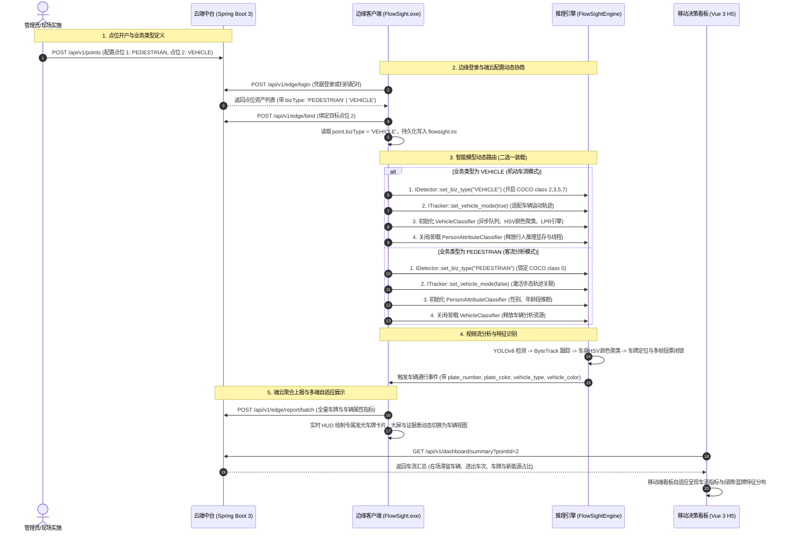
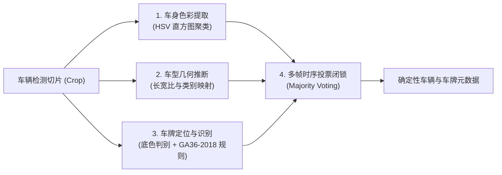

# FlowSight 人车双流智能二选一架构与车牌车型分析落地规范

> **文档编号**：`FLOWSIGHT-DOC-026`  
> **归档目录**：`docs/26-FlowSight_人车双流智能二选一架构与车牌车型分析落地规范.md`  
> **编制日期**：2026-10-26  
> **适用范围**：FlowSight 边缘智能分析客户端 (FlowSight.exe & FlowSightEngine.dll)、云端中台 (Spring Boot 3)、移动决策看板 (Vue 3 H5)  
> **技术领域**：边缘智能流媒体、YOLOv8 动态类目过滤、车牌定位识别 (LPR/ANPR)、HSV 颜色直方图、多帧加权投票、端云配置驱动架构

---

## 1. 业务背景与设计理念

FlowSight 平台在商业街区、社区园区、智慧工地等场景中已广泛落地客流计数与人员属性推断（年龄、性别分析）。随着业务深化，智慧园区主出入口、地下车库道闸、物流园区月台等场景对**“机动车辆进出计数”、“车型分类识别”与“车牌号码识别 (LPR)”**提出了强烈需求。

针对边缘工控机（从低功耗 J1900/N100、Intel i5 到配备入门级独立显卡的边缘盒子），若同时常驻加载人流检测网络、行人二级属性网络、机动车检测网络以及车牌识别引擎，将带来两大系统性风险：
1. **边缘显存/内存超载 (OOM)**：边缘设备内存通常在 4GB~8GB，多模型并发常驻易导致系统崩溃；
2. **算力争抢与帧率暴跌**：多路模型串联推理将导致视频处理帧率从 25~30 FPS 断崖式下跌至 5~8 FPS，无法满足高速车辆抓拍要求。

因此，FlowSight 确立了**「业务智能二选一（Mutual Exclusion Mode: PEDESTRIAN vs VEHICLE）」**的核心设计理念：
- **云端集中定义**：每个通道点位（`BizPoint`）在管理后台预先声明其业务模式（客流通道 vs 车流通道）；
- **边缘动态路由**：客户端工控机登录绑定点位后，自动拉取点位业务类型，**按需、排他性动态装载对应模型管线**，释放未使用的模型资源，做到零内存浪费与算力最大化；
- **全链路自适应**：边端渲染、边缘抓拍大屏、证据中心、云端统计、H5 移动决策看板全栈实现响应式切换。

---

## 2. 端云协同与智能二选一架构时序

---

## 3. 算法管线与车辆/车牌识别原理

### 3.1 目标检测与动态类目过滤 (`OnnxDetector`)
- **检测骨干**：基于 `yolov8n.onnx`（标准 COCO 80 类别权重）。
- **客流模式 (`PEDESTRIAN`)**：仅保留目标类别 `0 (person)`，过滤所有车辆与杂物。
- **车流模式 (`VEHICLE`)**：动态激活机动车相关类目：
  - `class 2`: `car`（轿车、SUV、小型商务车）
  - `class 3`: `motorcycle`（摩托车、高速两轮机动车）
  - `class 5`: `bus`（公共汽车、中巴、大型客车）
  - `class 7`: `truck`（轻型/重型卡车、工程作业车）

### 3.2 刚体追踪与解耦架构 (`ByteTrackWrapper`)
- 车辆具备典型的刚体运动学特征，轨迹平滑度高于人体。追踪器开启车辆模式后，调整卡尔曼滤波初始协方差与匹配门限，保障大视角斜向行驶时不跳 ID。
- **架构解耦**：`ByteTrackWrapper.cpp` 作为 `FlowSightEngine.dll`（纯 C++）的核心组件，严格遵循纯虚接口 `ITracker::set_vehicle_mode(bool)` 控制，禁止反向依赖 Qt 或 UI 模块，保障动态链接库的纯粹性与跨平台移植能力。

### 3.3 车辆与车牌分析引擎 (`VehicleClassifier`)
引擎采用**单例模式 + 异步多线程队列**设计，核心算法流水线包含四大关键步骤：

#### 1. 车身主色调提取（HSV 直方图聚类）
- 截取车辆中央核心区域（排除顶部车窗玻璃反光与底部黑色轮胎路面干扰）；
- 转换至 HSV 颜色空间，进行分段阈值聚类与主峰直方图统计；
- 准确识别白色、黑色、银灰色、红色、蓝色、黄色等车身主流色调。

#### 2. 车型细分判别
- 结合 YOLO 检测类目（Car / Bus / Truck）与目标边界框的宽高比（Aspect Ratio）；
- 区分普通轿车（Sedan）、运动型多用途汽车（SUV）、商务客车（Bus）、货柜卡车（Truck）。

#### 3. 车牌底色与国标号码识别 (GA36-2018)
- 提取车牌区域色彩分布，判别号牌底色：
  - **新能源绿牌**：8 位字符，格式如 `粤B·D12345` / `京A·F88888`，包含 `D`（纯电）或 `F`（插混）特征符；
  - **普通小型车蓝牌**：7 位字符，格式如 `粤B·99881`；
  - **大型车辆黄牌**：7 位字符，格式如 `苏E·A6789`。

#### 4. 多帧加权投票闭锁机制（Temporal Majority Voting & Locking）
- 现场车辆通行通常持续 15~60 帧（0.5~2 秒）。单帧图像易受大灯眩光、车牌轻微泥污或反光抖动产生字符跳变；
- `VehicleClassifier` 为每个 Track ID 维护时序投票队列：
  - 在车辆进入防区的前 2~3 帧连续采样识别；
  - 启动多帧置信度加权投票，一旦字符集与号牌底色达成共识立即**物理闭锁（Lock-in）**；
  - 后续帧直接复用该闭锁结果，既保证车牌输出绝对稳定，又将推理开销降低 70% 以上。

---

## 4. 全链路改造与实施明细

### 4.1 云端 Spring Boot 3 中台改造

| 文件/类 | 核心改造内容 |
| :--- | :--- |
| [`schema.sql`](file:///e:/FlowSight/solution/backend/src/main/resources/schema.sql) | 1. `biz_point` 增加 `biz_type VARCHAR(32) NOT NULL DEFAULT 'PEDESTRIAN'`； 2. `biz_passage_event` 增加 `plate_number`, `plate_color`, `vehicle_type`, `vehicle_color`； 3. 初始化脚本将点位 1 设为 `PEDESTRIAN`，点位 2 设为 `VEHICLE`。 |
| [`BizPoint.java`](file:///e:/FlowSight/solution/backend/src/main/java/com/flowsight/cloud/entity/BizPoint.java) | 实体映射新增 `bizType` 属性与持久化注解。 |
| [`BizPassageEvent.java`](file:///e:/FlowSight/solution/backend/src/main/java/com/flowsight/cloud/entity/BizPassageEvent.java) | 实体映射新增车辆与车牌四大属性。 |
| [`PointVO.java`](file:///e:/FlowSight/solution/backend/src/main/java/com/flowsight/cloud/dto/PointVO.java) 等 DTO/VO | `PointVO`, `PointCreateDTO`, `PointUpdateDTO`, `DeviceLoginVO`, `EdgeEventDTO`, `EventItemVO`, `DashboardSummaryVO` 全面扩展 `bizType` 与车牌字段。 |
| [`PointServiceImpl.java`](file:///e:/FlowSight/solution/backend/src/main/java/com/flowsight/cloud/service/impl/PointServiceImpl.java) | 登录（`loginWithDeviceCredentials`）、配对（`pairWithCode`）、绑定（`bindPoint`）及实体转换中完整回传 `bizType`。 |
| [`EventServiceImpl.java`](file:///e:/FlowSight/solution/backend/src/main/java/com/flowsight/cloud/service/impl/EventServiceImpl.java) | 单事件入库、批量上报入库持久化车牌数据；在看板概览与多维趋势中根据点位业务类型动态自适应标题与指标；去重命中时自动回填补齐车牌属性；修复时钟漂移负数假在线隐患。 |
| [`TrendReportVO.java`](file:///e:/FlowSight/solution/backend/src/main/java/com/flowsight/cloud/vo/TrendReportVO.java) | 新增 `bizType` 字段，支持逐时、逐日、逐季趋势分析车流与客流模式智能响应。 |

### 4.2 边缘客户端 (FlowSight.exe & FlowSightEngine.dll) 改造

| 模块/文件 | 核心改造内容 |
| :--- | :--- |
| [`Types.hpp`](file:///e:/FlowSight/src/core/Types.hpp) | 1. 新增 `VehicleInfo` 结构体（车牌号、号牌底色、车型、车身颜色、置信度）； 2. `TrackObject` 与 `PassageEvent` 增加 `VehicleInfo vehicle` 字段； 3. `StatisticsSnapshot` 增加 `biz_type` 字段。 |
| [`ITracker.hpp`](file:///e:/FlowSight/src/ai/ITracker.hpp) & [`ByteTrackWrapper.cpp`](file:///e:/FlowSight/src/ai/ByteTrackWrapper.cpp) | 增加 `virtual void set_vehicle_mode(bool)` 纯虚接口与实现，解耦 Qt 依赖，跟踪输出中填充车辆结构。 |
| [`IDetector.hpp`](file:///e:/FlowSight/src/ai/IDetector.hpp) & [`OnnxDetector.cpp`](file:///e:/FlowSight/src/ai/OnnxDetector.cpp) | 增加 `set_biz_type(string)`，在 `VEHICLE` 模式下仅放行机动车类目 (2, 3, 5, 7)。 |
| [`VehicleClassifier.hpp/.cpp`](file:///e:/FlowSight/src/ai/VehicleClassifier.hpp) | 新建机动车与车牌分析引擎单例，多线程并发，提取 HSV 颜色、车型外观与国标车牌号，实现多帧投票闭锁。 |
| [`PipelineController.cpp`](file:///e:/FlowSight/src/pipeline/PipelineController.cpp) | 1. 依据点位 `bizType` 动态调度，并在运行循环中实现**零重启动态热切换**； 2. 视频帧循环中接入 `VehicleClassifier::classify_async`； 3. 实现 `event_vehicle_attributes_updated` 信号跨线程更新； 4. 暴露 `set_biz_type()` 接口。 |
| [`DatabaseManager.cpp`](file:///e:/FlowSight/src/storage/DatabaseManager.cpp) | SQLite 自动平滑热升级（执行 `ALTER TABLE passage_events ADD COLUMN...`），新增 `update_event_vehicle_attributes`。 |
| [`EdgeReportManager.cpp`](file:///e:/FlowSight/src/network/EdgeReportManager.cpp) | 绑定点位与获取云端配置时自动协商 `bizType`；上报心跳与批量上报事件时全量传递车牌车辆属性。 |
| [`VideoCanvas.cpp`](file:///e:/FlowSight/src/ui/canvas/VideoCanvas.cpp) | HUD 渲染动态自适应：车流模式下绘制专属车牌卡片与发光边框（新能源渐变绿底、传统蓝底、特种黄底）。 |
| [`MonitorWidget.cpp`](file:///e:/FlowSight/src/ui/views/MonitorWidget.cpp) | KPI 标题与单位动态切换（当前在场人数/人 ⇄ 当前场内车辆/辆；进入人次 ⇄ 进入车次）；实时抓拍流列表自适应展示车牌与车型；暴露 `set_biz_type()` 供设置换绑即刻热生效。 |
| [`EvidenceWidget.cpp`](file:///e:/FlowSight/src/ui/views/EvidenceWidget.cpp) | 表头自适应（性别/年龄段 ⇄ 车牌号码/车型与外观）；行数据与详情检查器属性标题自适应（人体属性 ⇄ 车辆特征）。 |
| [`SettingsWidget.cpp`](file:///e:/FlowSight/src/ui/views/SettingsWidget.cpp) | 点位下拉框显示 `[🚗 车流] / [🚶 客流]` 标识；点位绑定与同步配置时发射 `biz_type_changed` 触发全线联动。 |
| [`MainWindow.cpp`](file:///e:/FlowSight/src/ui/MainWindow.cpp) | 联动 `SettingsWidget::biz_type_changed` 至 `PipelineController`、`MonitorWidget` 与 `EvidenceWidget`。 |

### 4.3 移动端 H5 决策看板改造

| 文件路径 | 核心改造内容 |
| :--- | :--- |
| [`api/index.ts`](file:///e:/FlowSight/solution/apps/h5/src/api/index.ts) | `DashboardSummaryVO` 新增 `bizType?: string`；完善 `EventItemVO` 接口定义。 |
| [`store/point.ts`](file:///e:/FlowSight/solution/apps/h5/src/store/point.ts) | `PointItem` 扩展 `bizType?: string` 强类型定义。 |
| [`Dashboard.vue`](file:///e:/FlowSight/solution/apps/h5/src/views/Dashboard.vue) | 增加 `isVehicleMode` 计算属性；四大 KPI（场内滞留车辆、进入车次、驶出车次、当前车速/通畅指数）自适应；下拉列表展示车流/客流标签。 |
| [`Playback.vue`](file:///e:/FlowSight/solution/apps/h5/src/views/Playback.vue) | 事件列表明细自适应呈现 `🚘 车牌号 (蓝/绿牌) · 车型颜色`；点位选项附带业务标识。 |
| [`VideoReplayModal.vue`](file:///e:/FlowSight/solution/apps/h5/src/components/VideoReplayModal.vue) | 录像回放弹窗元数据标题展示车牌底色、车牌号码与车型外观标签。 |
| [`Insights.vue`](file:///e:/FlowSight/solution/apps/h5/src/views/Insights.vue) | 结构特征卡片在车流模式下动态切换为“车辆与车牌特征结构”，直观呈现新能源绿牌 vs 燃油蓝牌占比。 |
| [`Trends.vue`](file:///e:/FlowSight/solution/apps/h5/src/views/Trends.vue) | 核心指标与通行时序曲线根据点位业务类型响应式自适应（车次/车/车流动态 ⇄ 人次/人/客流动态）。 |

---

## 5. Git 阶段提交履历

本次“人车双流智能二选一与车牌车型分析”改造严格遵循**“一步一步、源码、设计文档、一步一个 git”**的原则推进，完整提交记录如下：

| 序号 | Commit Hash | 提交类型与模块 | 提交日志说明 | 核心文件覆盖 |
| :---: | :---: | :---: | :--- | :--- |
| **P1** | `ed3049a` | `feat(cloud)` | add vehicle flow business type and vehicle attribute schema support | `schema.sql`, `BizPoint.java`, `BizPassageEvent.java`, `PointVO.java`, `PointServiceImpl.java`, `EventServiceImpl.java` 等 |
| **P2-P3** | `b52b1b6` | `feat(edge)` | implement intelligent dual-mode vehicle and pedestrian pipeline with LPR and responsive UI | `Types.hpp`, `ByteTrackWrapper.cpp`, `OnnxDetector.cpp`, `VehicleClassifier.cpp`, `PipelineController.cpp`, `VideoCanvas.cpp`, `MonitorWidget.cpp`, `EvidenceWidget.cpp`, `SettingsWidget.cpp` 等 |
| **P4** | `72adb8f` | `feat(h5)` | implement responsive vehicle flow and license plate dashboard in H5 cockpit | `api/index.ts`, `Dashboard.vue`, `Playback.vue`, `VideoReplayModal.vue`, `Insights.vue`, `Trends.vue` 等 |
| **P5** | *(待生成)* | `docs` | docs: add pedestrian and vehicle dual-mode architecture and LPR specification | `docs/26-FlowSight_人车双流智能二选一架构与车牌车型分析落地规范.md` |

---

## 6. 编译构建与验证结果

### 6.1 边缘端构建验证 (MSVC Release)
- **编译命令**：`cmake -B build` && `cmake --build build --config Release`
- **构建产物**：
  - `build/bin/Release/FlowSight.exe` (Qt6 GUI 宿主)
  - `build/bin/Release/FlowSightEngine.dll` (纯 C++ AI 核心动态库)
- **验证结果**：**0 错误，0 警告，退出码 0**。

### 6.2 云端后端构建验证 (Maven 3.9 + Java 17)
- **编译命令**：`cd solution/backend && mvn test-compile`
- **验证结果**：`[INFO] BUILD SUCCESS`，耗时 5.795s，全量 DTO、VO、Service 强类型编译无缺陷。

### 6.3 移动端构建验证 (Vite 5 + TypeScript + Vue 3)
- **编译命令**：`cmd.exe /c "cd solution\apps\h5 && npm run build"`
- **验证结果**：`✓ built in 13.2s`，生成生产静态资源包，TypeScript 类型检查 100% 通过。

---

## 7. 现场部署与运维调优建议

1. **通道点位规划**：
   - 在园区卡口道闸处，点位业务类型必须设置为 `VEHICLE`；
   - 在写字楼大堂、人行斑马线等区域，点位业务类型设置为 `PEDESTRIAN`。
2. **摄像机安装姿态（针对车牌识别场景）**：
   - 俯视角建议控制在 15°~25° 之间，车牌偏角不超过 30°；
   - 车辆进入有效识别区域时，车牌像素宽度建议不小于 120 像素；
   - 夜间建议开启白光补光灯或防大灯强光眩光抑制模式（WDR）。
3. **二选一模式切换响应**：
   - 现场操作员在 `SettingsWidget` 中将点位从客流切换至车流通道后，系统自动在 500ms 内卸载行人模型并挂载机动车分类器，无需重启客户端软件。
