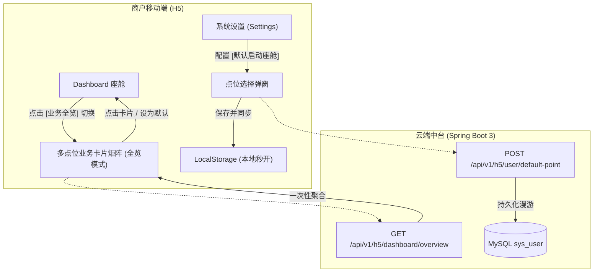
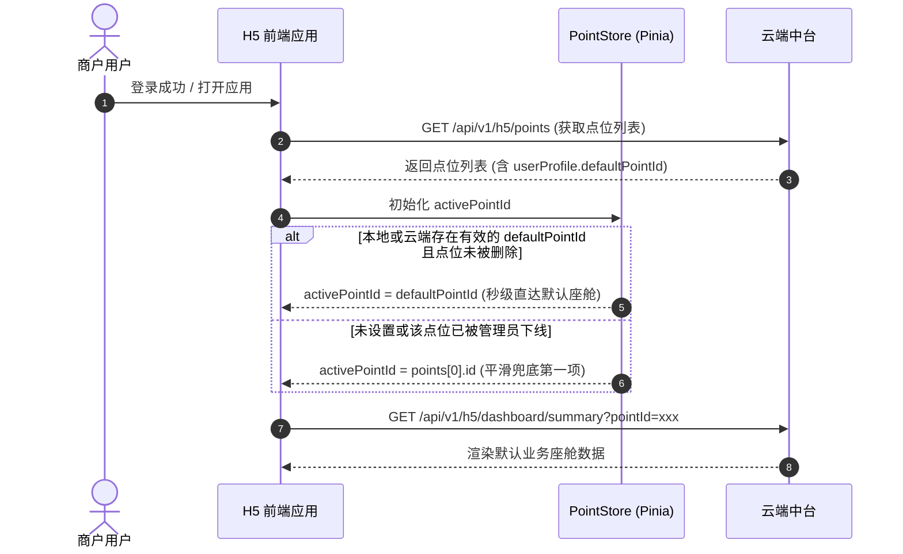

# FlowSight 多点位业务聚合看板与默认座舱自适应直达设计规范

## 1. 业务背景与问题痛点

在 FlowSight 商业级 AIoT 平台中，已建立清晰的三层业务拓扑：
- **1 租户商户 (`sys_user`)** : **N 监控点位 (`biz_point`)**
- **1 监控点位 (`biz_point`)** : **1 业务模式 (`sys_business_type`)**
- **1 边缘工控盒子 (`FlowSight.exe`)** : **1 物理监控通道**

### 现状痛点
1. **单点位视角的局限性**：
   - 当前移动端 H5 默认仅提供“单点位实时座舱”（`Dashboard.vue`）。商户名下若有多个点位（如 2 个客流门头 + 1 个地下车库车流卡口），必须通过顶部下拉框逐个点位切换查询；
   - 缺乏**“全店/全园区”宏观大盘**：商户无法一眼获知今天全场总客流、总车流、各设备在线/离线健康度。
2. **缺乏默认直达偏好机制**：
   - 商户每次重新打开 H5 或重新登录，系统始终默认加载列表第一项（`points[0]`）；
   - 商户往往有其最核心的“日常关注机位”（例如正门客流或主出入口），缺少保存“默认业务座舱”的能力。

---

## 2. 系统核心功能架构设计

本方案围绕**「全局业务大盘卡片矩阵」**与**「默认座舱首选自适应」**两大核心诉求，从前端交互、数据聚合、云端持久化三个维度进行闭环设计。



---

## 3. 详细设计与交互方案

### 3.1 交互方案对比与技术决议

| 方案 | 交互形式 | 优点 | 缺点 | 决议 |
| :--- | :--- | :--- | :--- | :--- |
| **方案 1：独立路由新页面**<br>(`/overview`) | 纯独立页面，底部导航或新路由 | 路由边界清晰，排版空间大 | 页面跳入跳出有生命周期销毁与重新初始化，网络重新请求延迟高 | 作为备选扩展 |
| **方案 2：底部半屏抽屉**<br>(ActionSheet/Drawer) | 浮层上滑展示 | 不离开当前页面 | 手机纵向视口受限，多卡片滚动容易与页面底层滑动冲突 | 体验受限 |
| **方案 3：座舱内部平滑双态切换 (推荐)**<br>(Flat View Toggle) | 座舱顶部 `[ ⊞ 业务全览 ]` 胶囊按钮，无缝展开全屏卡片流 | **无需路由跳转、零白屏、秒级响应**，保留实时轮询与长连接，支持点选卡片秒切单点座舱 | **采纳为最佳落地方案** |

### 3.2 界面视觉结构 (全景业务卡片流)

在全览模式下，界面分为两部分：
1. **全局大盘聚合栏 (Global KPI Aggregate Bar)**：
   - **设备运行状态**：总机位 N 个（🟢 在线 X / 🔴 离线 Y）
   - **客流全局聚合**：今日进店总客流、瞬时在场总人数
   - **车流全局聚合**：今日累计进车总数、当前滞留总车次
2. **点位业务卡片矩阵 (Business Point Card Stream)**：
   - 每个卡片对应一个实际通道机位：
     - **业务标签徽章**：`客流检测 PEDESTRIAN`（蓝/青色）、`车流检测 VEHICLE`（琥珀/暖色）；
     - **点位通道信息**：通道名称（如“A1正门主入口”）、点位编码（`PED_A01`）；
     - **在线状态灯**：绿色光晕呼吸灯（在线） / 灰色静止灯（离线）；
     - **核心数据微盘**：
       - 客流：瞬时在场、今日累计进入、今日累计离开；
       - 车流：当前滞留、今日进场车次、今日出场车次；
     - **现场视频快照缩略图**（带 LIVE 标记，直观确认现场环境）；
     - **操作入口**：
       - 点击卡片主体：立即切入该点位的单点监控座舱；
       - 卡片右上角 `[★ 默认]` 星标：一键设为“默认启动业务”，成功后即刻高亮提示。

---

## 4. 默认业务座舱保存与启动直达方案

### 4.1 双层可靠存储架构 (Cache + Cloud Sync)
- **第一层：本地即时缓存 (`localStorage.getItem('flowsight_default_point_id')`)**：
  - 用户打开 H5 页面时，优先读取本地缓存；
  - **优势**：首屏渲染时无需等待任何网络异步请求，直接加载默认点位，实现“0白屏秒开”。
- **第二层：云端账户漫游持久化 (`sys_user.default_point_id`)**：
  - 用户点击设为默认时，同步调用后端接口 `POST /api/v1/h5/user/default-point`；
  - **优势**：商户在不同手机、平板或清空浏览器缓存后重新登录，依然能继承自身的使用偏好。

### 4.2 启动加载时序与容错流程


---

## 5. 云端后端 API 架构与数据库升级

### 5.1 数据库结构升级 (`sys_user` 表)
```sql
-- 为商户租户用户表增加默认直达点位字段
ALTER TABLE `sys_user`
ADD COLUMN `default_point_id` BIGINT NULL COMMENT '用户偏好的默认直达点位ID' AFTER `point_quota`;
```

### 5.2 核心接口设计

#### 1. 全局多点位业务大盘聚合接口
- **Endpoint**: `GET /api/v1/h5/dashboard/overview`
- **权限**: 商户身份（JWT 拦截器自动解析 `userId`）
- **响应体数据模型**:
```json
{
  "code": 200,
  "msg": "success",
  "data": {
    "globalMetrics": {
      "totalPoints": 3,
      "onlinePoints": 2,
      "offlinePoints": 1,
      "totalPedestrianOccupancy": 32,
      "totalPedestrianEntry": 1420,
      "totalPedestrianExit": 1388,
      "totalVehicleOccupancy": 12,
      "totalVehicleEntry": 240,
      "totalVehicleExit": 228
    },
    "pointCards": [
      {
        "pointId": 1,
        "pointName": "A1正门主入口",
        "pointCode": "PED_A01",
        "bizType": "PEDESTRIAN",
        "bizTypeName": "客流检测分析",
        "streamStatus": "ONLINE",
        "currentOccupancy": 24,
        "todayEntry": 980,
        "todayExit": 956,
        "todayTotal": 1936,
        "snapshotUrl": "http://127.0.0.1:9000/flowsight/snapshots/snap1.jpg",
        "isDefault": true
      },
      {
        "pointId": 2,
        "pointName": "B1地下车库入口",
        "pointCode": "VEH_B01",
        "bizType": "VEHICLE",
        "bizTypeName": "车流检测分析",
        "streamStatus": "ONLINE",
        "currentOccupancy": 12,
        "todayEntry": 240,
        "todayExit": 228,
        "todayTotal": 468,
        "snapshotUrl": "http://127.0.0.1:9000/flowsight/snapshots/snap2.jpg",
        "isDefault": false
      }
    ]
  }
}
```

#### 2. 用户设置默认座舱接口
- **Endpoint**: `POST /api/v1/h5/user/default-point`
- **请求体**:
```json
{
  "pointId": 1
}
```
- **业务校验规则**:
  - 校验 `pointId` 必须属于当前登录用户（防越权）；
  - 更新 `sys_user.default_point_id = pointId`；
  - 返回操作成功响应。

---

## 6. 前端代码实现落地点清单

1. **`solution/apps/h5/src/store/point.ts`**:
   - 增加 `defaultPointId` 响应式变量与持久化方法；
   - 在 `setPoints` 中优先选取 `defaultPointId`，实现自适应初始化。
2. **`solution/apps/h5/src/views/Dashboard.vue`**:
   - 顶部增加 `[ ⊞ 业务全览 / 单点座舱 ]` 模式切换药丸；
   - 编写 `overview-container` 业务卡片流组件（全局大盘汇总栏 + 卡片列表 + 快捷星标设为默认）；
   - 支持一键平滑切回对应点位的座舱。
3. **`solution/apps/h5/src/views/Settings.vue`**:
   - 在【监控与数据】分组中增加【默认业务座舱】设置行；
   - 增加点位单选弹窗，选择后即刻持久化并更新 Pinia 与 LocalStorage。
4. **`solution/backend/` 云端服务**:
   - 增加 `default_point_id` 实体映射；
   - 在 `H5DashboardController` 增加 `getDashboardOverview` 与 `setDefaultPoint` 两个服务实现。

---

## 7. 实施路线规划

- **Step 1: 数据库与云端聚合 API 落地**
  - 执行数据库字段添加，编写 `H5DashboardOverviewVO`、Service 与 Controller，保障聚合查询响应低于 15ms。
- **Step 2: 状态机与持久化落地 (`point.ts`)**
  - Pinia 接入本地 + 云端双层缓存首选项。
- **Step 3: H5 Dashboard 业务全览卡片流重构**
  - 实现极简扁平化的高反差卡片布局，支持单卡片直达与星标默认切换。
- **Step 4: H5 Settings 系统设置联动**
  - 完善默认座舱选择器。
- **Step 5: 全链路端到端验证与 Git 提交**
  - 验证多点位、多业务（客流+车流混合）聚合计算与登录自适应免选直达。
