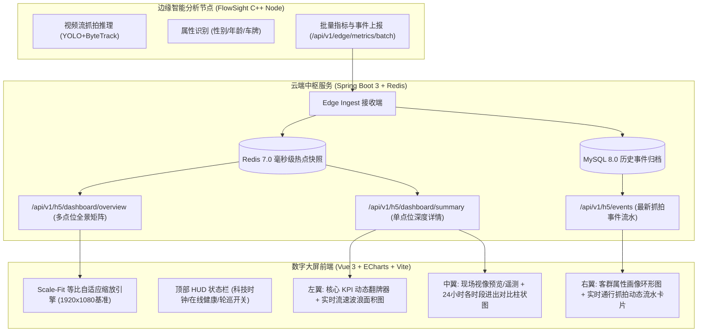

# FlowSight 智能视觉数字大屏与实时全景指挥中心设计白皮书

---

## 1. 业务背景与建设目标

随着 FlowSight 边缘 AI 视觉分析平台在园区、商业综合体、写字楼及交通卡口的深度落地，平台客户（包括商业地产物业总部、集团安防指挥中心、展厅接待领导视察等场景）对**“实时数字大屏（Digital Command Screen）”**提出了强烈诉求。

### 1.1 核心业务价值
1. **管理指挥直观化**：将传统表格化、分散化的设备数据和通行明细，升维为宏观全局态势与微观实时流速兼备的可视化大屏。
2. **7×24 小时无人值守运行**：支持挂墙大电视、指挥拼接屏（1080P/2K/4K/超宽屏）零交互自适应展示，无需人工点击翻页。
3. **毫秒级实时感知**：实时在场滞留、今日出入总计动态翻牌跳字，最新抓拍事件毫秒级流入大屏瀑布流。
4. **多模式智能轮巡**：支持“全景多点位汇总态势”与“单通道沉浸式监控”自由切换，并内置“自动轮巡（Auto Tour）”巡检机制。

---

## 2. 总体架构与数据流图

---

## 3. 大屏核心功能模块设计

### 3.1 顶部 HUD 科技顶栏（Header）
- **发光主标题**：支持动态展示企业/商户全称（如“FlowSight 智能视觉分析调度中心”）。
- **动态数字时钟**：年月日、星期、`HH:mm:ss` 毫秒级走时。
- **全局健康指示器**：在线点位 / 总点位数（带绿色呼吸灯光圈），AI 节点当前平均 FPS 与推理延迟。
- **交互控制组**：
  - **点位切换器**：可一键在“全局全景汇总”与具体通道（如“B1地下车库入口”、“A1主入口”）之间平滑切换。
  - **自动轮巡开关（Auto Tour）**：开启后每隔 20 秒平滑自动轮换切换点位，并附带倒计时进度环。
  - **一键真全屏**：调用浏览器原生 Fullscreen API，自动隐藏浏览器地址栏与标签页。

### 3.2 左翼：流量态势与实时流速（Traffic Flow）
1. **四大核心 KPI 翻牌矩阵**：
   - **今日总通行量**（进 + 出）
   - **实时在场滞留量**（当前通道/全场在场人员）
   - **进站 / 入场人次**（与今日累计占比）
   - **出站 / 离场人次**（净增量差值标识）
   - 数字采用 `CountUp` 平滑递增动画，杜绝突兀跳变。
2. **实时通行流速走势图**：
   - 基于 ECharts 双色高斯平滑曲线，展示今日实时进出流量时序波浪。
   - 渐变色面积填充（Neon Cyan `#00f0ff` & Neon Coral `#ff3366`）。

### 3.3 中翼：现场抓拍视像与时段进出分布（Visual & Hourly Distribution）
1. **现场快照与遥测 HUD 窗口**：
   - 展示边端回传的现场实时监控快照（带 ROI 绊线与算法检测框覆盖）。
   - 水滴角标指示点位在线状态（🟢 ONLINE / 🔴 OFFLINE）。
   - 实时遥测指标叠层：FPS、推理延时、硬件加速（CUDA/CPU/NPU）。
2. **24 小时各时段进出对比柱状图**：
   - 00:00 ~ 23:00 逐小时柱状对比（进站-荧光绿，离场-警示红）。
   - 自动识别并高亮标注“早晚高峰”峰值时段与峰值人数。
   - 鼠标悬浮展示双轴提示框（Tooltip）。

### 3.4 右翼：客群属性画像与实时抓拍事件流（Demographics & Live Stream）
1. **客群结构与特征画像**：
   - 性别比例环形图（男性 vs 女性百分比发光环）。
   - 年龄段阶梯分布（青年、中年、老年、儿童等占比横向胶囊柱）。
   - （车流模式下自动自适应为车牌颜色分布与车型分类）。
2. **实时抓拍流水卡片瀑布流**：
   - 展示最新 10~20 条通行事件。
   - 卡片内容：缩略图/抓拍切片、通行时间（秒级）、通道名称、穿行方向 Badge（进入/离开）、属性识别标签（如“青年 · 男”）。
   - 新事件流入时自顶向下平滑插入并伴随高光呼吸动画。

---

## 4. 关键技术方案与稳定性设计

### 4.1 全屏等比缩放引擎（Scale-Fit Engine）
使用基准设计分辨率 `1920 × 1080`，通过监听 `window.onresize` 动态计算等比缩放比率：
$$\text{scale} = \min\left(\frac{W_{\text{window}}}{1920}, \frac{H_{\text{window}}}{1080}\right)$$
通过 CSS 变换 `transform: scale(scale) translate(-50%, -50%)` 实现零变形、零滚动条、全设备绝对居中铺满。

### 4.2 毫秒级性能与防卡顿优化
- **ECharts 实例按需复用**：页面生命周期内只初始化一次图表实例，数据变更时调用 `setOption(..., { notMerge: false })` 增量刷新，禁止销毁重创。
- **DOM 节点硬上限**：最新抓拍流限制最大 20 个卡片，溢出部分自动截断，防止大屏在展厅连续开启数月导致内存溢出。
- **定时保活与垃圾回收**：大屏在后台运行定时器静默轮询（每 3~5 秒拉取一次 Redis 聚合热点缓存，耗时仅 2ms），完全消除对 MySQL 磁盘 I/O 的冲击。
