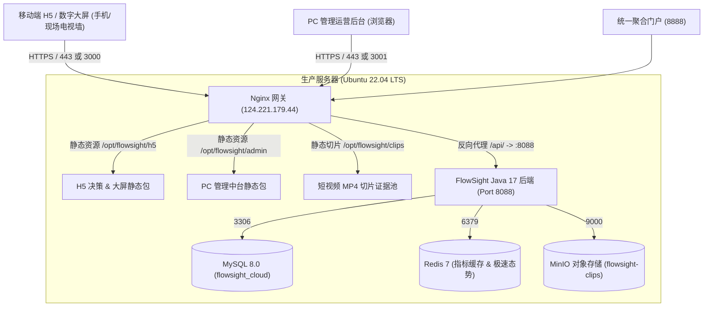

# FlowSight 边-云-端协同智能物联与视觉多租户平台 生产部署手册 (Deployment Guide)

> **版本**：v1.2.0  
> **生产域名**：`https://flowsight.1t90.com/`  
> **服务器 IP**：`124.221.179.44`  
> **技术栈基准**：Java 17 + Spring Boot 3.2.x + MySQL 8.0 + Redis 7 + MinIO + Vue 3 + Nginx  

---

## 目录
1. [系统架构与端口编排](#1-系统架构与端口编排)
2. [服务器基础环境准备](#2-服务器基础环境准备)
3. [单步部署操作手册 (Step-by-Step)](#3-单步部署操作手册-step-by-step)
   - [第一步：MySQL 数据库与租户数据字典初始化](#第一步mysql-数据库与租户数据字典初始化)
   - [第二步：Java 17 运行时安装与配置](#第二步java-17-运行时安装与配置)
   - [第三步：云端后端服务部署与 Systemd 守护进程](#第三步云端后端服务部署与-systemd-守护进程)
   - [第四步：前端 H5 移动决策/大屏与 PC 管理中台编译发布](#第四步前端-h5-移动决策大屏与-pc-管理中台编译发布)
   - [第五步：现场抓拍短视频切片静态回放池配置](#第五步现场抓拍短视频切片静态回放池配置)
   - [第六步：SSL 证书与 Nginx 反向代理配置](#第六步ssl-证书与-nginx-反向代理配置)
4. [一键自动化部署脚本使用指南](#4-一键自动化部署脚本使用指南)
5. [生产验证与冒烟测试用例](#5-生产验证与冒烟测试用例)
6. [运维管理与日志排查](#6-运维管理与日志排查)

---

## 1. 系统架构与端口编排



### 端口映射清单
| 端口号 | 服务说明 | 访问协议 | 监听范围 | 路径/代理目标 |
| :--- | :--- | :--- | :--- | :--- |
| **443** | 官方 HTTPS 生产门户 | HTTPS | 公网外网 | `/` -> H5; `/admin/` -> Admin; `/api/` -> 后端 |
| **80** | HTTP 自动重定向 | HTTP | 公网外网 | 强制 301 重定向到 `https://flowsight.1t90.com` |
| **3000** | 移动端 H5 / 专属数字大屏独立端口 | HTTP | 公网外网 | `/opt/flowsight/h5`，直达商户专属视觉大屏 |
| **3001** | PC 运营管理中台独立端口 | HTTP | 公网外网 | `/opt/flowsight/admin`，点位/租户集中调度 |
| **8888** | 统一多端聚合中枢独立端口 | HTTP | 公网外网 | 多端整合网关 |
| **8088** | Spring Boot 3 云端后端微服务 | HTTP | 127.0.0.1 本地 | 提供 RESTful API (`/api/v1/...`) |
| **3306** | MySQL 8.0 关系型数据库 | TCP | 127.0.0.1 本地 | 数据库 `flowsight_cloud` |
| **6379** | Redis 7 缓存服务 | TCP | 127.0.0.1 本地 | 高频指标脉冲与 Redis 分布式会话 |
| **9000** | MinIO S3 API | HTTP | 127.0.0.1 本地 | 存储桶 `flowsight-clips` |

---

## 2. 服务器基础环境准备

在开始单步操作前，确认服务器操作系统为 `Ubuntu 22.04 LTS` 或兼容发行版。
创建主程序存储目录：
```bash
mkdir -p /opt/flowsight/{h5,admin,clips,logs}
```

---

## 3. 单步部署操作手册 (Step-by-Step)

### 第一步：MySQL 数据库与租户数据字典初始化

1. **登录 MySQL 并创建专属数据库与专属账号**：
   ```bash
   mysql --defaults-file=/etc/mysql/debian.cnf -e "
     CREATE DATABASE IF NOT EXISTS flowsight_cloud CHARACTER SET utf8mb4 COLLATE utf8mb4_unicode_ci;
     CREATE USER IF NOT EXISTS 'flowsight'@'localhost' IDENTIFIED BY 'ZXCVbnm,=-09';
     CREATE USER IF NOT EXISTS 'flowsight'@'%' IDENTIFIED BY 'ZXCVbnm,=-09';
     GRANT ALL PRIVILEGES ON flowsight_cloud.* TO 'flowsight'@'localhost';
     GRANT ALL PRIVILEGES ON flowsight_cloud.* TO 'flowsight'@'%';
     FLUSH PRIVILEGES;
   "
   ```

2. **导入表结构与种子数据**：
   ```bash
   mysql -uflowsight -p'ZXCVbnm,=-09' flowsight_cloud < schema.sql
   mysql -uflowsight -p'ZXCVbnm,=-09' flowsight_cloud < data_init.sql
   ```

3. **数据完整性核验**：
   ```bash
   mysql -uflowsight -p'ZXCVbnm,=-09' flowsight_cloud -e "
     SELECT id, phone, company_name, role FROM sys_user;
     SELECT id, point_name, point_code, biz_type FROM biz_point;
   "
   ```

---

### 第二步：Java 17 运行时安装与配置

Spring Boot 3.x 必须使用 Java 17 或以上版本：
```bash
apt-get update -y
apt-get install -y openjdk-17-jre-headless

# 确认 Java 17 版本路径
/usr/lib/jvm/java-17-openjdk-amd64/bin/java -version
```

---

### 第三步：云端后端服务部署与 Systemd 守护进程

1. **放置应用产物与配置文件**：
   - 复制后端 Jar 包至 `/opt/flowsight/flowsight-backend.jar`
   - 放置生产配置文件 `/opt/flowsight/application-prod.yml`：
     ```yaml
     server:
       port: 8088
       servlet:
         context-path: /

     spring:
       application:
         name: flowsight-cloud-backend
       profiles:
         active: prod
       datasource:
         driver-class-name: com.mysql.cj.jdbc.Driver
         url: jdbc:mysql://127.0.0.1:3306/flowsight_cloud?createDatabaseIfNotExist=true&useUnicode=true&characterEncoding=UTF-8&serverTimezone=Asia/Shanghai&useSSL=false&allowPublicKeyRetrieval=true&allowMultiQueries=true
         username: flowsight
         password: ZXCVbnm,=-09
       data:
         redis:
           host: 127.0.0.1
           port: 6379
           password: ZXCVbnm,=-09
       sql:
         init:
           mode: always
           schema-locations: classpath:schema.sql
           continue-on-error: true

     minio:
       endpoint: http://127.0.0.1:9000
       access-key: kapian
       secret-key: Kapian@2024
       bucket-name: flowsight-clips

     jwt:
       secret: c29tZXZlcnlzZWNyZXRrZXlmb3JmbG93c2lnaHRhdXRoZW50aWNhdGlvbjEyMzQ1Ng==
       expire-hours: 72
     ```

2. **配置 Systemd 守护进程**：
   创建 `/etc/systemd/system/flowsight-backend.service`：
   ```ini
   [Unit]
   Description=FlowSight Cloud Backend Service
   After=network.target mysql.service redis-server.service

   [Service]
   Type=simple
   User=root
   WorkingDirectory=/opt/flowsight
   ExecStart=/usr/lib/jvm/java-17-openjdk-amd64/bin/java -Xms512m -Xmx1024m -XX:+UseG1GC -jar /opt/flowsight/flowsight-backend.jar --spring.profiles.active=prod --spring.config.additional-location=file:/opt/flowsight/application-prod.yml
   Restart=always
   RestartSec=5
   StandardOutput=append:/opt/flowsight/logs/backend.log
   StandardError=append:/opt/flowsight/logs/backend.error.log
   SuccessExitStatus=143

   [Install]
   WantedBy=multi-user.target
   ```

3. **启动并设置开机自启**：
   ```bash
   systemctl daemon-reload
   systemctl enable flowsight-backend
   systemctl restart flowsight-backend
   ```

4. **健康检测**：
   ```bash
   curl -I http://127.0.0.1:8088/api/v1/auth/login
   ```

---

### 第四步：前端 H5 移动决策/大屏与 PC 管理中台编译发布

1. **本地编译产物生成**：
   ```bash
   # H5 / 数字大屏 (已配置 base: './')
   npm --prefix solution/apps/h5 run build

   # PC 运营中台 (已配置 base: './')
   npm --prefix solution/apps/admin run build
   ```

2. **发布至服务器指定目录**：
   - 将 `solution/apps/h5/dist/*` 复制到 `/opt/flowsight/h5/`
   - 将 `solution/apps/admin/dist/*` 复制到 `/opt/flowsight/admin/`

---

### 第五步：现场抓拍短视频切片静态回放池配置

将测试和现场事件短切片 MP4 文件（约 100~300KB 每个）放置在 `/opt/flowsight/clips/`，供移动端 HUD 现场取证窗口和数字大屏 60fps 悬停弹窗秒级回放。

---

### 第六步：SSL 证书与 Nginx 反向代理配置

1. **SSL 证书生成或部署**：
   证书路径存放于 `/etc/ssl/1t90.com/`：
   - 证书文件：`/etc/ssl/1t90.com/flowsight.1t90.com_bundle.pem`
   - 私钥文件：`/etc/ssl/1t90.com/flowsight.1t90.com.key`

2. **部署 Nginx 站点配置**：
   将 `flowsight.conf` 复制至 `/etc/nginx/sites-available/flowsight.conf` 并软链到 `/etc/nginx/sites-enabled/`：
   ```bash
   ln -sf /etc/nginx/sites-available/flowsight.conf /etc/nginx/sites-enabled/flowsight.conf
   nginx -t
   systemctl reload nginx
   ```

---

## 4. 一键自动化部署脚本使用指南

我们提供了一键全自动化部署脚本 [`deploy/deploy.sh`](file:///e:/FlowSight/deploy/deploy.sh)。

### 使用方法
在部署包目录下直接以 root 身份运行：
```bash
chmod +x deploy.sh
./deploy.sh
```
脚本将自动按顺序完成：
- 运行时与生产目录检测创建
- MySQL 数据库及高权限账号自动开通
- 数据表与测试种子数据导入
- 前端与切片静态资源部署
- SSL 证书与 Nginx 路由自动热加载
- 后端 Systemd 守护进程拉起与 30 秒健康巡检探活

---

## 5. 生产验证与冒烟测试用例

完成部署后，通过浏览器或命令行执行以下核验：

### 1. 核心端点与 HTTP 状态码校验
| 访问路径 | 期望状态 | 预期展示内容 |
| :--- | :--- | :--- |
| `https://flowsight.1t90.com/` | 200 OK | H5 移动决策工作台 / 登录页 |
| `https://flowsight.1t90.com/#/screen` | 200 OK | 智能视觉全景调度数字大屏 |
| `https://flowsight.1t90.com/admin/` | 200 OK | PC 管理中台登录界面 |
| `https://flowsight.1t90.com/api/v1/auth/login` | 405 / 400 | 后端 API 反向代理链路畅通 |
| `http://124.221.179.44:3000/` | 200 OK | H5 独立直达通道 |
| `http://124.221.179.44:3001/` | 200 OK | Admin 独立直达通道 |
| `http://124.221.179.44:8888/` | 200 OK | 聚合网关通道 |

### 2. 账号登录与租户隔离验证
- **超管账号**：`13800000000` / `13800000000`
  - 进入 `https://flowsight.1t90.com/admin/`，可查看全域商户列表、所有通道点位状态及 AI 业务模式配置。
- **商户账号 1 (未来科技城一期)**：`13454118763` / `13454118763`
  - 登录 H5 后打开专属数字大屏：标题展示“未来科技城一期 · 智能视觉全景调度大屏”，仅呈现自身通道“正门主通道”，无租户切换器。
- **商户账号 2 (杭州栩文科技)**：`13454118762` / `13454118762`
  - 登录 H5 后打开专属数字大屏：标题展示“杭州栩文科技有限公司 · 智能视觉全景调度大屏”，通道包含“A1门”、“B1车库”。

---

## 6. 运维管理与日志排查

```bash
# 查看后端实时日志
tail -f /opt/flowsight/logs/backend.log

# 查看后端异常错误日志
tail -f /opt/flowsight/logs/backend.error.log

# 服务控制
systemctl status flowsight-backend
systemctl restart flowsight-backend
systemctl stop flowsight-backend

# Nginx 配置文件测试与重载
nginx -t
systemctl reload nginx
```
